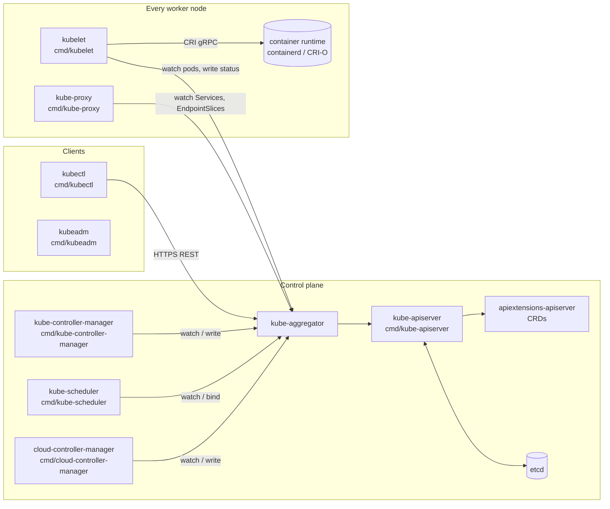
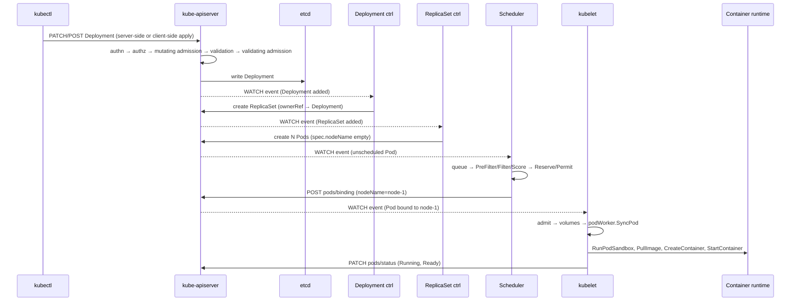

# 01 · Architecture Overview

## 1. What Kubernetes is, from the code's point of view

Kubernetes is a set of **independent binaries** that communicate **only through the API server**. Each binary is a Go program built from `cmd/<name>`, and each one is a long-running loop of the form:

```
for {
    desired  := read spec from API server (via watch/informer cache)
    observed := look at the real world (containers, iptables, etcd, cloud…)
    act to make observed == desired
    write status back to API server
}
```

Components hold no shared state apart from what is stored in **etcd** behind the API server. This is why every component can be restarted, scaled out (with leader election) or replaced independently.

## 2. Component map



| Component | Binary source | Core library | Role |
|-----------|---------------|--------------|------|
| kube-apiserver | [`cmd/kube-apiserver`](../kubernetes/cmd/kube-apiserver) | `pkg/controlplane`, `staging/.../apiserver` | The only component that talks to etcd. Serves REST and runs authentication, authorization, admission, validation, storage and watch. |
| kube-controller-manager | [`cmd/kube-controller-manager`](../kubernetes/cmd/kube-controller-manager) | `pkg/controller/*` | Runs about 50 reconcile loops (Deployment, ReplicaSet, Job, Node lifecycle, GC…). |
| kube-scheduler | [`cmd/kube-scheduler`](../kubernetes/cmd/kube-scheduler) | `pkg/scheduler` | Assigns unscheduled Pods (or Pod groups) to Nodes. |
| kubelet | [`cmd/kubelet`](../kubernetes/cmd/kubelet) | `pkg/kubelet` | The node agent. Makes the Pods bound to its node actually run through CRI. |
| kube-proxy | [`cmd/kube-proxy`](../kubernetes/cmd/kube-proxy) | `pkg/proxy` | Programs the node data plane (nftables/iptables/IPVS/HNS) so Service virtual IPs work. |
| cloud-controller-manager | [`cmd/cloud-controller-manager`](../kubernetes/cmd/cloud-controller-manager) | `staging/.../cloud-provider` | Cloud-specific controllers (node, route, service load balancer). |
| kubectl | [`cmd/kubectl`](../kubernetes/cmd/kubectl) | `staging/.../kubectl` | The CLI client. |
| kubeadm | [`cmd/kubeadm`](../kubernetes/cmd/kubeadm) | `cmd/kubeadm/app` | Cluster bootstrapping tool. |

## 3. Core design principles visible in the code

1. **Declarative API + level-triggered reconciliation.** Controllers do not react to *events*. They react to the *current state*. Events only tell them "something about key X changed; go and look". See `workqueue` + `informer` in [12-staging-libraries](12-staging-libraries.md#client-go).
2. **Spec / Status split.** Users write `.spec`, and controllers and the kubelet write `.status` (often through the `/status` subresource).
3. **Optimistic concurrency.** Every object has a `metadata.resourceVersion`. Writes with a stale version fail with `409 Conflict`, and the caller re-reads and retries.
4. **Watch-based caching.** Each component keeps an in-memory cache (informer) fed by a `LIST` followed by a long-lived `WATCH`. The API server itself has a *watch cache* (`storage/cacher`) in front of etcd.
5. **Pluggability.** Admission plugins, authorizers, scheduler plugins, volume plugins, CRI, CNI, CSI, device plugins and DRA drivers are all extension points.
6. **Feature gates.** Every new behaviour sits behind a gate in [`pkg/features/kube_features.go`](../kubernetes/pkg/features/kube_features.go) and goes through Alpha → Beta → GA.

## 4. End-to-end walkthrough: `kubectl apply -f deployment.yaml`



Step by step, with code references:

| Step | Code |
|------|------|
| kubectl builds the request | `staging/src/k8s.io/kubectl/pkg/cmd/apply` |
| API server filter chain | `staging/src/k8s.io/apiserver/pkg/server/config.go` → `DefaultBuildHandlerChain` |
| REST handler for create/patch | `staging/src/k8s.io/apiserver/pkg/endpoints/handlers/{create,patch}.go` |
| Deployment strategy (defaulting/validation) | `pkg/registry/apps/deployment/strategy.go`, `pkg/apis/apps/validation` |
| Storage write | `staging/src/k8s.io/apiserver/pkg/registry/generic/registry/store.go` → `storage/etcd3/store.go` |
| Deployment controller | `pkg/controller/deployment/deployment_controller.go` → `syncDeployment` |
| ReplicaSet controller | `pkg/controller/replicaset/replica_set.go` → `syncReplicaSet` / `manageReplicas` |
| Scheduler | `pkg/scheduler/schedule_one.go` → `ScheduleOne` |
| Kubelet | `pkg/kubelet/kubelet.go` → `syncLoopIteration` → `pod_workers.go` → `Kubelet.SyncPod` |
| CRI calls | `pkg/kubelet/kuberuntime/kuberuntime_manager.go` → `kubeGenericRuntimeManager.SyncPod` |
| Status write | `pkg/kubelet/status/status_manager.go` |

## 5. Communication patterns

| From → To | Protocol | Notes |
|-----------|----------|-------|
| Any client → API server | HTTPS, JSON / Protobuf / CBOR, plus WATCH streaming | Protobuf is used between components and JSON for humans. |
| API server → etcd | gRPC (etcd v3 client) | Only the API server talks to etcd. |
| API server → kubelet | HTTPS (port 10250) | `logs`, `exec`, `attach`, `port-forward`, `proxy`. |
| API server → webhooks / aggregated APIs | HTTPS | Admission webhooks, conversion webhooks, APIService backends. |
| kubelet → container runtime | gRPC over Unix socket (CRI) | `staging/src/k8s.io/cri-api`. |
| kubelet → device / DRA / CSI plugins | gRPC over Unix sockets | Registered through `pkg/kubelet/pluginmanager`. |

## 6. Where to go next

- The directory map: [02 · Repository layout](02-repository-layout.md)
- How objects are typed, versioned and serialised: [03 · API types & machinery](03-api-and-type-system.md)
