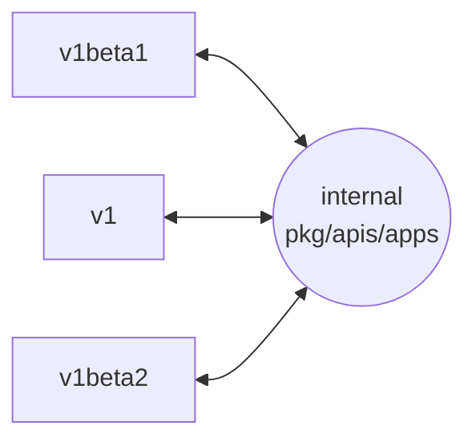
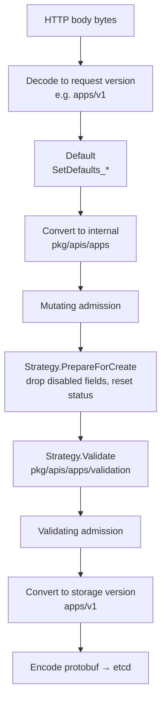

# 03 · API Types & API Machinery

This document explains how a Kubernetes object such as a `Pod` is **defined, versioned, defaulted, validated, converted and serialised**. Almost every other module depends on this.

## 1. The three layers of type definitions

| Layer | Location | Who uses it |
|-------|----------|-------------|
| **External (versioned) types** | `staging/src/k8s.io/api/<group>/<version>/types.go` (for example `core/v1`, `apps/v1`, `batch/v1`) | Clients, controllers, kubelet, everything on the wire |
| **Internal (hub) types** | `pkg/apis/<group>/types.go` (for example `pkg/apis/core/types.go`) | Only inside the API server: validation, registry, admission |
| **Meta types** | `staging/src/k8s.io/apimachinery/pkg/apis/meta/v1` | `ObjectMeta`, `TypeMeta`, `ListMeta`, `Status`, `ListOptions`, `Time`, `LabelSelector`… |

The **hub-and-spoke** model works like this. Each external version converts to and from the single internal version, so N versions need 2N conversions instead of N².



### 1.1 Per-group package structure (`pkg/apis/<group>/`)

```
pkg/apis/apps/
├── types.go            internal Go structs
├── register.go         SchemeGroupVersion, AddToScheme
├── install/            installs every version into legacyscheme.Scheme
├── v1/ v1beta1/ v1beta2/
│   ├── defaults.go     SetDefaults_* functions (hand-written)
│   ├── conversion.go   hand-written conversions where auto-conversion is not enough
│   ├── register.go
│   └── zz_generated.{conversion,defaults,validations}.go
├── validation/         ValidateDeployment, ValidateDeploymentUpdate, …
└── fuzzer/             randomised round-trip test fuzzers
```

API groups in this tree: `abac, admission, admissionregistration, apidiscovery, apiserverinternal, apps, authentication, authorization, autoscaling, batch, certificates, coordination, core, discovery, events, extensions, flowcontrol, imagepolicy, lifecycle, networking, node, policy, rbac, resource, scheduling, storage, storagemigration`.

> `lifecycle` is new. It holds the `Eviction` / `EvictionRequest` declarative eviction API. `resource` is Dynamic Resource Allocation (DRA). `scheduling` now also holds pod-group (workload/gang scheduling) types.

## 2. `runtime.Scheme`: the type registry

`staging/src/k8s.io/apimachinery/pkg/runtime/scheme.go`

A `Scheme` maps **GroupVersionKind (GVK) ↔ Go type**, and also stores:

- conversion functions (`AddConversionFunc`, generated ones),
- defaulting functions (`AddTypeDefaultingFunc`),
- field-label conversion functions (which fields can be used in `fieldSelector`).

Key methods:

| Method | What it does |
|--------|--------------|
| `AddKnownTypes(gv, objs...)` | Registers Go types under a GroupVersion |
| `New(gvk)` | Instantiates an empty object for a GVK |
| `ObjectKinds(obj)` | Reverse lookup: Go type → GVKs |
| `Convert(in, out, ctx)` | Runs the registered conversion |
| `Default(obj)` | Runs registered defaulters |

The API server uses **`pkg/api/legacyscheme.Scheme`**, which contains every built-in internal and external type. Clients use `client-go/kubernetes/scheme.Scheme`, which only contains external types.

## 3. Serialisation: `runtime.Codec` and `Serializer`

`apimachinery/pkg/runtime/serializer/`

| Serializer | Media type |
|------------|-----------|
| `json` | `application/json` (and YAML via `yaml` wrapping) |
| `protobuf` | `application/vnd.kubernetes.protobuf` |
| `cbor` | `application/cbor` (newer, behind a gate) |
| `streaming` | Framed watch streams |

`CodecFactory.CodecForVersions(encoder, decoder, encodeGV, decodeGV)` builds a codec that decodes bytes into **any** registered version, converts to the target version and encodes. The apiserver uses this to accept `apps/v1beta2` input and store it as `apps/v1` in etcd.

## 4. Object lifecycle inside the API server



## 5. Defaulting

- Written as `func SetDefaults_<Type>(obj *<Type>)` in `pkg/apis/<group>/<version>/defaults.go`.
- `defaulter-gen` generates `SetObjectDefaults_<Type>`, which walks nested fields and calls every applicable `SetDefaults_*`.
- Declarative defaults: the `// +default=` tag on external types.
- Defaulting happens **on decode**, so a client sees defaulted values in the response.

## 6. Validation

Two coexisting styles:

1. **Hand-written**: `pkg/apis/<group>/validation/validation.go`, for example `ValidatePod`, `ValidatePodUpdate`, `ValidatePodSpec`. These return a `field.ErrorList` from `apimachinery/pkg/util/validation/field`.
2. **Declarative validation** (newer): `+k8s:` tags on external types such as `+k8s:minimum=0`, `+k8s:required`, `+k8s:format=k8s-short-name`. `validation-gen` turns these into `zz_generated.validations.go`. The framework lives in `apimachinery/pkg/api/validate`. Tests in `test/declarative_validation` compare both styles for equivalence.

Common helpers (`apimachinery/pkg/api/validation`, `apimachinery/pkg/util/validation`): `ValidateObjectMeta`, `IsDNS1123Label`, `IsQualifiedName`, `IsValidLabelValue`, `ValidateLabels`, `ValidateAnnotations`.

## 7. Conversion

- Auto-generated by `conversion-gen` for fields with the same names and types.
- Hand-written `Convert_<pkg>_<Type>_To_<pkg>_<Type>` functions override where needed (renamed fields, structural changes).
- **Round-trip tests** (`staging/src/k8s.io/api/roundtrip_test.go`, `pkg/api/testing`) fuzz objects and require `external → internal → external` to be lossless.

## 8. `apimachinery` package tour

| Package | Purpose |
|---------|---------|
| `pkg/runtime` | `Object` interface, `Scheme`, `Unstructured` converter, codecs, `RawExtension` |
| `pkg/runtime/schema` | `GroupVersion`, `GroupVersionKind`, `GroupVersionResource` |
| `pkg/apis/meta/v1` | `ObjectMeta`, `TypeMeta`, `ListOptions`, `Status`, `OwnerReference`, `Condition`, `LabelSelector`, `Time`/`MicroTime`, `ManagedFieldsEntry` |
| `pkg/apis/meta/v1/unstructured` | `Unstructured`, a `map[string]interface{}` object used by dynamic clients and CRDs |
| `pkg/api/meta` | `meta.Accessor(obj)` to read metadata from any object, `RESTMapper` (GVK ↔ GVR) |
| `pkg/api/errors` | `NewNotFound`, `NewConflict`, `IsNotFound`, `IsConflict`… (typed `StatusError`) |
| `pkg/api/resource` | `Quantity` (`500m`, `1Gi`) parsing and arithmetic |
| `pkg/api/equality` | Semantic deep equality (`Quantity`-aware) |
| `pkg/labels`, `pkg/fields`, `pkg/selection` | Label and field selector parsing and matching |
| `pkg/watch` | `watch.Interface`, `Event{Type, Object}` (`ADDED`, `MODIFIED`, `DELETED`, `BOOKMARK`, `ERROR`) |
| `pkg/types` | `UID`, `NamespacedName`, `PatchType` (JSON, Merge, StrategicMerge, Apply) |
| `pkg/util/sets`, `wait`, `runtime`, `intstr`, `strategicpatch`, `managedfields`, `net`, `validation`, `yaml`, `json` | General utilities. `wait.PollUntilContextTimeout` and `runtime.HandleCrash` are used everywhere |
| `pkg/conversion` | Low-level conversion scope / cloner |
| `pkg/version` | Version info types |
| `pkg/sharding` | **New.** Hash-range sharding selectors: an FNV-1a 64-bit hash of a field such as `object.metadata.uid` filtered by a `[Start, End)` hex range. Lets list/watch be split across multiple consumers |

## 9. Server-Side Apply & managed fields

- Every write records which **field manager** owns which fields in `metadata.managedFields` (`ManagedFieldsEntry` with a `FieldsV1` set).
- Implementation: `apimachinery/pkg/util/managedfields` and `apiserver/pkg/endpoints/handlers/fieldmanager`, built on `sigs.k8s.io/structured-merge-diff`.
- `PATCH` with `application/apply-patch+yaml` performs a structured merge and reports **conflicts** when a different manager owns a field.

## 10. Code generation pipeline

`hack/update-codegen.sh` runs these generators from `staging/src/k8s.io/code-generator` and `k8s.io/kube-openapi`:

| Generator | Input tag | Output |
|-----------|-----------|--------|
| deepcopy-gen | `+k8s:deepcopy-gen=package` | `zz_generated.deepcopy.go` |
| defaulter-gen | `+k8s:defaulter-gen=TypeMeta` | `zz_generated.defaults.go` |
| conversion-gen | `+k8s:conversion-gen=k8s.io/kubernetes/pkg/apis/apps` | `zz_generated.conversion.go` |
| validation-gen | `+k8s:validation-gen=TypeMeta` | `zz_generated.validations.go` |
| go-to-protobuf | `+protobuf` | `generated.proto`, `generated.pb.go` |
| client-gen | `+genclient` | typed clientsets |
| lister-gen / informer-gen | `+genclient` | listers and shared informers |
| applyconfiguration-gen | — | `client-go/applyconfigurations` (SSA builders) |
| openapi-gen | `+k8s:openapi-gen=true` | `pkg/generated/openapi/zz_generated.openapi.go` |
| prerelease-lifecycle-gen | `+k8s:prerelease-lifecycle-gen:introduced=1.x` | `APILifecycleIntroduced/Deprecated/Removed` |

Outputs that are checked in for API reviewers live in `api/`:
- `api/openapi-spec/` holds the swagger v2 and OpenAPI v3 documents,
- `api/discovery/` holds aggregated discovery documents,
- `api/api-rules/` holds the API lint violation exception list.

## 11. Helper packages over API types: `pkg/api/*`

| Package | Purpose |
|---------|---------|
| `pkg/api/legacyscheme` | The global `Scheme`, `Codecs`, `ParameterCodec` used by the apiserver |
| `pkg/api/pod` | `DropDisabledPodFields` (clears fields of disabled feature gates), `VisitPodSecretNames`, `GetValidationOptionsFromPodSpecAndMeta`, warnings |
| `pkg/api/service`, `persistentvolume`, `persistentvolumeclaim`, `storage`, `node`, `job`, `deployment`, `servicecidr`, `resourceclaimspec` | Same pattern for other types: drop disabled fields and emit API warnings |
| `pkg/api/v1/*` | Helpers over **external** v1 types (for example `pod.IsPodReady`, `resource.PodRequests`) |
| `pkg/api/testing` | Round-trip, defaulting and serialisation tests |
