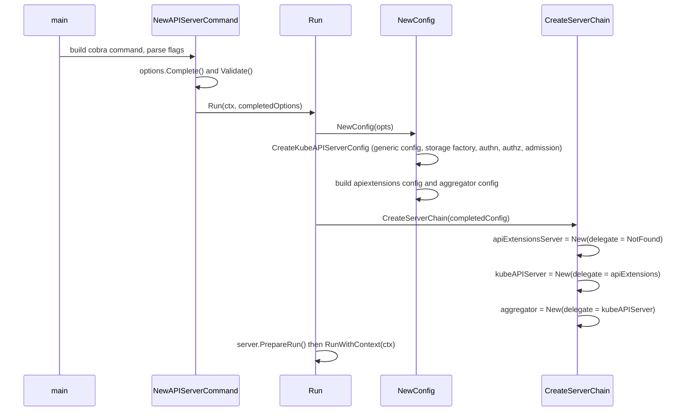
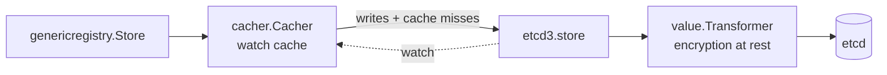

# 04 · kube-apiserver

The API server is the **only** component that reads and writes etcd. It is a REST server with a large pipeline in front of the storage layer: authentication, authorization, admission and validation.

## 1. Code map

| Location | Responsibility |
|----------|----------------|
| [`cmd/kube-apiserver/apiserver.go`](../kubernetes/cmd/kube-apiserver/apiserver.go) | `main()` → `app.NewAPIServerCommand()` |
| [`cmd/kube-apiserver/app/server.go`](../kubernetes/cmd/kube-apiserver/app/server.go) | Cobra command, `Run`, `CreateServerChain`, `CreateKubeAPIServerConfig` |
| `cmd/kube-apiserver/app/config.go` | `NewConfig` builds the configs for all three servers (aggregator, kube, apiextensions) |
| `cmd/kube-apiserver/app/aggregator.go` | APIService priorities for built-in groups |
| `cmd/kube-apiserver/app/options/` | Every `--flag` (`ServerRunOptions`, `Complete`, `Validate`) |
| [`pkg/controlplane/instance.go`](../kubernetes/pkg/controlplane/instance.go) | `CompletedConfig.New` creates the kube API `Instance`; `StorageProviders` lists every API group's REST storage |
| `pkg/controlplane/apiserver/` | Generic control-plane server shared with other servers (`server.go`, `apis.go`, `apiextensions.go`, `aggregator.go`, `peer.go`) |
| `pkg/controlplane/controller/*` | Controllers that run **inside** the API server (see §8) |
| `pkg/controlplane/reconcilers/` | Keeps the `kubernetes` Service endpoints in sync with live apiservers (`lease`, `instancecount`, `none`) |
| `pkg/kubeapiserver/` | kube-apiserver specific option and authn/authz/admission wiring, plus `default_storage_factory_builder.go` |
| `pkg/registry/<group>/<resource>/` | REST storage and **strategy** per resource |
| `staging/src/k8s.io/apiserver/` | The generic API server library (filters, endpoints, storage, admission, audit, auth) |
| `staging/src/k8s.io/kube-aggregator/` | Aggregation layer (`APIService` → proxy to extension apiservers) |
| `staging/src/k8s.io/apiextensions-apiserver/` | CRDs |

## 2. Startup sequence



### 2.1 The delegation chain

`CreateServerChain` creates **three servers**, each delegating unknown paths to the next:

```
request ─▶ kube-aggregator ─▶ kube-apiserver (built-in groups) ─▶ apiextensions-apiserver (CRDs) ─▶ 404
              │
              └─ for APIService objects backed by a Service: proxy to that extension apiserver
```

- **Aggregator** (`kube-aggregator/pkg/apiserver`) owns `/apis` discovery merging and `APIService` proxying, for example to `metrics.k8s.io`.
- **Kube API server** (`pkg/controlplane`) serves `/api/v1` and all built-in `/apis/<group>`.
- **apiextensions** serves `CustomResourceDefinition` objects and, dynamically, every CR.

## 3. Request handler chain (filters)

Built in `DefaultBuildHandlerChain` in `staging/src/k8s.io/apiserver/pkg/server/config.go`. Filters are applied inside-out, so in **request order** a request passes through:

| # | Filter | Source | Purpose |
|---|--------|--------|---------|
| 1 | Panic recovery / RequestInfo | `server/filters/wrap.go`, `endpoints/filters/requestinfo.go` | Parses URL → `RequestInfo{Verb, APIGroup, Resource, Namespace, Name, Subresource}` |
| 2 | Request-received time, audit init, HSTS, GoAway, CacheControl | `endpoints/filters/*`, `server/filters/*` | Bookkeeping |
| 3 | WaitGroup | `server/filters/waitgroup.go` | Tracks in-flight requests for graceful shutdown |
| 4 | Request deadline / timeout | `request_deadline.go`, `timeout.go` | Non-long-running requests time out (default 60s) |
| 5 | Warning recorder | `warning.go` | Collects `Warning:` headers |
| 6 | CORS | `cors.go` | |
| 7 | **Authentication** | `endpoints/filters/authentication.go` | Produces `user.Info` (name, UID, groups, extra). Returns 401 on failure |
| 8 | Tracing | `traces.go` | OpenTelemetry spans |
| 9 | **Audit** | `audit.go` | Emits audit events according to the audit policy |
| 10 | **Impersonation** | `endpoints/filters/impersonation` | `Impersonate-User` / `-Group` headers, including constrained impersonation |
| 11 | **Max-in-flight** or **Priority & Fairness (APF)** | `maxinflight.go`, `priority-and-fairness.go` | Concurrency limiting. APF classifies requests into `FlowSchema` → `PriorityLevelConfiguration` queues (`apiserver/pkg/util/flowcontrol`) |
| 12 | **Authorization** | `authorization.go` | Calls the authorizer chain. Returns 403 on deny. Supports conditions-aware authorization |
| 13 | Mux / REST handler | `endpoints/handlers/*` | The actual verb handler |

## 4. REST handlers (`apiserver/pkg/endpoints`)

`endpoints/installer.go` turns each `rest.Storage` into routes. It inspects which interfaces the storage implements (`rest.Creater`, `Getter`, `Lister`, `Updater`, `Patcher`, `GracefulDeleter`, `Watcher`, `Connecter`…) and registers the matching verbs.

| Handler file | Verb | Notes |
|--------------|------|-------|
| `handlers/get.go` | GET, LIST | Supports `resourceVersion`, `limit`/`continue` pagination, label/field selectors, Table output |
| `handlers/watch.go` | WATCH | HTTP chunked or WebSocket streaming, bookmarks |
| `handlers/create.go` | POST | Decode → default → admission → `storage.Create` |
| `handlers/update.go` | PUT | Optimistic concurrency via `resourceVersion` |
| `handlers/patch.go` | PATCH | JSON patch, merge patch, strategic merge patch, **apply** (SSA) |
| `handlers/delete.go` | DELETE, DELETECOLLECTION | Propagation policy (`Foreground`, `Background`, `Orphan`), grace period, preconditions |
| `handlers/rest.go` | CONNECT | `exec`, `attach`, `portforward`, `proxy` subresources |
| `handlers/fieldmanager` | — | Managed fields and server-side apply |
| `handlers/negotiation` | — | Content-type negotiation (JSON / Protobuf / CBOR / Table) |
| `handlers/responsewriters` | — | Status errors, streaming responses |

Discovery (`/api`, `/apis`, aggregated discovery `apidiscovery.k8s.io/v2`) is served from `endpoints/discovery`.

## 5. Registry: per-resource storage (`pkg/registry`)

Each resource has `pkg/registry/<group>/<resource>/` containing:

```
strategy.go          rest.RESTCreateStrategy / RESTUpdateStrategy / RESTDeleteStrategy
storage/storage.go   NewREST(): wraps genericregistry.Store, adds subresources (status, scale, eviction, binding…)
```

### 5.1 The Strategy interface

| Method | Called | Typical work |
|--------|--------|--------------|
| `NamespaceScoped()` | always | true / false |
| `PrepareForCreate(ctx, obj)` | create | Clear `.status`, set `generation=1`, drop disabled fields |
| `PrepareForUpdate(ctx, new, old)` | update | Copy old `.status` (spec endpoint) or old `.spec` (status endpoint), bump `generation` when spec changes |
| `Validate(ctx, obj)` | create | `validation.ValidateX` |
| `ValidateUpdate(ctx, new, old)` | update | Immutable-field checks |
| `WarningsOnCreate/Update` | both | Deprecation warnings |
| `Canonicalize(obj)` | both | Normalise ordering and so on |
| `AllowCreateOnUpdate()` | update | `PUT` can create? |
| `AllowUnconditionalUpdate()` | update | Allow without `resourceVersion`? |
| `GetResetFields()` | SSA | Fields that the endpoint resets (spec vs. status) |

### 5.2 Generic store (`apiserver/pkg/registry/generic/registry/store.go`)

`genericregistry.Store` implements the full CRUD + watch logic once for all resources:

- `Create`: `BeforeCreate` (strategy) → `Storage.Create` → `AfterCreate` / decorators
- `Update`: `GuaranteedUpdate` read-modify-write loop with conflict retries
- `Delete`: graceful deletion (`deletionTimestamp`, `deletionGracePeriodSeconds`) and **finalizers** (the object is removed only when `metadata.finalizers` is empty)
- `List` / `Watch`: delegates to the cacher when the watch cache is enabled
- `dryrun.go`: `?dryRun=All` runs everything except the final write

### 5.3 Notable registries

| Registry | Specials |
|----------|----------|
| `core/pod` | Subresources `binding`, `eviction` (honours PodDisruptionBudgets), `status`, `log`, `exec`, `attach`, `portforward`, `proxy`, `ephemeralcontainers`, `resize` |
| `core/service` | ClusterIP and NodePort **allocators** (`ipallocator`, `portallocator`; ServiceCIDR-based allocation), plus repair loops |
| `core/namespace` | Finalization workflow |
| `core/node` | `proxy` subresource to the kubelet, plus `status` |
| `apps/deployment` etc. | `scale` subresource, rollback |
| `rbac/*` | **Escalation prevention**: you cannot grant permissions you do not hold (`rbac/validation`) |
| `authentication/tokenreview`, `authorization/subjectaccessreview` | Virtual, create-only resources |
| `core/rangeallocation` | Persists allocator bitmaps |
| `lifecycle/*`, `resource/*`, `scheduling/*` | Eviction requests, DRA, Workload/PodGroup APIs |

## 6. Storage layer (`apiserver/pkg/storage`)



| Package | Purpose |
|---------|---------|
| `storage/interfaces.go` | `storage.Interface`: `Create`, `Delete`, `Watch`, `Get`, `GetList`, `GuaranteedUpdate`, `Count`, `ReadinessCheck` |
| `storage/etcd3` | etcd v3 implementation: keys like `/registry/pods/<ns>/<name>`, transactions, compaction-aware watch, `resourceVersion` = etcd `ModRevision` |
| `storage/cacher` | **Watch cache**: one LIST+WATCH per resource against etcd, fanned out to thousands of watchers. Serves consistent reads from cache (`watch_cache.go`, `cache_watcher.go`, `delegator.go`, `consistency`, `progress` notify) |
| `storage/value` | Transformers. `encrypt/aes` (GCM/CBC), `secretbox`, `envelope` (**KMS v2**, `staging/src/k8s.io/kms`), `identity` |
| `storage/storagebackend` | Config and factory for creating the etcd client |
| `storage/names` | `generateName` suffix generator |
| `server/storage` | `StorageFactory`: chooses the storage version, etcd prefix and encryption per resource |
| `storageversion` | Publishes `StorageVersion` objects for HA-safe storage migration |

**Consistency:** `resourceVersion=""` gives a quorum-consistent read (now served from the watch cache using etcd progress notifications). `resourceVersion="0"` returns any cached data.

## 7. Authentication & authorization

### 7.1 Authenticators (union: the first success wins)

Configured in `pkg/kubeapiserver/authenticator/config.go`:

| Authenticator | Source |
|---------------|--------|
| x509 client certificates | `apiserver/pkg/authentication/request/x509` |
| Static / bootstrap tokens | `plugin/pkg/auth/authenticator/token/bootstrap` |
| ServiceAccount JWTs (bound tokens) | `pkg/serviceaccount` |
| OIDC / structured authentication config (multiple issuers, CEL claim mappings) | `apiserver/plugin/pkg/authenticator/token/oidc` |
| Webhook token | `apiserver/plugin/pkg/authenticator/token/webhook` |
| Request header (front proxy) | `authentication/request/headerrequest` |
| Anonymous | `authentication/request/anonymous` |

### 7.2 Authorizers (chain: the first Allow or Deny wins; NoOpinion falls through)

`pkg/kubeapiserver/authorizer/config.go`, modes in `modes/modes.go`:

`AlwaysAllow`, `AlwaysDeny`, `ABAC`, `Webhook`, `RBAC`, `Node`. Structured authorization configuration (`--authorization-config`) allows multiple webhooks with CEL match conditions and hot reload (`reload.go`).

- **Node** (`plugin/pkg/auth/authorizer/node`): builds a graph of pod → secret / configmap / PVC / ResourceClaim / SA → node, and lets kubelet `system:node:<name>` read only objects referenced by pods bound to it.
- **RBAC** (`plugin/pkg/auth/authorizer/rbac`): evaluates Roles, ClusterRoles and their bindings. `bootstrappolicy/` defines all default `system:*` roles.

## 8. In-process control-plane controllers (`pkg/controlplane/controller`)

| Controller | Purpose |
|------------|---------|
| `kubernetesservice` | Creates and maintains the `default/kubernetes` Service |
| `systemnamespaces` | Ensures `kube-system`, `kube-public`, `kube-node-lease`, `default` exist |
| `apiserverleasegc` | Removes stale apiserver identity Leases |
| `clusterauthenticationtrust` | Publishes client-CA data into `kube-system/extension-apiserver-authentication` ConfigMap |
| `crdregistration` | Registers CRD groups with the aggregator |
| `legacytokentracking` | Tracks use of legacy Secret-based SA tokens |
| `defaultservicecidr` | Creates the default `ServiceCIDR` object from `--service-cluster-ip-range` |
| `leaderelection` | Coordinated leader election (`LeaseCandidate`) |

Other post-start hooks include RBAC bootstrap (`rbac/bootstrap-roles`), priority-class bootstrap, APF configuration bootstrap, and the start of informers.

## 9. Health & observability endpoints

| Path | Meaning |
|------|---------|
| `/livez`, `/readyz`, `/healthz` (+ `/livez/<check>`) | Liveness and readiness. `readyz` waits for etcd, informer sync and post-start hooks |
| `/metrics` | Prometheus metrics (`apiserver_request_total`, `apiserver_request_duration_seconds`, `etcd_*`, APF metrics) |
| `/debug/pprof` | Profiling (when `--profiling` is set) |
| `/flagz`, `/statusz` | Component status pages (z-pages) |
| `/openapi/v2`, `/openapi/v3` | OpenAPI documents |
| `/.well-known/openid-configuration`, `/openid/v1/jwks` | SA issuer discovery (`pkg/routes/openidmetadata.go`) |

## 10. Graceful shutdown

`apiserver/pkg/server/genericapiserver.go` and `lifecycle_signals.go` define the shutdown signals: `ShutdownInitiated` → `AfterShutdownDelayDuration` → `InFlightRequestsDrained` → `HTTPServerStoppedListening`. `/readyz` starts failing first, so load balancers drain traffic before the listener closes.
