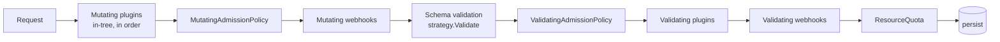

# 05 · Admission Control

Admission runs **after authentication and authorization** and **before the object is persisted**. It can **mutate** the object (set defaults, inject things) or **validate** it (reject the request).

## 1. Framework (`staging/src/k8s.io/apiserver/pkg/admission`)

| Type / file | Purpose |
|-------------|---------|
| `interfaces.go` → `admission.Interface` | `Handles(operation) bool` |
| `MutationInterface` | `Admit(ctx, attrs, objInterfaces) error`, which may change `attrs.GetObject()` |
| `ValidationInterface` | `Validate(ctx, attrs, objInterfaces) error`, read-only |
| `Attributes` | Operation (`CREATE`/`UPDATE`/`DELETE`/`CONNECT`), object, old object, GVK/GVR, subresource, namespace, user info, dry-run flag |
| `plugins.go` → `Plugins` | Registry: `Register(name, factory)`, `NewFromPlugins(names, config, initializer)` |
| `chain.go` | `chainAdmissionHandler`, which runs every mutating plugin and then every validating plugin |
| `initializer/` | Injects dependencies into plugins that declare `Want*` interfaces: `WantsExternalKubeClientSet`, `WantsExternalKubeInformerFactory`, `WantsAuthorizer`, `WantsQuotaConfiguration`… |
| `metrics/` | `apiserver_admission_controller_admission_duration_seconds` and related metrics |
| `plugin/webhook/` | `MutatingAdmissionWebhook`, `ValidatingAdmissionWebhook` |
| `plugin/policy/validating`, `plugin/policy/mutating` | **CEL** based `ValidatingAdmissionPolicy` and `MutatingAdmissionPolicy` |
| `plugin/policy/manifest`, `plugin/manifest` | Loading admission configuration from static manifest files |
| `plugin/namespace/lifecycle` | `NamespaceLifecycle` |
| `plugin/resourcequota` | `ResourceQuota` |
| `plugin/authorizer/conditionsenforcer` | `AuthorizationConditionsEnforcer` (conditional authorization) |
| `plugin/cel` | Shared CEL compilation and evaluation |



kube-apiserver wiring: `pkg/kubeapiserver/options/plugins.go` (`AllOrderedPlugins`, `RegisterAllAdmissionPlugins`, `DefaultOffAdmissionPlugins`) and `pkg/kubeapiserver/admission/` (config and plugin initializer). Enable or disable plugins with `--enable-admission-plugins` / `--disable-admission-plugins`.

## 2. Every in-tree admission plugin (in execution order)

**On** means the plugin is enabled by default.

| # | Plugin name | Source | Default | M/V | What it does |
|---|-------------|--------|---------|-----|--------------|
| 1 | `AlwaysAdmit` | `plugin/pkg/admission/admit` | off | – | Deprecated. Admits everything |
| 2 | `NamespaceAutoProvision` | `admission/namespace/autoprovision` | off | M | Creates the namespace automatically if it does not exist |
| 3 | `NamespaceLifecycle` | `apiserver/.../plugin/namespace/lifecycle` | **on** | V | Rejects creates in terminating or non-existent namespaces. Protects `default`, `kube-system`, `kube-public` from deletion |
| 4 | `NamespaceExists` | `admission/namespace/exists` | off | V | Rejects requests in namespaces that do not exist |
| 5 | `LimitPodHardAntiAffinityTopology` | `admission/antiaffinity` | off | V | Allows only `kubernetes.io/hostname` as the topology key for required anti-affinity |
| 6 | `LimitRanger` | `admission/limitranger` | **on** | M+V | Applies `LimitRange` defaults (requests/limits) and enforces min/max/ratio |
| 7 | `ServiceAccount` | `admission/serviceaccount` | **on** | M+V | Sets `spec.serviceAccountName=default`, mounts the projected token volume, and checks that the SA exists |
| 8 | `NodeRestriction` | `admission/noderestriction` | off* | V | Limits kubelets to modifying only their own Node and the Pods bound to them. Blocks setting `node-restriction.kubernetes.io/` labels. *kubeadm enables it |
| 9 | `TaintNodesByCondition` | `admission/nodetaint` | **on** | M | Adds the `node.kubernetes.io/not-ready:NoSchedule` taint to newly created Nodes |
| 10 | `AlwaysPullImages` | `admission/alwayspullimages` | off | M+V | Forces `imagePullPolicy: Always` (multi-tenant credential protection) |
| 11 | `ImagePolicyWebhook` | `admission/imagepolicy` | off | V | Asks an external webhook (`ImageReview`) whether images are allowed |
| 12 | `PodSecurity` | `admission/security/podsecurity` → `staging/.../pod-security-admission` | **on** | V | Enforces Pod Security Standards (`privileged`/`baseline`/`restricted`) via namespace labels `pod-security.kubernetes.io/{enforce,audit,warn}` |
| 13 | `PodNodeSelector` | `admission/podnodeselector` | off | M+V | Merges and validates namespace-level node selectors |
| 14 | `Priority` | `admission/priority` | **on** | M+V | Resolves `priorityClassName` → `spec.priority`, applies the default PriorityClass, and guards `system-*` classes |
| 15 | `DefaultTolerationSeconds` | `admission/defaulttolerationseconds` | **on** | M | Adds 300s tolerations for `not-ready` / `unreachable` taints |
| 16 | `PodTolerationRestriction` | `admission/podtolerationrestriction` | off | M+V | Namespace default tolerations and whitelist |
| 17 | `EventRateLimit` | `admission/eventratelimit` | off | V | Token-bucket rate limiting for Event objects (server/namespace/user/source) |
| 18 | `ExtendedResourceToleration` | `admission/extendedresourcetoleration` | off | M | Adds tolerations for extended resources such as `nvidia.com/gpu` |
| 19 | `DefaultStorageClass` | `admission/storage/storageclass/setdefault` | **on** | M | Sets `storageClassName` on PVCs that have none |
| 20 | `StorageObjectInUseProtection` | `admission/storage/storageobjectinuseprotection` | **on** | M | Adds the `kubernetes.io/pvc-protection` / `pv-protection` finalizers |
| 21 | `PodGroupProtection` | `admission/scheduling/podgroupprotection` | **on** | M | Adds protection finalizers to `PodGroup` / `CompositePodGroup` so they cannot be deleted while still referenced |
| 22 | `OwnerReferencesPermissionEnforcement` | `admission/gc` | off | V | Requires `delete` permission on the owner to set `blockOwnerDeletion` |
| 23 | `PersistentVolumeClaimResize` | `admission/storage/persistentvolume/resize` | **on** | V | Allows PVC expansion only if the StorageClass has `allowVolumeExpansion` |
| 24 | `RuntimeClass` | `admission/runtimeclass` | **on** | M+V | Adds pod overhead and scheduling constraints from the `RuntimeClass` |
| 25 | `CertificateApproval` | `admission/certificates/approval` | **on** | V | Requires `approve` permission on the signer name to approve a CSR |
| 26 | `CertificateSigning` | `admission/certificates/signing` | **on** | V | Requires `sign` permission on the signer to update CSR status |
| 27 | `ClusterTrustBundleAttest` | `admission/certificates/ctbattest` | **on** | V | Requires `attest` permission on the signer for ClusterTrustBundles |
| 28 | `CertificateSubjectRestriction` | `admission/certificates/subjectrestriction` | **on** | V | Rejects CSRs for `kube-apiserver-client` with group `system:masters` |
| 29 | `DefaultIngressClass` | `admission/network/defaultingressclass` | **on** | M | Sets the default `ingressClassName` |
| 30 | `DenyServiceExternalIPs` | `admission/network/denyserviceexternalips` | off | V | Blocks new uses of `Service.spec.externalIPs` (CVE-2020-8554 mitigation) |
| 31 | `PodTopologyLabels` | `admission/podtopologylabels` | **on**† | M | Copies `topology.kubernetes.io/{zone,region}` from the Node onto the Pod at binding time |
| 32 | `NodeDeclaredFeatureValidator` | `admission/nodedeclaredfeatures` | **on**† | V | Validates pod updates against the features the node declares it supports |
| 33 | `PodResizeValidator` | `admission/podresize` | **on** | V | Validates in-place resize requests against node allocatable and OS |
| 34 | `MutatingAdmissionPolicy` | `apiserver/.../policy/mutating` | **on**† | M | CEL-based mutation (`MutatingAdmissionPolicy` + binding) |
| 35 | `MutatingAdmissionWebhook` | `apiserver/.../webhook/mutating` | **on** | M | Calls `MutatingWebhookConfiguration` webhooks; may re-invoke them |
| 36 | `ValidatingAdmissionPolicy` | `apiserver/.../policy/validating` | **on** | V | CEL-based validation with `validations`, `auditAnnotations`, `matchConditions`, params |
| 37 | `AuthorizationConditionsEnforcer` | `apiserver/.../authorizer/conditionsenforcer` | **on**† | V | Enforces conditions returned by a conditional authorizer decision |
| 38 | `ValidatingAdmissionWebhook` | `apiserver/.../webhook/validating` | **on** | V | Calls `ValidatingWebhookConfiguration` webhooks in parallel |
| 39 | `ResourceQuota` | `apiserver/.../resourcequota` + `pkg/quota/v1` | **on** | V | Charges usage against `ResourceQuota` objects and rejects requests over the limit. **Must run last** so mutations have been applied |
| 40 | `AlwaysDeny` | `admission/deny` | off | V | Deprecated. Rejects everything |

† Active only when the related feature gate is enabled.

## 3. Webhook & CEL admission details

**Webhooks** (`plugin/webhook`):
- `config/` holds the dynamic config from `{Mutating,Validating}WebhookConfiguration` informers.
- `predicates/` holds namespace selector, object selector, rules and `matchConditions` (CEL).
- `request/` builds the `AdmissionReview` v1/v1beta1 request.
- `mutating/dispatcher.go` applies JSONPatch responses sequentially and re-invokes webhooks if a later plugin changed the object (`reinvocationPolicy: IfNeeded`).
- `validating/dispatcher.go` calls webhooks in parallel.
- `failurePolicy: Fail | Ignore` and timeouts apply.

**ValidatingAdmissionPolicy** (`plugin/policy/validating`):
- A policy contains CEL `validations` (`expression`, `message`, `messageExpression`, `reason`), `matchConstraints`, `paramKind`, `variables` and `auditAnnotations`.
- `ValidatingAdmissionPolicyBinding` attaches the policy to resources with `validationActions: [Deny, Warn, Audit]`.
- Type checking results are written to `.status` by the `validatingadmissionpolicy-status-controller` in KCM.

## 4. Writing an admission plugin (pattern)

```go
const PluginName = "MyPlugin"

func Register(plugins *admission.Plugins) {
    plugins.Register(PluginName, func(config io.Reader) (admission.Interface, error) {
        return &Plugin{Handler: admission.NewHandler(admission.Create, admission.Update)}, nil
    })
}

type Plugin struct {
    *admission.Handler
    podLister corev1listers.PodLister
}

var _ admission.ValidationInterface = &Plugin{}
var _ genericadmissioninitializer.WantsExternalKubeInformerFactory = &Plugin{}

func (p *Plugin) SetExternalKubeInformerFactory(f informers.SharedInformerFactory) {
    p.podLister = f.Core().V1().Pods().Lister()
    p.SetReadyFunc(f.Core().V1().Pods().Informer().HasSynced)
}

func (p *Plugin) Validate(ctx context.Context, a admission.Attributes, o admission.ObjectInterfaces) error {
    if a.GetResource().GroupResource() != api.Resource("pods") { return nil }
    pod := a.GetObject().(*api.Pod) // internal type
    // ... return admission.NewForbidden(a, err) to reject
    return nil
}
```

Then add it to `AllOrderedPlugins` and `RegisterAllAdmissionPlugins` in `pkg/kubeapiserver/options/plugins.go`.
