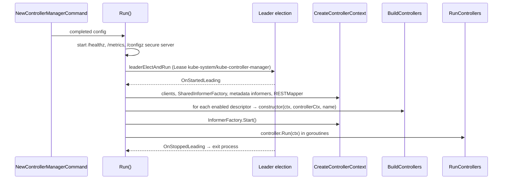

# 06 · kube-controller-manager

The kube-controller-manager (KCM) is a single binary that runs **about 50 independent controllers**. Each controller is a reconcile loop over one or more resource types.

## 1. Code map

| Location | Responsibility |
|----------|----------------|
| `cmd/kube-controller-manager/controller-manager.go` | `main()` |
| [`cmd/kube-controller-manager/app/controllermanager.go`](../kubernetes/cmd/kube-controller-manager/app/controllermanager.go) | `NewControllerManagerCommand`, `Run`, `CreateControllerContext`, `BuildControllers`, `RunControllers`, leader election |
| `cmd/kube-controller-manager/app/controller_descriptor.go` | `ControllerDescriptor` registry (`NewControllerDescriptors`) |
| `cmd/kube-controller-manager/app/{apps,batch,core,networking,policy,rbac,resource,scheduling,lifecycle,certificates,bootstrap,autoscaling,…}.go` | One `newXxxControllerDescriptor()` constructor per controller |
| `cmd/kube-controller-manager/names/controller_names.go` | Canonical controller names (used in `--controllers`) |
| `cmd/kube-controller-manager/app/options/` | Flags; per-controller config lives in `staging/src/k8s.io/kube-controller-manager/config/v1alpha1` |
| `pkg/controller/<name>/` | Controller implementations |
| `pkg/controller/controller_utils.go` | Shared helpers: `PodControlInterface` (create/delete pods with `ControllerExpectations`), `FilterActivePods`, rate limiters |
| `pkg/controller/controller_ref_manager.go` | `PodControllerRefManager.ClaimPods`: adopt or orphan objects based on selector and `ownerReferences` |
| `staging/src/k8s.io/controller-manager` | Code shared with cloud-controller-manager (leader migration, health, options) |

## 2. Startup & lifecycle



- **`ControllerDescriptor`** fields: `name`, `constructor`, `requiredFeatureGates`, `aliases`, `isDisabledByDefault`, `requiresSpecialHandling`.
- **`--controllers=*,-foo,bar`** chooses which controllers run (`IsControllerEnabled`). Disabled by default: `bootstrap-signer-controller`, `token-cleaner-controller`, `selinux-warning-controller`.
- **Per-controller credentials:** with `--use-service-account-credentials`, each controller authenticates as `system:serviceaccount:kube-system:<controller-sa>` through `clientBuilder` (least privilege).
- **Leader election** uses a `coordination.k8s.io/v1 Lease`. Only one active KCM runs controllers. Leader migration (`controller-manager/pkg/leadermigration`) supports moving controllers to the CCM. Election recovery and write-gating (`electionRun.writeGate`) stop a stale leader from writing.

## 3. The canonical controller pattern

Every controller follows the same structure:

```go
type Controller struct {
    kubeClient clientset.Interface
    podLister  corelisters.PodLister   // read from informer cache, never from apiserver
    podsSynced cache.InformerSynced
    queue      workqueue.TypedRateLimitingInterface[string]
}

func NewController(ctx, podInformer, client) *Controller {
    c := &Controller{...}
    podInformer.Informer().AddEventHandler(cache.ResourceEventHandlerFuncs{
        AddFunc:    c.enqueue,            // obj → "namespace/name" key
        UpdateFunc: func(old, new any) { c.enqueue(new) },
        DeleteFunc: c.enqueue,            // handle cache.DeletedFinalStateUnknown
    })
    return c
}

func (c *Controller) Run(ctx context.Context, workers int) {
    defer c.queue.ShutDown()
    if !cache.WaitForNamedCacheSync("foo", ctx.Done(), c.podsSynced) { return }
    for i := 0; i < workers; i++ { go wait.UntilWithContext(ctx, c.worker, time.Second) }
    <-ctx.Done()
}

func (c *Controller) worker(ctx context.Context) { for c.processNextWorkItem(ctx) {} }

func (c *Controller) processNextWorkItem(ctx context.Context) bool {
    key, quit := c.queue.Get(); if quit { return false }
    defer c.queue.Done(key)
    if err := c.sync(ctx, key); err != nil { c.queue.AddRateLimited(key); return true }
    c.queue.Forget(key)
    return true
}
```

Key ideas:
- **Workqueue de-duplication**: a key is processed by only one worker at a time, and repeated adds collapse into one.
- **Expectations** (`ControllerExpectations`): after issuing N creates, the controller does not act on the stale cache until it has observed N add events. This prevents over-creation.
- **Owner references + adoption**: controllers own the objects they create (`controller: true`) and adopt or release objects whose labels match or stop matching.

## 4. Every built-in controller

### 4.1 Workloads (apps / batch)

| Controller name | Package | Main function | What it reconciles |
|-----------------|---------|---------------|--------------------|
| `deployment-controller` | `pkg/controller/deployment` | `syncDeployment` | Deployment → ReplicaSets. Strategies `RollingUpdate` (`rolling.go`: `maxSurge`/`maxUnavailable`) and `Recreate` (`recreate.go`). Handles rollback, pause, `progressDeadlineSeconds` (`progress.go`) and `revisionHistoryLimit` cleanup. Pod-template-hash label from `controller.ComputeHash` |
| `replicaset-controller` | `pkg/controller/replicaset` | `syncReplicaSet` → `manageReplicas` | Keeps `replicas` Pods alive. Slow-start batch creation, deletion ranking (`getPodsToDelete`, preferring not-ready / unscheduled / newest pods), and pod-group min count for gang scheduling |
| `replicationcontroller-controller` | `pkg/controller/replication` | (wraps ReplicaSet logic) | Legacy `ReplicationController` |
| `statefulset-controller` | `pkg/controller/statefulset` | `stateful_set_control.go` → `UpdateStatefulSet` | Ordered, stable identities (`name-0…N`), per-pod PVCs from `volumeClaimTemplates`, `OrderedReady`/`Parallel` management, RollingUpdate with `partition`/`maxUnavailable`, PVC retention policy |
| `daemonset-controller` | `pkg/controller/daemon` | `syncDaemonSet`, `syncNodes` | One Pod per eligible node (node affinity + taints simulated via `NodeShouldRunDaemonPod`). Rolling update (`update.go`) |
| `job-controller` | `pkg/controller/job` | `syncJob` | Runs Pods to completion. `completions`/`parallelism`, `Indexed` completion mode, `backoffLimit` (+ per-index), `podFailurePolicy`, `successPolicy`, `activeDeadlineSeconds`, pod finalizers for reliable tracking (`batch.kubernetes.io/job-tracking`), suspend, `managedBy`, `podReplacementPolicy`, Workload/PodGroup gang min count (`job_scheduling_manager.go`) |
| `cronjob-controller` | `pkg/controller/cronjob` | `ControllerV2.sync` / `syncCronJob` | Creates Jobs on a cron schedule (`timeZone`, `concurrencyPolicy`, `startingDeadlineSeconds`, history limits). Requeues itself for the next schedule time |
| `ttl-after-finished-controller` | `pkg/controller/ttlafterfinished` | | Deletes finished Jobs after `ttlSecondsAfterFinished` |
| `horizontal-pod-autoscaler-controller` | `pkg/controller/podautoscaler` | `horizontal.go` → `reconcileAutoscaler`; `replica_calculator.go` | Reads metrics (`metrics.k8s.io`, `custom.metrics.k8s.io`, `external.metrics.k8s.io`) and computes `desired = ceil(current * currentMetric / target)` with tolerance, stabilisation windows and `behavior` scaling policies. Writes `/scale` |
| `disruption-controller` | `pkg/controller/disruption` | `sync` | Computes PodDisruptionBudget status (`currentHealthy`, `desiredHealthy`, `disruptionsAllowed`), which the eviction API consults. `syncStalePodDisruption` clears the `DisruptionTarget` condition |

### 4.2 Nodes

| Controller | Package | What it does |
|------------|---------|--------------|
| `node-lifecycle-controller` | `pkg/controller/nodelifecycle` | Watches node heartbeats (Node `Lease` in `kube-node-lease` + `NodeStatus`). Sets the `Ready=Unknown` condition after `--node-monitor-grace-period`. Applies `node.kubernetes.io/not-ready` / `unreachable` **NoExecute** taints with zone-aware rate limiting (`--node-eviction-rate`, `--unhealthy-zone-threshold`), and marks pods NotReady |
| `taint-eviction-controller` | `pkg/controller/tainteviction` | Deletes pods that do not tolerate a node's `NoExecute` taints, honouring `tolerationSeconds` (timed workers) |
| `node-ipam-controller` | `pkg/controller/nodeipam` | Allocates `node.spec.podCIDR(s)` from `--cluster-cidr` (`ipam/range_allocator.go`, `cidrset`) |
| `ttl-controller` | `pkg/controller/ttl` | Sets the `node.alpha.kubernetes.io/ttl` annotation (kubelet secret/configmap cache TTL) based on cluster size |
| `pod-garbage-collector-controller` | `pkg/controller/podgc` | Deletes terminated pods beyond `--terminated-pod-gc-threshold`, orphaned pods (node gone), and unscheduled terminating pods. Force-deletes pods on out-of-service nodes |
| `device-taint-eviction-controller` | `pkg/controller/devicetainteviction` | Evicts pods using DRA devices that have `NoExecute` device taints |

### 4.3 Networking

| Controller | Package | What it does |
|------------|---------|--------------|
| `endpointslice-controller` | `pkg/controller/endpointslice` + `staging/k8s.io/endpointslice` | For each Service with a selector: selects ready/serving/terminating pods and maintains `EndpointSlice` objects (≤100 endpoints each by default). The `Reconciler` minimises churn; topology hints are added for traffic distribution |
| `endpointslice-mirroring-controller` | `pkg/controller/endpointslicemirroring` | Mirrors user-managed `Endpoints` (selector-less Services) into EndpointSlices |
| `endpoints-controller` | `pkg/controller/endpoint` | Maintains the legacy `v1.Endpoints` objects (deprecated API, still populated) |
| `service-cidr-controller` | `pkg/controller/servicecidrs` | Manages `ServiceCIDR` status/finalizers and `IPAddress` objects for multi-CIDR Service IP allocation |

### 4.4 Namespaces, GC, quota, service accounts

| Controller | Package | What it does |
|------------|---------|--------------|
| `namespace-controller` | `pkg/controller/namespace` | When a Namespace is deleted, discovers every namespaced resource and deletes all contents (`deletion/namespaced_resources_deleter.go`), then removes the `kubernetes` finalizer |
| `garbage-collector-controller` | `pkg/controller/garbagecollector` | Builds a **dependency graph** from `ownerReferences` across all resources (`graph_builder.go`, monitors via metadata informers). Deletes dependents whose owners are gone (`attemptToDelete`) and implements `Foreground` deletion (`foregroundDeletion` finalizer) and `Orphan` (`orphan` finalizer) |
| `resourcequota-controller` | `pkg/controller/resourcequota` | Recalculates `ResourceQuota.status.used` (evaluators in `pkg/quota/v1/evaluator/core`) |
| `serviceaccount-controller` | `pkg/controller/serviceaccount` | Ensures a `default` ServiceAccount exists in every namespace |
| `serviceaccount-token-controller` | `pkg/controller/serviceaccount/tokens_controller.go` | Populates legacy `kubernetes.io/service-account-token` Secrets |
| `legacy-serviceaccount-token-cleaner-controller` | `pkg/controller/serviceaccount/legacy_serviceaccount_token_cleaner.go` | Labels and deletes unused auto-generated legacy SA token Secrets |
| `root-ca-certificate-publisher-controller` | `pkg/controller/certificates/rootcacertpublisher` | Publishes the `kube-root-ca.crt` ConfigMap into every namespace |
| `clusterrole-aggregation-controller` | `pkg/controller/clusterroleaggregation` | Fills ClusterRoles that have `aggregationRule` (for example `admin`, `edit`, `view`) from labelled ClusterRoles |

### 4.5 Certificates & bootstrap

| Controller | Package | What it does |
|------------|---------|--------------|
| `certificatesigningrequest-approving-controller` | `pkg/controller/certificates/approver` | Auto-approves kubelet client CSRs (`kubernetes.io/kube-apiserver-client-kubelet`) after a SubjectAccessReview check |
| `certificatesigningrequest-signing-controller` | `pkg/controller/certificates/signer` | Signs approved CSRs for built-in signers using the cluster CA (`--cluster-signing-*`) |
| `certificatesigningrequest-cleaner-controller` | `pkg/controller/certificates/cleaner` | Garbage-collects old CSRs |
| `podcertificaterequest-cleaner-controller` | `pkg/controller/certificates/cleaner` | Garbage-collects `PodCertificateRequest`s (feature-gated) |
| `kube-apiserver-serving-clustertrustbundle-publisher-controller` | `pkg/controller/certificates/clustertrustbundlepublisher` | Publishes the apiserver serving CA as a `ClusterTrustBundle` (gated) |
| `bootstrap-signer-controller` *(off)* | `pkg/controller/bootstrap/bootstrapsigner.go` | Signs the `kube-public/cluster-info` ConfigMap with bootstrap tokens (JWS), used by `kubeadm join` discovery |
| `token-cleaner-controller` *(off)* | `pkg/controller/bootstrap/tokencleaner.go` | Deletes expired bootstrap-token Secrets |

### 4.6 Storage

| Controller | Package | What it does |
|------------|---------|--------------|
| `persistentvolume-binder-controller` | `pkg/controller/volume/persistentvolume` | Binds PVCs to PVs (`pv_controller.go`: `syncClaim`, `syncVolume`). Triggers dynamic provisioning (in-tree or via CSI external-provisioner annotations) and reclaim policies (`Delete`/`Retain`) |
| `persistentvolume-attach-detach-controller` | `pkg/controller/volume/attachdetach` | Maintains desired vs. actual attachments (`VolumeAttachment` for CSI), attach/detach reconciler, and populators |
| `persistentvolume-expander-controller` | `pkg/controller/volume/expand` | Control-plane volume resize |
| `persistentvolumeclaim-protection-controller` | `pkg/controller/volume/pvcprotection` | Removes the `pvc-protection` finalizer only when no pod uses the PVC |
| `persistentvolume-protection-controller` | `pkg/controller/volume/pvprotection` | Removes the `pv-protection` finalizer when the PV is unbound |
| `volumeattributesclass-protection-controller` | `pkg/controller/volume/vacprotection` | Protects `VolumeAttributesClass` objects that are in use |
| `ephemeral-volume-controller` | `pkg/controller/volume/ephemeral` | Creates PVCs for generic ephemeral volumes in pod specs |
| `selinux-warning-controller` *(off)* | `pkg/controller/volume/selinuxwarning` | Emits events about SELinux label conflicts on shared volumes |

### 4.7 Dynamic Resource Allocation, scheduling & lifecycle

| Controller | Package | What it does |
|------------|---------|--------------|
| `resourceclaim-controller` | `pkg/controller/resourceclaim` | Creates `ResourceClaim`s from `ResourceClaimTemplate`s for pods and pod groups. Maintains `status.reservedFor`, deallocates and deletes generated claims when the consumers are gone |
| `resourcepoolstatusrequest-controller` | `pkg/controller/resourcepoolstatusrequest` | Answers `ResourcePoolStatusRequest` by aggregating ResourceSlices and allocations (gated) |
| `podgroup-protection-controller` | `pkg/controller/scheduling/podgroupprotection` | Removes PodGroup protection finalizers once no pods reference the group (gated) |
| `evictionrequest-controller` | `pkg/controller/evictionrequest` | Manages declarative `EvictionRequest`s and `Eviction`s (`lifecycle.k8s.io`). Coordinates responders for graceful pod eviction (gated) |
| `imperative-eviction-responder-controller` | `pkg/controller/imperativeevictionresponder` | Built-in responder `imperative-eviction.k8s.io/evictor`: fulfils declarative evictions by calling the `pods/eviction` subresource (gated) |

### 4.8 API-machinery maintenance

| Controller | Package | What it does |
|------------|---------|--------------|
| `storageversion-garbage-collector-controller` | `pkg/controller/storageversiongc` | Removes `StorageVersion` entries left by apiservers that no longer exist (gated) |
| `storage-version-migrator-controller` | `pkg/controller/storageversionmigrator` | Executes `StorageVersionMigration` by rewriting every object of a resource (re-encrypt or re-version) |
| `validatingadmissionpolicy-status-controller` | `pkg/controller/validatingadmissionpolicystatus` | Type-checks VAP CEL expressions and writes warnings to status |

## 5. Shared helpers worth knowing

| Helper | File | Usage |
|--------|------|-------|
| `ControllerExpectations` / `UIDTrackingControllerExpectations` | `controller_utils.go` | Avoid acting on a stale cache after creates and deletes |
| `RealPodControl.CreatePods / DeletePod` | `controller_utils.go` | Creates pods with ownerRefs and records events |
| `ActivePodsWithRanks`, `FilterActivePods`, `IsPodActive` | `controller_utils.go` | Pod sorting and filtering for scale-down decisions |
| `ComputeHash(template, collisionCount)` | `controller_utils.go` | `pod-template-hash` |
| `PodControllerRefManager.ClaimPods` | `controller_ref_manager.go` | Adoption and orphaning |
| `history.Interface` | `pkg/controller/history` | `ControllerRevision` management for StatefulSet and DaemonSet |
| `pkg/controller/util/*` | | `node`, `selectors`, `endpoint` helpers |
| `testutil` | `pkg/controller/testutil` | Fake node handlers etc. for unit tests |
