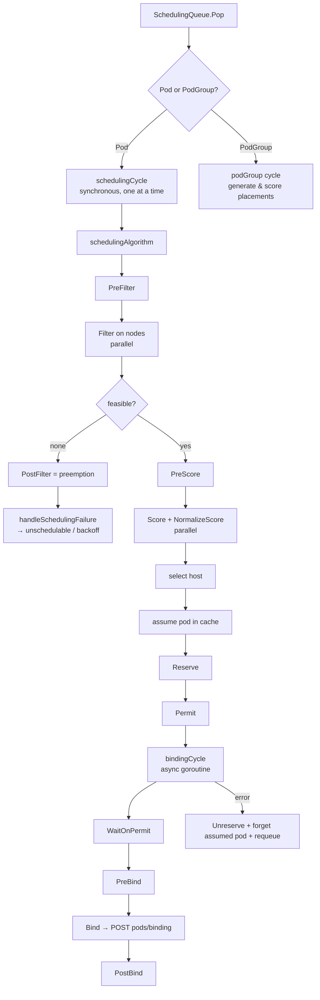

# 07 · kube-scheduler

The scheduler watches for Pods with an empty `spec.nodeName`, picks the best Node for each, and writes a `Binding`. It is built around the **Scheduling Framework**, a pipeline of plugin extension points. This tree also supports **pod-group (gang) scheduling** for `Workload` / `PodGroup` objects.

## 1. Code map

| Location | Responsibility |
|----------|----------------|
| `cmd/kube-scheduler/scheduler.go` | `main()` → `app.NewSchedulerCommand()` |
| `cmd/kube-scheduler/app/server.go` | `NewSchedulerCommand(registryOptions...)`, `Setup` (build config + `scheduler.New`), `Run` (health server, leader election, `sched.Run`) |
| `cmd/kube-scheduler/app/options`, `config` | Flags and `KubeSchedulerConfiguration` loading |
| [`pkg/scheduler/scheduler.go`](../kubernetes/pkg/scheduler/scheduler.go) | `Scheduler` struct, `New(...)` with functional `Option`s, `Run`, `buildQueueingHintMap` |
| [`pkg/scheduler/schedule_one.go`](../kubernetes/pkg/scheduler/schedule_one.go) | **The main algorithm**: `ScheduleOne`, `schedulingCycle`, `schedulingAlgorithm`, `prioritizeNodes`, `bindingCycle`, `handleSchedulingFailure` |
| `pkg/scheduler/schedule_one_podgroup.go`, `algorithm_podgroup.go` | Scheduling a whole PodGroup in one cycle (placements) |
| `pkg/scheduler/eventhandlers.go` | Informer handlers: add unscheduled pods to the queue and update the cache for scheduled pods and nodes |
| `pkg/scheduler/extender.go` | HTTP scheduler extenders (legacy extension mechanism) |
| `pkg/scheduler/profile` | Multiple scheduler profiles (`schedulerName`) → one framework each |
| `pkg/scheduler/apis/config` | `KubeSchedulerConfiguration` types (internal + `v1`), validation, defaults |
| `pkg/scheduler/backend/queue` | `SchedulingQueue` (activeQ, backoffQ, unschedulable pods), nominator, workload forest |
| `pkg/scheduler/backend/cache` | Scheduler cache + `Snapshot` (NodeInfo tree), assumed pods, pod-group state |
| `pkg/scheduler/backend/api_dispatcher`, `api_cache` | Asynchronous API calls (status patches, bindings) with coalescing |
| `pkg/scheduler/backend/heap` | Generic heap used by the queues |
| `pkg/scheduler/framework` | Framework interfaces, `CycleState`, `NodeInfo`, events |
| `pkg/scheduler/framework/runtime` | `frameworkImpl` (runs plugins), registry, waiting pods (Permit), **opportunistic batching** (`batch.go`) |
| `pkg/scheduler/framework/plugins/*` | All in-tree plugins |
| `pkg/scheduler/framework/preemption` | Generic preemption evaluator (single pod and pod group) |
| `pkg/scheduler/metrics` | Prometheus metrics (`scheduler_schedule_attempts_total`, `scheduler_scheduling_attempt_duration_seconds`, …) |
| `staging/src/k8s.io/kube-scheduler/framework` | **Public** plugin API (`fwk.Plugin`, `fwk.Status`, `fwk.CycleState`, `fwk.NodeInfo`) used by out-of-tree plugins |

## 2. Main loop



### 2.1 `ScheduleOne` (`schedule_one.go`)

1. `podInfo := sched.NextPod()`. This blocks on the queue.
2. Skip the pod if it is being deleted or is already assumed (`skipPodSchedule`).
3. Pick the framework for `pod.spec.schedulerName` (`frameworkForPod`).
4. **Scheduling cycle** (serial): `schedulingAlgorithm` → `assume` → `Reserve` → `Permit`.
5. **Binding cycle** (runs in a goroutine, so the next pod can start): `WaitOnPermit` → `PreBind` → `Bind` → `PostBind`.
6. On failure, `handleSchedulingFailure` records the `PodScheduled=False` condition and an event, and puts the pod back in the queue with the plugins that rejected it (used by queueing hints).

### 2.2 `schedulingAlgorithm`

- `UpdateSnapshot`: copy-on-write snapshot of all `NodeInfo`s (generation numbers mean only changed nodes are copied).
- `findNodesThatFitPod`: runs `RunPreFilterPlugins`, which may narrow the node set (`PreFilterResult.NodeNames`). Evaluates the **nominated node** first. Then runs Filter plugins in parallel (`parallelize`), stopping after enough feasible nodes are found (`percentageOfNodesToScore`, adaptive by cluster size). Finally runs extenders.
- `prioritizeNodes`: `PreScore` → `Score` per plugin per node → `NormalizeScore` → weighted sum (+ extender scores).
- `selectHost`: highest score, ties broken by reservoir sampling.
- **Opportunistic batching** (`framework/runtime/batch.go`): consecutive pods with an identical *pod signature* (`SignPod`) reuse cached filter and score results. The previously chosen node is rechecked first (`GetNodeHint` / `StoreScheduleResults`).

## 3. Scheduling queue (`backend/queue`)

| Sub-queue | Contents |
|-----------|----------|
| **activeQ** (`active_queue.go`) | Heap ordered by the `QueueSort` plugin (default: priority, then timestamp) |
| **backoffQ** (`backoff_queue.go`) | Pods that failed recently. Exponential backoff from `podInitialBackoffSeconds` (1s) up to `podMaxBackoffSeconds` (10s) |
| **unschedulable pods** (`unschedulable_entities.go`) | Pods no plugin could satisfy. They are moved back when a relevant cluster event occurs, or after `podMaxInUnschedulablePodsDuration` (5 min) |

**Queueing hints:** each plugin implements `EventsToRegister()`, returning `ClusterEventWithHint{Event, QueueingHintFn}`. When, for example, a Node is added, only pods rejected by plugins that care about `Node/Add` are re-evaluated, and the hint function can return `Queue` or `QueueSkip`. This is set up in `buildQueueingHintMap`.

**PreEnqueue** plugins (for example `SchedulingGates`, `GangScheduling`) can keep pods out of activeQ entirely. The nominator (`nominator.go`) tracks `status.nominatedNodeName` from preemption.

## 4. Scheduler cache (`backend/cache`)

- Holds `NodeInfo` per node: requested resources, pods, ports, image states, affinity pods, PVC ref counts.
- **Assume**: after choosing a node, the pod is added to the cache *before* binding completes, so the next pod sees the reserved resources. `FinishBinding` starts an expiry timer, and the confirmed add from the informer replaces the assumed entry. `ForgetPod` rolls back on failure.
- `node_tree.go` spreads node iteration across zones.
- `podgroupstate.go` tracks pod-group membership and progress.
- `debugger/` prints cache vs. informer comparison on `SIGUSR2`.

## 5. Framework extension points

Interface definitions are in `staging/src/k8s.io/kube-scheduler/framework/interface.go` (public) and `pkg/scheduler/framework/interface.go`.

| Extension point | Signature (simplified) | Purpose |
|-----------------|------------------------|---------|
| `PreEnqueue` | `(pod) Status` | Gate entry to activeQ |
| `QueueSort` | `Less(a, b)` | Queue ordering (exactly one plugin) |
| `PreFilter` | `(state, pod) (PreFilterResult, Status)` | Precompute, early reject, narrow nodes |
| `Filter` | `(state, pod, nodeInfo) Status` | Is this node feasible? |
| `PostFilter` | `(state, pod, statusMap) (PostFilterResult, Status)` | Runs when no node fits, usually **preemption** |
| `PreScore` | `(state, pod, nodes) Status` | Precompute for scoring |
| `Score` + `ScoreExtensions.NormalizeScore` | `(state, pod, nodeInfo) (int64, Status)` | 0–100 score per node |
| `Reserve` / `Unreserve` | `(state, pod, node)` | Reserve resources in plugin state (volumes, DRA claims) |
| `Permit` | `(state, pod, node) (Status, timeout)` | Allow, deny or **wait** (used by gang scheduling) |
| `PreBind` (+ `PreBindPreFlight`) | | For example, bind PVCs or allocate DRA claims before binding |
| `Bind` | | Write the binding (exactly one plugin succeeds) |
| `PostBind` | | Informational cleanup |
| `SignPod` | | Pod signature for batching |
| **Pod-group points** | `PlacementGenerate`, `PlacementFeasible`, `PlacementScore`, `PodGroupPostFilter` | Generate candidate node sets (placements) for a whole group, check feasibility and score them |
| `EnqueueExtensions.EventsToRegister` | | Queueing hints |

`CycleState` is a per-cycle key/value store that plugins use to pass precomputed data from PreFilter to Filter and so on (`Clone()`-able for preemption simulation).

`Status` codes: `Success`, `Error`, `Unschedulable`, `UnschedulableAndUnresolvable` (preemption cannot help), `Wait`, `Skip`, `Pending`.

## 6. Every in-tree plugin

Registered in [`pkg/scheduler/framework/plugins/registry.go`](../kubernetes/pkg/scheduler/framework/plugins/registry.go) (`NewInTreeRegistry`).

| Plugin | Extension points | Behaviour |
|--------|------------------|-----------|
| `PrioritySort` (`queuesort`) | QueueSort | Higher `spec.priority` first, then FIFO |
| `SchedulingGates` | PreEnqueue | Holds pods while `spec.schedulingGates` is non-empty |
| `NodeUnschedulable` | Filter | Rejects `spec.unschedulable` nodes unless the pod tolerates the `node.kubernetes.io/unschedulable` taint |
| `NodeName` | Filter | Honours `spec.nodeName` if pre-set |
| `NodePorts` | PreFilter, Filter | `hostPort` conflicts |
| `NodeAffinity` | PreFilter, Filter, PreScore, Score | `nodeSelector`, required/preferred node affinity, plus profile-level `addedAffinity` |
| `NodeResourcesFit` (`noderesources/fit.go`) | PreFilter, Filter, PreScore, Score | Requests fit in allocatable (CPU, memory, ephemeral-storage, extended resources, pod overhead, pod-level resources). Scoring strategies `LeastAllocated` (default), `MostAllocated`, `RequestedToCapacityRatio` |
| `NodeResourcesBalancedAllocation` | PreScore, Score | Prefers nodes where CPU and memory utilisation are balanced |
| `TaintToleration` | Filter, PreScore, Score | `NoSchedule` taints must be tolerated. Fewer `PreferNoSchedule` taints score better |
| `InterPodAffinity` | PreFilter, Filter, PreScore, Score | Required/preferred pod affinity and anti-affinity by topology key |
| `PodTopologySpread` | PreFilter, Filter, PreScore, Score | `topologySpreadConstraints` (`maxSkew`, `whenUnsatisfiable`, `minDomains`, `nodeAffinityPolicy`, `nodeTaintsPolicy`) plus cluster default constraints |
| `ImageLocality` | Score | Prefers nodes that already have the images (size-weighted, spread-adjusted) |
| `VolumeBinding` | PreFilter, Filter, Reserve, PreBind, Score | Matches unbound PVCs to PVs or checks dynamic provisioning topology. Binds in PreBind (`WaitForFirstConsumer`) |
| `VolumeRestrictions` | PreFilter, Filter | Volume conflicts (for example the same GCE PD read-write, `ReadWriteOncePod`) |
| `VolumeZone` | PreFilter, Filter | PV zone labels must match node zone |
| `NodeVolumeLimits` (CSI) | PreFilter, Filter | Max attachable volumes per node per CSI driver (`CSINode.spec.drivers[].allocatable`) |
| `DynamicResources` | PreEnqueue, PreFilter, Filter, PostFilter, Reserve, PreBind | **DRA**: allocates devices for `ResourceClaim`s from `ResourceSlice`s using `DeviceClass` CEL selectors (`staging/k8s.io/dynamic-resource-allocation/structured`). Writes the allocation in PreBind |
| `NodeDeclaredFeatures` | PreFilter, Filter | Node must declare the features the pod requires |
| `DeferredPodScheduling` | PreFilter, Filter, Bind | Evaluates **deferred in-place resize** pods (already bound) against node capacity and sets the `SchedulerEvaluationCompleted` condition instead of binding |
| `GangScheduling` | PreEnqueue, PlacementFeasible, Permit | **All-or-nothing**: pods in a PodGroup are not enqueued until the group (or CompositePodGroup hierarchy) reaches quorum (`minCount`), and a placement is feasible only if enough pods fit |
| `TopologyPlacement` (`topologyaware`) | PlacementGenerate | Generates candidate placements (node subsets per topology domain, for example a rack or zone) from the PodGroup's topology constraint |
| `PodGroupPodsCount` | PlacementScore | Prefers placements that fit more pods of the group |
| `DefaultPreemption` | PostFilter | Finds victims (lower priority pods) whose removal makes the pod fit, respecting PDBs as far as possible. Picks the node with minimal disruption and sets `nominatedNodeName` |
| `DefaultBinder` | Bind | `POST /api/v1/namespaces/<ns>/pods/<name>/binding` |

Default plugin set and weights: `pkg/scheduler/apis/config/v1/default_plugins.go`.

## 7. Preemption (`framework/preemption`)

1. `PostFilter` is called with the per-node failure statuses.
2. For each candidate node (excluding `UnschedulableAndUnresolvable` ones) the evaluator simulates removing lower-priority pods (`SelectVictimsOnNode`) and re-runs the filters on a cloned `CycleState`. It then re-adds victims greedily to minimise disruption.
3. It chooses the best candidate (`pickOneNodeForPreemption`): fewest PDB violations, then lowest highest-victim priority, then smallest sum of priorities, then fewest victims, then latest start time.
4. `executor.go` deletes the victims (setting the `DisruptionTarget` condition), clears lower-priority nominations and sets `status.nominatedNodeName`. It can run asynchronously.
5. `podgrouppreemption.go` extends this to finding victims for an entire pod group.

## 8. Configuration (`KubeSchedulerConfiguration`)

```yaml
apiVersion: kubescheduler.config.k8s.io/v1
kind: KubeSchedulerConfiguration
percentageOfNodesToScore: 0          # 0 = adaptive
podInitialBackoffSeconds: 1
podMaxBackoffSeconds: 10
profiles:
- schedulerName: default-scheduler
  plugins:
    score:
      disabled: [{name: ImageLocality}]
      enabled:  [{name: MyPlugin, weight: 3}]
  pluginConfig:
  - name: NodeResourcesFit
    args:
      scoringStrategy: {type: MostAllocated}
extenders: []
```

## 9. Writing an out-of-tree plugin

```go
// main.go of your custom scheduler
command := app.NewSchedulerCommand(app.WithPlugin("MyPlugin", myplugin.New))
```

```go
type MyPlugin struct{ handle fwk.Handle }
var _ fwk.FilterPlugin = &MyPlugin{}
func (p *MyPlugin) Name() string { return "MyPlugin" }
func (p *MyPlugin) Filter(ctx context.Context, s fwk.CycleState, pod *v1.Pod, ni fwk.NodeInfo) *fwk.Status {
    if ni.Node().Labels["team"] != pod.Labels["team"] {
        return fwk.NewStatus(fwk.Unschedulable, "team mismatch")
    }
    return nil
}
func New(ctx context.Context, _ runtime.Object, h fwk.Handle, _ feature.Features) (fwk.Plugin, error) {
    return &MyPlugin{handle: h}, nil
}
```

Benchmarks for scheduler changes: `test/integration/scheduler_perf`.
