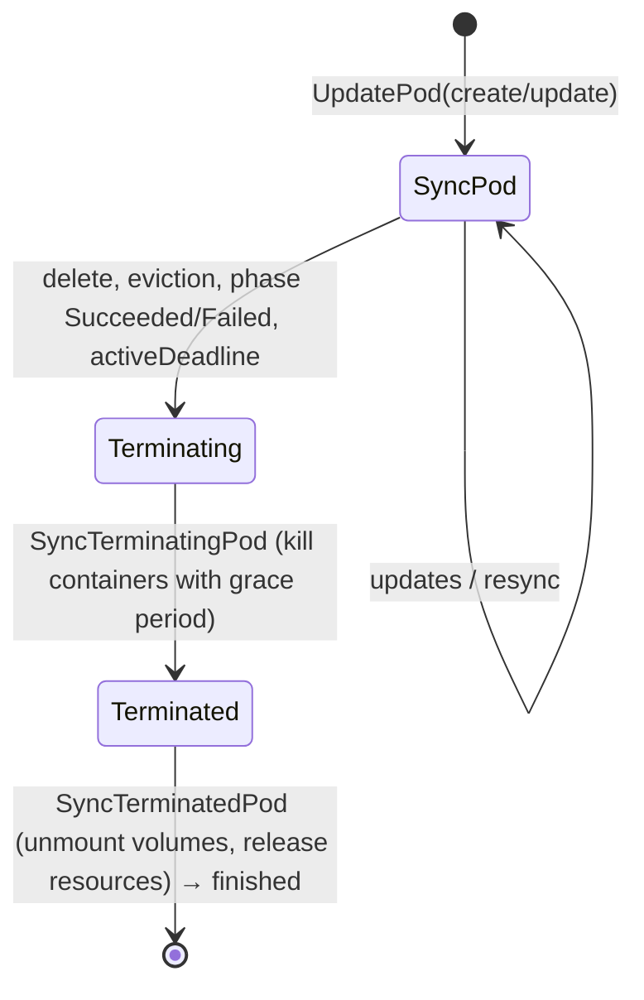

# 08 · kubelet

The kubelet is the node agent. It makes sure that the Pods bound to its node are running as specified, using the container runtime (CRI), volume plugins (CSI), device plugins and DRA drivers. It also reports Node and Pod status back to the API server.

## 1. Code map

| Location | Responsibility |
|----------|----------------|
| `cmd/kubelet/kubelet.go` | `main()` |
| [`cmd/kubelet/app/server.go`](../kubernetes/cmd/kubelet/app/server.go) | `NewKubeletCommand`, `Run` → `run` (build clients, cgroup/container manager, auth, certificate rotation) → `RunKubelet` → `startKubelet` |
| `cmd/kubelet/app/options` | Flags and `KubeletConfiguration` (`staging/src/k8s.io/kubelet/config/v1beta1`) |
| `cmd/kubelet/app/plugins.go` | Registers in-tree volume plugins |
| [`pkg/kubelet/kubelet.go`](../kubernetes/pkg/kubelet/kubelet.go) | `Kubelet` struct, `NewMainKubelet`, `Run`, `syncLoop`, `syncLoopIteration`, `SyncPod`, `SyncTerminatingPod`, `SyncTerminatedPod`, `HandlePod*` |
| `pkg/kubelet/pod_workers.go` | Per-pod goroutine state machine |
| `pkg/kubelet/kubelet_pods.go` | Pod helpers: env vars, mounts, `generateAPIPodStatus`, cleanup (`HandlePodCleanups`) |
| `pkg/kubelet/kubelet_node_status.go` | Node registration and status updates |
| `pkg/kubelet/kubelet_volumes.go`, `kubelet_network*.go`, `kubelet_resources.go`, `kubelet_getters.go` | Supporting functions |

## 2. Startup

```mermaid
sequenceDiagram
  participant Cmd as NewKubeletCommand
  participant Run as app.run()
  participant NMK as NewMainKubelet
  participant K as Kubelet.Run
  Cmd->>Cmd: load --config file, flags, feature gates, dynamic drop-in configs
  Cmd->>Run: Run(ctx, kubeletServer, deps)
  Run->>Run: bootstrap kubeconfig / TLS bootstrap (CSR) and client cert rotation
  Run->>Run: build ContainerManager (cgroups, QoS, CPU/memory/topology/device/DRA managers)
  Run->>Run: PreInitRuntimeService (connect CRI sockets)
  Run->>NMK: RunKubelet → createAndInitKubelet
  NMK->>NMK: wire every sub-manager (see §3)
  Run->>K: startKubelet → go k.Run(podUpdates); ListenAndServe (10250), read-only (10255), pod-resources gRPC
  K->>K: initializeModules (dirs, image GC, cert mgr, OOM watcher, resource analyzer)
  K->>K: start volumeManager, nodeStatus loop, node lease, PLEG, eviction, probes, statusManager…
  K->>K: syncLoop(updates)
```

## 3. Sub-managers wired into `Kubelet`

| Field / package | Responsibility |
|-----------------|----------------|
| **Pod config sources** `pkg/kubelet/config` | Merges pod updates from three sources into one channel: **apiserver** (`apiserver.go`, watch on `spec.nodeName=<me>`), **file** (static pods from `staticPodPath`), **http** (`staticPodURL`). `mux.go` and `config.go` turn them into `PodUpdate{Op: ADD/UPDATE/REMOVE/RECONCILE/DELETE}` |
| **podManager** `pkg/kubelet/pod` | Desired-state store of pods, including **mirror pods** for static pods |
| **podWorkers** `pod_workers.go` | One goroutine per pod. Serialises sync / terminate / terminated transitions |
| **containerRuntime** `pkg/kubelet/kuberuntime` | CRI-based `kubeGenericRuntimeManager` |
| **PLEG** `pkg/kubelet/pleg` | Pod Lifecycle Event Generator: `generic.go` (relist every 1s) or `evented.go` (CRI event stream) |
| **podCache** `pkg/kubelet/container/cache.go` | Latest `PodStatus` per pod from the runtime, with timestamps |
| **statusManager** `pkg/kubelet/status` | Caches the computed `v1.PodStatus` and syncs it to the API server (patching) |
| **probeManager** `pkg/kubelet/prober` | Per-container liveness/readiness/startup workers |
| **volumeManager** `pkg/kubelet/volumemanager` | Attach/mount reconciliation |
| **containerManager** `pkg/kubelet/cm` | cgroups, QoS, Node allocatable, CPU/memory/topology/device/DRA managers |
| **evictionManager** `pkg/kubelet/eviction` | Node-pressure eviction |
| **imageManager** `pkg/kubelet/images` | Image pulls (`puller.go`, serial/parallel), pull credential verification (`pullmanager`), **image GC** (`image_gc_manager.go`) |
| **containerGC** `pkg/kubelet/container/container_gc.go` | Removes dead containers and sandboxes |
| **nodeShutdownManager** `pkg/kubelet/nodeshutdown` | Graceful node shutdown via systemd inhibitor locks (`systemd/`), priority-based grace periods |
| **allocationManager** `pkg/kubelet/allocation` | Tracks allocated resources for **in-place pod resize** and admission |
| **pluginManager** `pkg/kubelet/pluginmanager` | Watches `/var/lib/kubelet/plugins_registry` for CSI, device-plugin and DRA plugin sockets |
| **secret/configmap managers** `pkg/kubelet/{secret,configmap}` | Watch-based or TTL-cached access to referenced objects |
| **token manager** `pkg/kubelet/token` | Bound SA token requests and refresh for projected volumes |
| **podCertificate** `pkg/kubelet/podcertificate` | Issues and refreshes `PodCertificateRequest`-backed projected certificates |
| **clusterTrustBundle** `pkg/kubelet/clustertrustbundle` | ClusterTrustBundle projection |
| **nodeLease** (component-helpers) | Renews `kube-node-lease/<node>` every 10s (heartbeat) |
| **runtimeClass** `pkg/kubelet/runtimeclass` | Resolves `RuntimeClass` handler |
| **userns** `pkg/kubelet/userns` | User-namespace ID range allocation |
| **sysctl** `pkg/kubelet/sysctl` | Safe/unsafe sysctl admission |
| **logs** `pkg/kubelet/logs` | Container log rotation (`containerLogMaxSize`/`MaxFiles`) |
| **server** `pkg/kubelet/server` | HTTPS API: `/pods`, `/healthz`, `/metrics`, `/metrics/cadvisor`, `/metrics/resource`, `/stats/summary`, `/logs`, `/exec`, `/attach`, `/portForward`, `/containerLogs`, `/checkpoint`, `/configz`. Authenticated and authorised via the API server (`auth.go`) |
| **stats** `pkg/kubelet/stats` | Summary API (CRI stats or cAdvisor stats provider) |
| **cadvisor** `pkg/kubelet/cadvisor` | Embedded cAdvisor for machine and container metrics |
| **certificate** `pkg/kubelet/certificate` | Client and serving certificate rotation via CSR |
| **oom** `pkg/kubelet/oom` | OOM event watcher |
| **watchdog** `pkg/kubelet/watchdog` | systemd watchdog integration |
| **preemption** `pkg/kubelet/preemption` | Critical pod admission: evicts lower-priority pods when a critical pod cannot be admitted |
| **lifecycle** `pkg/kubelet/lifecycle` | Pod admit handlers (`predicate.go` re-runs scheduler-like fit checks) and lifecycle hook handlers (`handlers.go`: `postStart`/`preStop` exec, http, sleep) |

## 4. The sync loop

`syncLoop` → `syncLoopIteration` is a `select` over these channels:

| Channel | Source | Action |
|---------|--------|--------|
| `configCh` | Pod config sources | `HandlePodAdditions` / `Updates` / `Removes` / `Reconcile` / `Syncs` |
| `plegCh` | PLEG events (container started or died) | `HandlePodSyncs` for that pod. Also cleans up dead containers |
| `syncCh` (1s ticker) | | Re-sync pods whose work queue entry is due (`getPodsToSync`) |
| `housekeepingCh` (2s) | | `HandlePodCleanups`: kill orphaned pods, clean up volumes, cgroups, mirror pods and probe workers |
| liveness / readiness / startup result channels | Prober | Restart a container (liveness) or update status (readiness) |
| `containerManager` updates | Device/DRA health | Re-sync affected pods |

`HandlePodAdditions` sorts pods by creation time and runs **admission** (`canAdmitPod`: resource fit, node affinity, taints, sysctls, AppArmor, topology manager, eviction pressure, shutdown). Rejected pods are failed with a reason. Admitted pods are dispatched to `podWorkers.UpdatePod`.

## 5. Pod workers: per-pod state machine



`podSyncStatus` tracks `startedAt`, `terminatingAt`, `terminatedAt`, `finished`, `evicted`, `deleted`. The kubelet answers questions like `ShouldPodContainersBeTerminating(uid)` and `CouldHaveRunningContainers(uid)` from this state.

### 5.1 `Kubelet.SyncPod` (running pods)

1. Generate the API status (`generateAPIPodStatus`) and record first-seen latency metrics.
2. If the pod should not be running (`canRunPod`: for example AppArmor or soft admission), set it to Pending with a reason.
3. `statusManager.SetPodStatus`.
4. Make sure the network plugin is ready (except for host-network pods).
5. Ensure **pod-level cgroups** (`pcm.EnsureExists`) and kill the pod first if the QoS class changed.
6. For static pods, create or refresh the **mirror pod**.
7. Make the pod data directories.
8. `volumeManager.WaitForAttachAndMount` (blocks until volumes are ready).
9. Fetch image pull secrets.
10. `PrepareDynamicResources` (DRA `NodePrepareResources`).
11. **`containerRuntime.SyncPod`** (below).
12. Handle in-place resize status (`allocationManager`).

### 5.2 `kubeGenericRuntimeManager.SyncPod` (`kuberuntime/kuberuntime_manager.go`)

Steps (from the code's own doc comment):

1. `computePodActions`: compare the spec with the runtime status, then decide whether to create or kill the sandbox, which containers to start or kill, and the restart policy (with crash-loop **backoff**).
2. Kill the pod sandbox if needed (sandbox changed, for example its network namespace).
3. Kill containers that should not be running (spec hash changed, liveness failed).
4. Create the sandbox if needed: `RunPodSandbox` with `PodSandboxConfig` (hostname, DNS, ports, cgroup parent, security context, runtime handler).
5. `OnPodSandboxReady` lets the kubelet update pod status (pod IPs).
6. **Resize** the pod and running containers in place (`UpdateContainerResources`).
7. Create **ephemeral containers** (`kubectl debug`).
8. Create **init containers** in order. Sidecars (`restartPolicy: Always` init containers) keep running.
9. Create normal containers: `startContainer` = pull image → `CreateContainer` → `StartContainer` → run the `postStart` hook.

Related files: `kuberuntime_container.go` (start/kill/logs, `killContainer` with `preStop` and grace), `kuberuntime_sandbox.go`, `kuberuntime_image.go`, `kuberuntime_gc.go`, `kuberuntime_termination_order.go` (sidecar termination order), `security_context*.go`, `labels.go` (container labels and annotations used to recover state), `convert.go`.

## 6. PLEG (`pkg/kubelet/pleg`)

- **Generic PLEG** (`generic.go`): every `relistPeriod` (1s) it calls `GetPods(all=true)`, diffs against the previous snapshot and emits `ContainerStarted`, `ContainerDied`, `ContainerRemoved`, `ContainerChanged` events. It also updates `podCache` for every changed pod.
- **Evented PLEG** (`evented.go`): consumes the CRI `GetContainerEvents` stream and falls back to the generic PLEG if needed.
- `Healthy()` fails if a relist has not completed within 3 minutes, which makes the node NotReady (`PLEG is not healthy`).

## 7. Container manager (`pkg/kubelet/cm`)

| Sub-package | Responsibility |
|-------------|----------------|
| `container_manager_linux.go` | Sets up `kubepods` cgroup hierarchy, system-reserved/kube-reserved enforcement (`node_container_manager_linux.go`), node allocatable |
| `cgroup_manager_linux.go`, `cgroup_v1_manager_linux.go`, `cgroup_v2_manager_linux.go` | cgroupfs / systemd driver abstraction via libcontainer |
| `qos_container_manager_linux.go` | `kubepods/burstable`, `kubepods/besteffort` cgroups and their periodic resizing |
| `pod_container_manager_linux.go` | Per-pod cgroups (`pod<uid>`) |
| `cpumanager` | Policies `none` and `static` (exclusive CPUs for Guaranteed pods with integer CPU). Options such as `full-pcpus-only`, `distribute-cpus-across-numa`. State checkpoint at `/var/lib/kubelet/cpu_manager_state` |
| `memorymanager` | Policies `None`, `Static` (NUMA memory pinning), `BestEffort` |
| `topologymanager` | Policies `none`, `best-effort`, `restricted`, `single-numa-node`. Scopes `container`/`pod`. Merges NUMA hints from the CPU, memory and device managers |
| `devicemanager` | **Device plugin** gRPC API (`Register`, `ListAndWatch`, `Allocate`, `GetPreferredAllocation`). Checkpointed allocations |
| `dra` | **DRA** kubelet plugin manager: `NodePrepareResources` / `NodeUnprepareResources`, claim info cache, CDI device injection, device health |
| `containermap`, `resourceupdates`, `admission`, `qos`, `util` | Helpers |

QoS classes (`pkg/apis/core/v1/helper/qos`): **Guaranteed** (requests == limits for all containers), **Burstable**, **BestEffort**. They drive cgroup placement, OOM score adjustment (`pkg/kubelet/qos/policy.go`) and eviction order.

## 8. Probes (`pkg/kubelet/prober`)

- `prober_manager.go` creates one `worker` per (pod, container, probe type).
- `worker.go` loops every `periodSeconds` and respects `initialDelaySeconds`, `failureThreshold`, `successThreshold` and `timeoutSeconds`.
- `prober.go` dispatches to `pkg/probe/{exec,http,tcp,grpc}`.
- Results go to `results.Manager` → the kubelet sync loop. Liveness failure kills the container. Readiness failure sets `ContainerStatus.Ready=false`, which feeds into EndpointSlices. Startup probes gate the other two.

## 9. Node-pressure eviction (`pkg/kubelet/eviction`)

- Signals: `memory.available`, `nodefs.available`, `nodefs.inodesFree`, `imagefs.*`, `containerfs.*`, `pid.available`, `allocatableMemory.available`.
- **Hard** thresholds evict immediately. **Soft** thresholds evict after a grace period.
- `eviction_manager.go` → `synchronize()`: observe stats → compare with thresholds → set node conditions (`MemoryPressure`, `DiskPressure`, `PIDPressure`) → first try to **reclaim node-level resources** (image GC, container GC) → otherwise rank pods (exceeds requests? → priority → usage above requests) and evict one per interval.
- Kernel memcg notifications (`threshold_notifier_linux.go`) give faster reactions.

## 10. Status reporting

- **Pod status:** `generateAPIPodStatus` → `statusManager.SetPodStatus` → `syncPod` patches `pods/status` when the status changes. It never moves a pod backward from a terminal phase and handles `DisruptionTarget` / `PodReadyToStartContainers` / `PodResizePending` / `PodResizeInProgress` conditions.
- **Node status** (`kubelet_node_status.go`, `nodestatus/setters.go`): addresses, capacity/allocatable, `NodeInfo` (kernel, OS, runtime version), images, volumes in use, conditions (`Ready`, pressure conditions), declared features. Updated every `nodeStatusUpdateFrequency` when something changes, and at least every `nodeStatusReportFrequency`. The Lease carries the frequent heartbeat.

## 11. Static pods & mirror pods

Pods from the file or http sources are **static pods**. The kubelet runs them without the API server and creates a read-only **mirror pod** in the API (annotation `kubernetes.io/config.mirror`) so they are visible. `kubeadm` uses static pods for the control plane (`/etc/kubernetes/manifests`).

## 12. Important on-disk paths

| Path | Contents |
|------|----------|
| `/var/lib/kubelet/config.yaml` | KubeletConfiguration (kubeadm) |
| `/var/lib/kubelet/pods/<uid>/volumes/<plugin>/<name>` | Volume mount points |
| `/var/lib/kubelet/plugins_registry/` | Plugin registration sockets |
| `/var/lib/kubelet/device-plugins/` | Device plugin sockets and checkpoint |
| `/var/lib/kubelet/{cpu,memory}_manager_state`, `dra_manager_state` | Manager checkpoints |
| `/var/lib/kubelet/pki/` | Kubelet client and serving certificates |
| `/var/log/pods/<ns>_<name>_<uid>/<container>/N.log` | Container logs (CRI format) |
| `/etc/kubernetes/manifests/` | Static pod manifests (default with kubeadm) |
