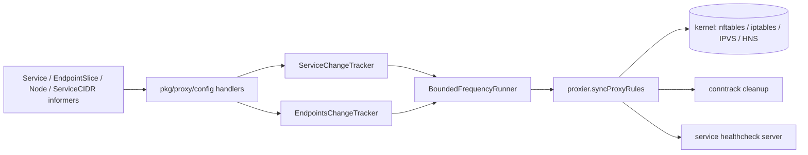

# 09 · kube-proxy

kube-proxy runs on every node. It turns `Service` and `EndpointSlice` objects into **packet-forwarding rules** in the kernel, so that traffic to a ClusterIP, NodePort, LoadBalancer IP or ExternalIP reaches a healthy backend Pod.

## 1. Code map

| Location | Responsibility |
|----------|----------------|
| `cmd/kube-proxy/proxy.go` | `main()` |
| `cmd/kube-proxy/app/server.go` | `NewProxyCommand`, `ProxyServer`, `Run` (informers, healthz, metrics, conntrack setup) |
| `cmd/kube-proxy/app/server_linux.go` | Platform defaults (mode `iptables` when unset, detect-local `ClusterCIDR`) and `createProxier` for iptables / ipvs / nftables |
| `cmd/kube-proxy/app/server_windows.go` | Windows: mode `kernelspace` (HNS) |
| `cmd/kube-proxy/app/options.go` | Flags and `KubeProxyConfiguration` (`pkg/proxy/apis/config`) |
| `pkg/proxy/types.go` | `Provider` interface (event handlers + `Sync`/`SyncLoop`), `ServicePortName` |
| `pkg/proxy/config` | Informer adaptors: `ServiceConfig`, `EndpointSliceConfig`, `NodeTopologyConfig`, `ServiceCIDRConfig`, which call the `On*` handlers |
| `pkg/proxy/servicechangetracker.go` | Accumulates pending Service changes → `ServicePortMap` |
| `pkg/proxy/endpointschangetracker.go`, `endpointslicecache.go` | Accumulates EndpointSlice changes → `EndpointsMap` (merging slices per service port) |
| `pkg/proxy/serviceport.go`, `endpoint.go` | `BaseServicePortInfo`, `BaseEndpointInfo` (ready / serving / terminating, zone hints) |
| `pkg/proxy/topology.go` | `CategorizeEndpoints`: applies `internalTrafficPolicy`, `externalTrafficPolicy: Local`, topology-aware hints and `trafficDistribution` (`PreferSameZone` / `PreferSameNode`) |
| `pkg/proxy/runner/bounded_frequency_runner.go` | Rate-limits full syncs (`minSyncPeriod` … `syncPeriod`) |
| `pkg/proxy/healthcheck` | `proxy_health.go` (`/healthz`, `/livez` on 10256) and `service_health.go` (per-Service `healthCheckNodePort` for `externalTrafficPolicy: Local`) |
| `pkg/proxy/conntrack` | Flush stale UDP/SCTP conntrack entries when endpoints change, and conntrack sysctls |
| `pkg/proxy/nodemanager` | Watches the local Node (IPs, podCIDR, topology labels) and restarts on relevant change |
| `pkg/proxy/metaproxier` | Wraps an IPv4 proxier and an IPv6 proxier for **dual-stack** |
| `pkg/proxy/localnodeportproxy` | Userspace localhost NodePort proxy (used with nftables when `localhost:NodePort` must work) |
| `pkg/proxy/util` | Local traffic detectors (`localdetector.go`), NodePort address selection, `nfacct` counters |
| `pkg/proxy/metrics` | `kubeproxy_sync_proxy_rules_duration_seconds`, `…_last_timestamp`, rule counts |

## 2. Data flow

Each `On*` handler only records the change and calls `syncRunner.Run()`. `syncProxyRules` then:
1. Applies pending changes to `svcPortMap` and `endpointsMap` and gets the list of stale services and endpoints.
2. Computes the full desired rule set from scratch (or partially, for iptables "partial sync" optimisation).
3. Writes it to the kernel **atomically** (`iptables-restore`, an nft transaction, or IPVS netlink calls).
4. Deletes stale conntrack entries and updates healthcheck and metrics.

## 3. Backends (`--proxy-mode`)

| Mode | Package | Mechanism | Notes |
|------|---------|-----------|-------|
| `iptables` (Linux default when unset) | `pkg/proxy/iptables/proxier.go` | `KUBE-SERVICES` → `KUBE-SVC-<hash>` → probabilistic `-m statistic` jumps → `KUBE-SEP-<hash>` DNAT. Also `KUBE-NODEPORTS`, `KUBE-EXT-*`, `KUBE-FW-*`, `KUBE-MARK-MASQ`, `KUBE-POSTROUTING` | O(n) rule traversal. Full or partial `iptables-restore` |
| `nftables` | `pkg/proxy/nftables/proxier.go` (see its `README.md`) | Single `kube-proxy` table. **verdict maps** (`service-ips`, `service-nodeports`) give O(1) dispatch, `numgen random mod N` selects the endpoint. Chains `service-*`, `endpoint-*`, `external-*`, `firewall-*`, `mark-for-masquerade`, `masquerading` | Recommended modern backend. Uses `sigs.k8s.io/knftables`. NodePorts are only on selected `nodePortAddresses` |
| `ipvs` | `pkg/proxy/ipvs/proxier.go` | Kernel IPVS virtual servers on the dummy interface `kube-ipvs0`, plus `ipset` + a few iptables rules for masquerade and filtering | Schedulers `rr`, `lc`, `sh`, …; `graceful_termination.go` |
| `kernelspace` (Windows) | `pkg/proxy/winkernel/proxier.go` | Host Networking Service (HNS) load balancers via `hcnutils.go` / `hns.go` | DSR and overlay support |

## 4. Important behaviours

- **Masquerading (SNAT)**: traffic is masqueraded when it comes from outside the cluster CIDR (`--cluster-cidr` / detect-local mode) or in hairpin cases. External traffic to `externalTrafficPolicy: Cluster` is masqueraded.
- **`externalTrafficPolicy: Local`**: only node-local endpoints are used. The client IP is preserved and the `healthCheckNodePort` reports local endpoint availability to the cloud load balancer.
- **Terminating endpoints**: if no ready endpoints exist, serving-but-terminating endpoints are used (graceful shutdown for LB traffic).
- **Session affinity**: `ClientIP` with a timeout (iptables `recent` module, nftables sets with timeouts, IPVS persistence).
- **Rejecting**: services without endpoints get REJECT (ICMP) rules instead of black-holing traffic.
- **Topology / traffic distribution**: endpoint selection filtered by zone or node hints from EndpointSlices.
- **ServiceCIDR awareness**: `OnServiceCIDRsChanged` updates rules that drop traffic to unallocated ClusterIPs.

## 5. Endpoints

| Port | Endpoint |
|------|----------|
| 10249 | `/metrics`, `/configz` |
| 10256 | `/healthz`, `/livez` (used by cloud load balancers for node health) |
