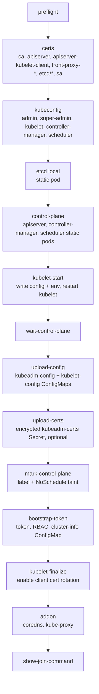

# 11 · kubeadm

`kubeadm` bootstraps a best-practice Kubernetes cluster. It generates certificates, kubeconfigs, static-pod manifests for the control plane, and bootstrap tokens, and it installs the CoreDNS and kube-proxy add-ons. It does **not** provision machines or install the kubelet or container runtime.

## 1. Code map

| Location | Responsibility |
|----------|----------------|
| `cmd/kubeadm/kubeadm.go` | `main()` → `app.Run()` |
| `cmd/kubeadm/app/cmd/cmd.go` | Root command: `init`, `join`, `reset`, `upgrade`, `token`, `certs`, `kubeconfig`, `config`, `version`, `completion` |
| `cmd/kubeadm/app/cmd/{init,join,reset}.go` | Workflow commands built from phases |
| `cmd/kubeadm/app/cmd/phases/workflow` | **Phase runner** framework (`Runner`, `Phase`, `--skip-phases`, `kubeadm init phase <name>`) |
| `cmd/kubeadm/app/cmd/phases/{init,join,reset,upgrade}` | Phase definitions (CLI side) |
| `cmd/kubeadm/app/phases/*` | Phase implementations (library side) |
| `cmd/kubeadm/app/apis/kubeadm` | Config API: internal types plus `v1beta4` and `v1` (`InitConfiguration`, `ClusterConfiguration`, `JoinConfiguration`, `ResetConfiguration`, `UpgradeConfiguration`) |
| `cmd/kubeadm/app/componentconfigs` | Manages the KubeletConfiguration and KubeProxyConfiguration that kubeadm generates |
| `cmd/kubeadm/app/preflight` | Pre-flight checks (ports, swap, cgroups, runtime socket, kernel modules, existing files, versions) |
| `cmd/kubeadm/app/discovery` | Join discovery: `token` (CA pinning via `--discovery-token-ca-cert-hash`), `file`, `https` |
| `cmd/kubeadm/app/constants` | Paths, ports, default versions (`/etc/kubernetes/pki`, `manifests`, …) |
| `cmd/kubeadm/app/images` | Image names and tags for control-plane components, etcd, CoreDNS, pause |
| `cmd/kubeadm/app/features` | kubeadm-specific feature gates |
| `cmd/kubeadm/app/util` | `apiclient`, `kubeconfig`, `pkiutil`, `staticpod`, `etcd` client, `config` loading/migration, `dryrun`… |

## 2. `kubeadm init` phases

| Phase (CLI file `phases/init/…`) | Implementation | Output |
|----------------------------------|----------------|--------|
| `preflight.go` | `app/preflight` | Fails early on bad host state |
| `certs.go` | `phases/certs` (`certlist.go` defines every cert) | `/etc/kubernetes/pki/*` |
| `kubeconfig.go` | `phases/kubeconfig` | `/etc/kubernetes/*.conf` |
| `etcd.go` | `phases/etcd/local.go` | `/etc/kubernetes/manifests/etcd.yaml` |
| `controlplane.go` | `phases/controlplane/manifests.go`, `volumes.go` | kube-apiserver / controller-manager / scheduler manifests with flags derived from `ClusterConfiguration` |
| `kubelet.go` | `phases/kubelet` | `/var/lib/kubelet/config.yaml`, `kubeadm-flags.env` |
| `waitcontrolplane.go` | `util/apiclient` | Polls component health |
| `uploadconfig.go` | `phases/uploadconfig` | `kube-system/kubeadm-config`, `kubelet-config` |
| `uploadcerts.go` | `phases/copycerts` | Encrypted Secret so additional control-plane nodes can download certificates |
| `markcontrolplane.go` | `phases/markcontrolplane` | `node-role.kubernetes.io/control-plane` label and taint |
| `bootstraptoken.go` | `phases/bootstraptoken/{node,clusterinfo}` | Bootstrap token Secret, RBAC for CSR auto-approval, `kube-public/cluster-info` |
| `kubeletfinalize.go` | | Switches the kubelet kubeconfig to a rotated client certificate |
| `addons.go` | `phases/addons/{dns,proxy}` | CoreDNS Deployment and kube-proxy DaemonSet + ConfigMap |
| `showjoincommand.go` | | Prints `kubeadm join …` |

## 3. `kubeadm join`

Phases (`phases/join`): `preflight` → `control-plane-prepare` (download certificates, generate certificates, kubeconfigs and manifests for control-plane joins) → `kubelet-start` (TLS bootstrap using the bootstrap token) → `check-etcd` / `control-plane-join` (add an etcd member, upload config, mark control plane) → `wait-control-plane`.

**Discovery** (`app/discovery/token`): fetches `kube-public/cluster-info` anonymously, verifies the JWS signature made with the bootstrap token (added by `bootstrap-signer-controller`), and pins the CA public key hash.

## 4. `kubeadm reset`

Phases (`phases/reset`): `preflight` → `remove-etcd-member` → `cleanup-node` (stop the kubelet, remove containers, unmount `/var/lib/kubelet` (`unmount_linux.go`), delete `/etc/kubernetes` files, certificates and etcd data). It does **not** clean iptables/IPVS rules or CNI configuration.

## 5. `kubeadm upgrade`

| Sub-command | File | What it does |
|-------------|------|--------------|
| `upgrade plan` | `cmd/upgrade/plan.go` | Shows available versions (`phases/upgrade/versiongetter.go`, `compute.go`) |
| `upgrade apply v1.x.y` | `cmd/upgrade/apply.go` + `phases/upgrade/apply/*` | Preflight + version-skew policy (`policy.go`) → health checks (`health.go`) → upgrade static pods one by one with rollback (`staticpods.go`, renews certificates) → upload config → kubelet config → bootstrap token RBAC → add-ons (`postupgrade.go`) |
| `upgrade node` | `phases/upgrade/node/*` | On other nodes: upgrade the local control plane (if any) and the kubelet configuration |
| `upgrade diff` | `cmd/upgrade/diff.go` | Shows manifest differences |

## 6. Other commands

| Command | Purpose |
|---------|---------|
| `kubeadm token create|list|delete|generate` | Manage bootstrap tokens (`--print-join-command`) |
| `kubeadm certs check-expiration|renew|certificate-key|generate-csr` | Certificate management (`phases/certs/renewal`) |
| `kubeadm kubeconfig user` | Generate a kubeconfig for a user |
| `kubeadm config print|migrate|validate|images list|images pull` | Config tooling |
