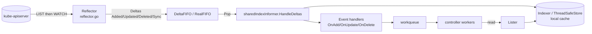

# 12 · Staging Libraries (`staging/src/k8s.io/*`)

Each directory below is a **separate Go module**, published automatically to `github.com/kubernetes/<name>` and importable as `k8s.io/<name>`. Code is edited **only here**. Staging modules must never import `k8s.io/kubernetes`.

## 1. Overview

| Module | Purpose | Main consumers |
|--------|---------|----------------|
| `api` | External versioned API types (`core/v1`, `apps/v1`, …) with protobuf | Everyone |
| `apimachinery` | Scheme, codecs, meta types, selectors, utilities | Everyone. See [03](03-api-and-type-system.md) |
| `client-go` | Go client library: typed/dynamic clients, informers, workqueue, leader election | Every controller |
| `apiserver` | Generic API server library | kube-apiserver, aggregated apiservers. See [04](04-kube-apiserver.md) |
| `apiextensions-api`, `apiextensions-apiserver` | CRD types and server | kube-apiserver |
| `kube-aggregator` | APIService aggregation layer | kube-apiserver |
| `component-base` | Shared plumbing for all components: CLI, logs, metrics, feature gates, tracing, version, z-pages | All binaries |
| `component-helpers` | Shared business logic usable outside k8s.io/kubernetes | kubelet, scheduler, controllers |
| `controller-manager` | Code shared by KCM and CCM | KCM, CCM |
| `cloud-provider` | Cloud provider interface plus cloud controllers | CCM implementations |
| `cli-runtime` | kubectl plumbing (config flags, resource builder, printers) | kubectl, plugins |
| `kubectl` | kubectl implementation | `cmd/kubectl` |
| `kubelet` | Kubelet config API, device plugin / DRA / pod-resources / plugin-registration / credential-provider gRPC APIs | kubelet, plugins |
| `kube-proxy`, `kube-scheduler`, `kube-controller-manager` | Component config types (and the **scheduler framework public API** in `kube-scheduler/framework`) | Components and out-of-tree plugins |
| `cri-api` | Container Runtime Interface protobuf / gRPC (`pkg/apis/runtime/v1/api.proto`) | kubelet, containerd, CRI-O |
| `cri-client` | Go CRI client (`remote_runtime.go`, `remote_image.go`) with logging and metrics | kubelet, crictl-like tools |
| `cri-streaming` | Server-side streaming for exec/attach/port-forward used by CRI runtimes | Runtimes |
| `streaming` | Transport streaming primitives: `httpstream` (SPDY), `wsstream` (WebSocket) | apiserver, client-go, kubelet |
| `csi-translation-lib` | Translates in-tree volume specs (AWS EBS, GCE PD, Azure Disk/File, Cinder, vSphere, Portworx) into CSI | CSI migration in kubelet, KCM, scheduler |
| `dynamic-resource-allocation` | DRA helpers: structured-parameters allocator, CEL device selectors, kubelet plugin helper, ResourceSlice controller | scheduler, kubelet, DRA drivers |
| `endpointslice` | EndpointSlice reconciler library | KCM, other projects |
| `externaljwt` | gRPC protocol for an **external JWT signer** (SA tokens signed outside the apiserver) | kube-apiserver |
| `kms` | KMS v2 plugin gRPC API plus a reference implementation | apiserver encryption at rest |
| `metrics` | `metrics.k8s.io`, `custom.metrics.k8s.io`, `external.metrics.k8s.io` types and clients | HPA, kubectl top |
| `mount-utils` | Cross-platform mount, unmount, format-and-mount, resizefs | kubelet, CSI drivers |
| `pod-security-admission` | Pod Security Standards policy checks plus the admission plugin and webhook | kube-apiserver |
| `cluster-bootstrap` | Bootstrap token helpers and JWS signing | kubeadm, KCM bootstrap controllers |
| `code-generator` | deepcopy, client, lister, informer, conversion, defaulter, validation, protobuf and applyconfig generators | Kubernetes and every CRD project |
| `ktesting` | Context-based testing helpers (`ktesting.Init(t)` → `TContext` with logger, cancel, assertions) | Unit and integration tests |
| `sample-apiserver`, `sample-controller`, `sample-cli-plugin` | Reference examples for extension authors | Learning |

---

## 2. client-go

`staging/src/k8s.io/client-go` (`ARCHITECTURE.md` in that directory is a good companion).

| Package | Purpose |
|---------|---------|
| `rest` | Low-level `RESTClient`, `Config` (host, TLS, auth, QPS/Burst, rate limiter, content type), request builder (`Get().Namespace().Resource().Name().Do(ctx)`), retries, warnings |
| `kubernetes` | **Typed clientset** (`clientset.CoreV1().Pods(ns).Get/List/Watch/Create/Update/Patch/Apply/Delete`) |
| `dynamic` | Unstructured client for any GVR (`dynamic.Interface.Resource(gvr).Namespace(ns).Get`) |
| `metadata` | Clients and informers that fetch only `PartialObjectMetadata` (used by the GC and namespace controllers) |
| `discovery` | API group and resource discovery (aggregated discovery support, cached disk/memory discovery) |
| `restmapper` | GVK ↔ GVR mapping built from discovery (`DeferredDiscoveryRESTMapper`) |
| `scale` | Polymorphic `/scale` client |
| `informers` | `SharedInformerFactory` with typed informers per resource |
| `listers` | Typed indexer-backed listers |
| `applyconfigurations` | Typed builders for server-side apply |
| `tools/cache` | **Reflector, DeltaFIFO, Indexer, SharedIndexInformer** (see below) |
| `tools/clientcmd` | kubeconfig loading and merging (`BuildConfigFromFlags`, `NewNonInteractiveDeferredLoadingClientConfig`) |
| `tools/leaderelection` | Lease-based leader election (`LeaderElector`, `RunOrDie`, coordinated leader election) |
| `tools/record`, `tools/events` | Event recorders (core/v1 Events and events.k8s.io), with correlation and spam filtering |
| `tools/remotecommand`, `tools/portforward` | exec/attach/port-forward over SPDY and WebSockets |
| `tools/watch` | `UntilWithSync`, `RetryWatcher` |
| `tools/pager` | Chunked LIST |
| `util/workqueue` | `TypedRateLimitingInterface`, `DelayingInterface`, rate limiters (exponential per item, bucket) |
| `util/flowcontrol` | Token bucket rate limiter and `Backoff` |
| `util/retry` | `RetryOnConflict` |
| `util/cert`, `util/keyutil`, `util/certificate` | Certificate helpers and the certificate rotation manager |
| `transport` | HTTP round-trippers (auth, user-agent, impersonation, debugging), TLS cache |
| `plugin/pkg/client/auth/exec` | Exec credential plugins (`client.authentication.k8s.io`) |
| `testing`, `kubernetes/fake` | Fake clientsets with object trackers for unit tests |
| `features` | client-go feature gates (for example `WatchListClient`, `InformerResourceVersion`) |

### 2.1 How an informer works



- **Reflector** (`tools/cache/reflector.go`): runs `ListAndWatch` (or streaming **WatchList** with bookmarks). It re-lists on `410 Gone`, uses backoff, and stores the latest `resourceVersion`.
- **DeltaFIFO** (`delta_fifo.go`, `the_real_fifo.go`): a queue of object deltas keyed by `namespace/name`.
- **Indexer** (`index.go`, `thread_safe_store.go`): an in-memory map plus secondary indexes (for example `cache.NamespaceIndex`, custom indexers like "pods by node").
- **SharedIndexInformer** (`shared_informer.go`): one reflector shared by many handlers. Each handler has its own buffered listener, so slow handlers do not block others. `resyncPeriod` re-delivers Sync events.
- **HasSynced** (`synctrack`): true once the initial list has been delivered to the handlers.

### 2.2 Minimal controller with client-go

```go
cfg, _ := clientcmd.BuildConfigFromFlags("", kubeconfig)
cs := kubernetes.NewForConfigOrDie(cfg)
f := informers.NewSharedInformerFactory(cs, 30*time.Second)
podInf := f.Core().V1().Pods()
q := workqueue.NewTypedRateLimitingQueue(workqueue.DefaultTypedControllerRateLimiter[string]())
podInf.Informer().AddEventHandler(cache.ResourceEventHandlerFuncs{
    AddFunc: func(o any) { k, _ := cache.MetaNamespaceKeyFunc(o); q.Add(k) },
})
f.Start(ctx.Done()); f.WaitForCacheSync(ctx.Done())
// workers: key, _ := q.Get(); pod, err := podInf.Lister().Pods(ns).Get(name) ...
```

A full example is in `staging/src/k8s.io/sample-controller`.

---

## 3. component-base

| Package | Purpose |
|---------|---------|
| `cli` | `cli.Run(cmd)`: common cobra execution, logging flush and exit codes |
| `cli/flag` | Flag types (`MapStringBool`, `ColonSeparatedMultimapStringString`, named flag sets) |
| `featuregate` | `FeatureGate` / `MutableVersionedFeatureGate`: gate specs per version (`Alpha`/`Beta`/`GA`/`Deprecated`, `LockToDefault`). Used by `pkg/features` |
| `compatibility` | **Compatibility versions / emulated version** (`--emulated-version`): lets a newer binary behave like an older one for safe upgrades and rollbacks |
| `logs` | klog configuration, JSON logging format, contextual logging, `logs.Options` |
| `metrics` | Wrappers over Prometheus with **stability levels** (`ALPHA`, `BETA`, `STABLE`), `legacyregistry`, and a static analysis tool (`metrics/testutil`, stable-metrics tooling in `hack/tools/instrumentation`) |
| `tracing` | OpenTelemetry tracing configuration |
| `configz` | `/configz` endpoint exposing component config |
| `zpages` | `/statusz`, `/flagz` debug pages |
| `version` | Build version info (`version.Get()`), set by `-ldflags` (`hack/lib/version.sh`) |
| `config` | Shared component-config types: `ClientConnectionConfiguration`, `LeaderElectionConfiguration`, `DebuggingConfiguration` |
| `codec`, `term` | Helpers |

## 4. component-helpers

Logic shared between components without depending on `k8s.io/kubernetes`:

| Package | Contents |
|---------|----------|
| `scheduling/corev1` | `PodPriority`, node affinity matching (`nodeaffinity.NodeSelector`), taint and toleration helpers |
| `resource` | Pod resource requests and limits computation (including pod-level resources, overhead, sidecars) |
| `node/topology`, `node/util` | Node topology labels, heartbeat helpers |
| `nodedeclaredfeatures` | Framework for nodes declaring features and pods requiring them |
| `storage/volume`, `storage/ephemeral` | PV/PVC helpers, generic ephemeral volume naming |
| `apps/poddisruptionbudget` | PDB condition helpers |
| `auth/rbac` | RBAC rule matching and validation |
| `apimachinery/lease` | Lease controller used by node and apiserver heartbeats |

## 5. cloud-provider

- `cloud.go`: the `cloudprovider.Interface` with optional sub-interfaces `LoadBalancer()`, `Instances()` / `InstancesV2()`, `Zones()`, `Clusters()`, `Routes()`.
- `plugins.go`: `RegisterCloudProvider(name, factory)`.
- `controllers/node`: initialises new Nodes (removes the `node.cloudprovider.kubernetes.io/uninitialized` taint, sets addresses, providerID, zone labels).
- `controllers/nodelifecycle`: deletes Nodes whose instances are gone and sets the shutdown taint.
- `controllers/route`: programs cloud routes for pod CIDRs.
- `controllers/service`: provisions cloud load balancers for `type: LoadBalancer` Services and updates `status.loadBalancer`.
- `app`: `NewCloudControllerManagerCommand`. Used by `cmd/cloud-controller-manager` and by every out-of-tree provider (AWS, GCP, Azure, OpenStack, …). There are **no in-tree cloud providers** any more.

## 6. kubelet APIs (`staging/src/k8s.io/kubelet`)

| Package | API |
|---------|-----|
| `config/v1beta1` (also `v1`, `v1alpha1`) | `KubeletConfiguration`, `CredentialProviderConfig`, `SerializedNodeConfigSource` |
| `pkg/apis/deviceplugin/v1beta1` | Device plugin gRPC (`Registration`, `DevicePlugin` service) |
| `pkg/apis/dra/*`, `dra-health` | DRA kubelet plugin gRPC (`NodePrepareResources`, `NodeUnprepareResources`) and device health streaming |
| `pkg/apis/pluginregistration` | Plugin watcher registration protocol |
| `pkg/apis/podresources` | Pod resources gRPC (which devices and CPUs are assigned to which containers), used by monitoring agents |
| `pkg/apis/credentialprovider` | Exec-based image credential provider protocol |
| `pkg/apis/stats/v1alpha1` | `/stats/summary` types |

## 7. dynamic-resource-allocation (DRA)

| Package | Purpose |
|---------|---------|
| `structured` | The **allocator**: given claims, `DeviceClass`es and `ResourceSlice`s, finds a device assignment that satisfies CEL selectors, constraints (`matchAttribute`), admin access, partitionable devices, consumable capacity and device taints |
| `cel` | CEL environment for `device.attributes[...]` / `device.capacity[...]` |
| `kubeletplugin` | Helper for writing DRA drivers (`Start` with gRPC servers, plugin registration, ResourceSlice publishing) |
| `resourceslice` | Controller that publishes driver ResourceSlices |
| `resourceclaim`, `deviceclass`, `deviceattribute`, `devicemetadata` | Helpers |

## 8. apiextensions-apiserver (CRDs)

- `pkg/apis/apiextensions`: `CustomResourceDefinition` types.
- `pkg/apiserver`: `customresource_handler.go` serves CRs dynamically per version (`crdHandler`). Covers structural schema pruning, defaulting, OpenAPI v3 validation, **CEL `x-kubernetes-validations`** and ratcheting, plus `status` and `scale` subresources.
- `pkg/apiserver/conversion`: `None` or `Webhook` conversion between CR versions.
- `pkg/controller`: `establish` (Established condition), `finalizer` (deletes all CRs on CRD deletion), `nonstructuralschema`, `openapi`/`openapiv3` (publishes CRD schemas), `apiapproval` (protected `*.k8s.io` groups), `status` (naming conflicts).

## 9. kube-aggregator

- `APIService` (`apiregistration.k8s.io/v1`) maps a `group/version` to either `Local` (served in-process) or a `Service` (proxied).
- `pkg/apiserver/handler_proxy.go`: proxies requests with front-proxy client certificates and `X-Remote-User` / `X-Remote-Group` headers.
- `pkg/controllers/status`: health checks for remote APIServices (`Available` condition).
- `pkg/apiserver/handler_discovery.go`: merges aggregated discovery documents from all APIServices.
- `pkg/controllers/openapi*`: aggregates OpenAPI v2 / v3 specs.

## 10. pod-security-admission

- `policy/`: one check per control, for example `check_privileged.go`, `check_hostNamespaces.go`, `check_capabilities_restricted.go`, `check_runAsNonRoot.go`, `check_seccompProfile_restricted.go`, each versioned per Kubernetes minor release.
- `admission/`: evaluates namespace labels `pod-security.kubernetes.io/<mode>=<level>` and `<mode>-version`, and applies exemptions (usernames, namespaces, runtime classes).
- `cmd/webhook`: runs the same checks as a standalone validating webhook.
