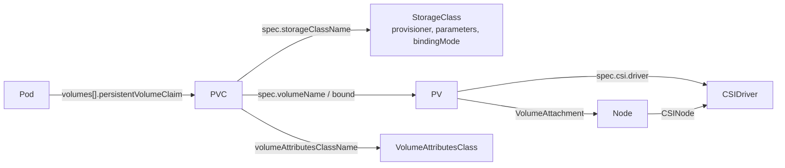
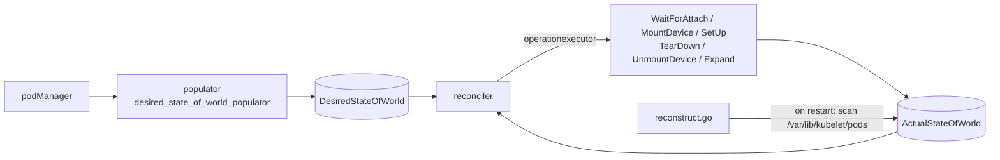

# 13 · Storage & Volumes

Storage logic is split between the **control plane** (PV/PVC binding, provisioning, attach/detach, expansion, protection) and the **kubelet** (mount/unmount, ephemeral volumes, node expansion). Both sides share the **volume plugin framework** in `pkg/volume`.

## 1. Object model

| Object | Group | Who manages it |
|--------|-------|----------------|
| `PersistentVolumeClaim`, `PersistentVolume` | core/v1 | User / PV binder controller / provisioner |
| `StorageClass`, `VolumeAttachment`, `CSIDriver`, `CSINode`, `CSIStorageCapacity`, `VolumeAttributesClass` | storage.k8s.io | Admin / attach-detach controller / CSI sidecars / kubelet |

## 2. Volume plugin framework (`pkg/volume`)

[`pkg/volume/plugins.go`](../kubernetes/pkg/volume/plugins.go) defines the plugin interfaces and `VolumePluginMgr`:

| Interface | Methods (key) | Implemented by |
|-----------|---------------|----------------|
| `VolumePlugin` | `Init`, `GetPluginName`, `GetVolumeName`, `CanSupport`, `NewMounter`, `NewUnmounter`, `ConstructVolumeSpec` | All |
| `PersistentVolumePlugin` | `GetAccessModes` | PV-capable plugins |
| `AttachableVolumePlugin` | `NewAttacher`, `NewDetacher` (`Attach`, `WaitForAttach`, `Detach`) | CSI, FC, iSCSI |
| `DeviceMountableVolumePlugin` | `NewDeviceMounter` (`MountDevice` to the global path) | CSI (staging) |
| `ExpandableVolumePlugin` / `NodeExpandableVolumePlugin` | `ExpandVolumeDevice`, `NodeExpand` | CSI |
| `BlockVolumePlugin` | `NewBlockVolumeMapper` | Raw block volumes |
| `ProvisionableVolumePlugin`, `DeletableVolumePlugin`, `RecyclableVolumePlugin` | Provision, delete, recycle | Legacy in-tree (hostPath for tests) |

`volume.go` defines `Mounter.SetUp(MounterArgs)` (with `fsGroup` ownership change and SELinux mount options), `Unmounter.TearDown`, and `MetricsProvider` (statfs / du / cached metrics).

### 2.1 In-tree plugins still present

| Plugin | Package | Type |
|--------|---------|------|
| `configmap`, `secret`, `downwardapi`, `projected` | `pkg/volume/{configmap,secret,downwardapi,projected}` | Ephemeral, written with `util/atomic_writer.go` (atomic symlink swap). `projected` also includes SA tokens, ClusterTrustBundles and pod certificates |
| `emptydir` | `pkg/volume/emptydir` | Node disk or `medium: Memory` (tmpfs), with `sizeLimit` |
| `hostpath` | `pkg/volume/hostpath` | Host directories (types `Directory`, `File`, `Socket`, …) |
| `local` | `pkg/volume/local` | Local PVs with node affinity |
| `nfs`, `iscsi`, `fc` | `pkg/volume/{nfs,iscsi,fc}` | Network and block storage |
| `image` | `pkg/volume/image` | **Image volumes**: mount an OCI image or artifact read-only |
| `git_repo` | `pkg/volume/git_repo` | Deprecated |
| `flexvolume` | `pkg/volume/flexvolume` | Deprecated exec-based driver interface |
| **`csi`** | `pkg/volume/csi` | The bridge to every CSI driver (see below) |
| `csimigration` | `pkg/volume/csimigration` | Redirects in-tree cloud plugins (EBS, PD, AzureDisk, …) to CSI via `csi-translation-lib` |

### 2.2 The CSI plugin (`pkg/volume/csi`)

| File | Responsibility |
|------|----------------|
| `csi_plugin.go` | Registers drivers discovered via the plugin watcher (`RegistrationHandler`) and updates `CSINode` (`nodeinfomanager`) |
| `csi_attacher.go` | Creates and waits for `VolumeAttachment` objects (the external-attacher sidecar performs `ControllerPublishVolume`). `MountDevice` → `NodeStageVolume` |
| `csi_mounter.go` | `SetUp` → `NodePublishVolume` (target path under the pod dir). `TearDown` → `NodeUnpublishVolume` |
| `csi_block.go` | Raw block mapping |
| `csi_client.go` | gRPC client to the node plugin socket |
| `expander.go` | `NodeExpandVolume` |
| `csi_drivers_store.go` | Registered drivers and their endpoints |
| `health_client.go`, `csi_metrics.go` | Volume health and `NodeGetVolumeStats` |

### 2.3 Shared utilities (`pkg/volume/util`)

- **`operationexecutor`**: generates the attach / detach / mount / unmount / expand / map operations used by both the attach-detach controller and the kubelet.
- `nestedpendingoperations`: prevents concurrent operations on the same volume, with exponential backoff.
- `subpath`: safe `subPath` mounting (symlink-race-free bind mounts).
- `hostutil`, `volumepathhandler`, `fsquota`, `selinux.go`, `resize_util.go`, `atomic_writer.go`, `recyclerclient`.

## 3. Control plane controllers

| Controller | Package | Key logic |
|------------|---------|-----------|
| PV binder | `pkg/controller/volume/persistentvolume/pv_controller.go` | `syncClaim`: find the best matching PV (`index.go` → `findBestMatchForClaim` by size, access modes, class, selector and node affinity) or provision. `syncVolume`: handle Released PVs per `reclaimPolicy`. With `volumeBindingMode: WaitForFirstConsumer`, binding is delegated to the scheduler's `VolumeBinding` plugin (`volume.kubernetes.io/selected-node` annotation) |
| Attach/detach | `pkg/controller/volume/attachdetach` | `cache/desired_state_of_world` (from pods scheduled to nodes), `cache/actual_state_of_world` (from `node.status.volumesAttached`), `reconciler` (attach the missing ones; detach the extras after unmount or `maxWaitForUnmountDuration`), `statusupdater` |
| Expand | `pkg/controller/volume/expand` | `ControllerExpandVolume` for in-tree plugins (CSI uses the external-resizer sidecar). Sets `FileSystemResizePending` |
| PVC / PV protection | `pkg/controller/volume/{pvcprotection,pvprotection}` | Finalizer-based "in use" protection |
| VAC protection | `pkg/controller/volume/vacprotection` | Same for VolumeAttributesClass |
| Ephemeral | `pkg/controller/volume/ephemeral` | Creates `<pod>-<volume>` PVCs for `ephemeral.volumeClaimTemplate` |
| SELinux warning | `pkg/controller/volume/selinuxwarning` | Detects conflicting SELinux contexts across pods sharing a volume |

## 4. Kubelet volume manager (`pkg/kubelet/volumemanager`)

| Component | File | Responsibility |
|-----------|------|----------------|
| `VolumeManager` | `volume_manager.go` | `Run`, `WaitForAttachAndMount(pod)`, `WaitForUnmount(pod)`, `GetMountedVolumesForPod`, `GetVolumesInUse` (reported in node status) |
| Populator | `populator/desired_state_of_world_populator.go` | Adds and removes pod volumes in the desired state, resolves PVC → PV, and handles resize requests |
| Reconciler | `reconciler/reconciler.go` | Every 100ms: unmount volumes no longer desired → mount or attach desired ones → unmount devices → detach (only when the kubelet manages attach) |
| Reconstruction | `reconciler/reconstruct.go` | After a kubelet restart, rebuilds the actual state from disk so volumes are not leaked |
| Caches | `cache/actual_state_of_world.go`, `desired_state_of_world.go` | Thread-safe state |
| Volume health | `volumehealth` | Abnormal volume condition events |

**SELinux mount optimisation:** when supported, volumes are mounted with `-o context=<label>` instead of relabelling every file (`SELinuxMountReadWriteOncePod` / `SELinuxMount`).

**fsGroup:** after `SetUp`, ownership is changed recursively according to `fsGroupChangePolicy` (`OnRootMismatch` / `Always`), unless the CSI driver handles it itself (`CSIDriver.spec.fsGroupPolicy`).
