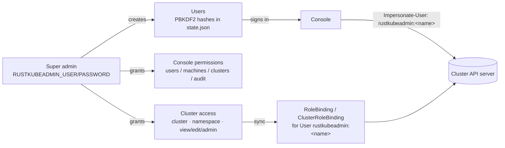

# rustkubeadmin — the web console

`admin/` holds `rustkubeadmin`: a Rust server (axum) and a Next.js UI, exported statically and embedded into the
binary at build time. The UI reuses pgrustadmin's design system: the colour tokens in `globals.css`, the
`Button`/`Card`/`Field`/`Modal`/`Tabs` kit, the app shell with section tabs and a resource list, the split-screen
sign-in, light and dark themes, and live updates over Server-Sent Events.

## 1. Who can do what

- **The super admin** exists only in the environment, is never stored, and can do everything. Inside clusters it
  uses the cluster's admin credentials.
- **Console permissions** (checked by the console):

  | Permission | Allows |
  |------------|--------|
  | `users.manage` | create, edit and delete users and their grants (only permissions you hold yourself) |
  | `machines.manage` | add machines, run the installer, remove machines, rebuild the bundle |
  | `clusters.manage` | create, import, start, stop, retry and delete clusters; see control-plane services and logs |
  | `audit.view` | see everyone's jobs and audit entries (otherwise only your own) |

- **Cluster access** (checked by Kubernetes). A grant `{cluster, namespace, role}` becomes:
  - a ClusterRoleBinding `rustkubeadmin:<user>:<role>` to `cluster-admin`, `edit` or `view` (whole cluster), or
  - a RoleBinding in the namespace to `admin`, `edit` or `view`.

  Bindings carry `rustkubeadmin.io/managed=true` and are reconciled whenever users change or a cluster starts. A user
  who creates a cluster gets `admin` on it.
- **Enforcement**: every action inside a cluster (`/api/kube/<cluster>/…`, Apply YAML, logs) is sent with
  `Impersonate-User: rustkubeadmin:<user>` and `Impersonate-Group: rustkubeadmin:users`. Kubernetes RBAC allows or
  forbids it, with the standard messages. Live views are filtered to the user's namespaces, and node lists are hidden
  from namespace-only users. A downloaded kubeconfig contains a client certificate for the same identity, so the same
  rules apply outside the console.

Sessions: an HttpOnly, SameSite=Strict cookie, 12 hours, in memory. Writes must be JSON, and any `Origin` header must
match the host (CSRF). Failed sign-ins are delayed and audited. Every change is appended to `audit.log`.

## 2. Machines and the offline installer

| Step | What happens |
|------|--------------|
| Add machine | name, IP, transport (`local` or `ssh`), SSH user/port, auth (rustkubeadmin's ed25519 key, a stored private key, or a password via `sshpass`), install directory (default `$HOME/.local/rustkube`, no root needed) |
| Bundle | `rustkube-bundle.tar.gz` (≈ 95 MiB): 7 release binaries plus the static `rustkube-portforward` helper, `rustkube-node`, `install.sh` and `docker save` of `pause:3.10`, `coredns:v1.12.1`, `kube-proxy-base`, `etcd:3.5.21-0`, `flannel:v0.27.4`, `metrics-server:v0.8.0`, `local-path-provisioner:v0.0.32` and `busybox:latest`. One build at a time; concurrent installs wait for it. Rebuilt when a binary or image changes (fingerprint of sizes, mtimes and image IDs) |
| Copy | `cp` or `scp` to `/tmp/rustkube-bundle-<job>.tar.gz` |
| Install | `install.sh PREFIX`: checks Linux, architecture and Docker access; installs `bin/*`; `docker load`s the images; picks a supervisor (`systemd` as root, `systemd-user`, otherwise `nohup`); prints `FACT key=value` lines (OS, kernel, CPUs, memory, Docker version, supervisor, prefix, br_netfilter) |

Scripts are sent on stdin (`sh -s`), so there is no shell quoting. SSH host keys are pinned on first contact
(`StrictHostKeyChecking=accept-new`, in the console's own `known_hosts`). Secrets are stored mode 0600 in the data
directory.

## 3. Creating a cluster

1. **PKI**: on the console host, `kubeadm init` with the master's IP and the cluster's ports. Each worker gets
   `kubeadm node-credentials` (kubelet serving certificate and `kubelet.conf`). `ca.key` never leaves the console.
2. **Payload per machine** (`<data>/clusters/<name>/payload/<node>`):
   - certificates and kubeconfigs;
   - one script per service (`etcd`, `kube-apiserver`, `kube-controller-manager`, `kube-scheduler` on the master; `kubelet`
     and `kube-proxy` on every node);
   - `services/order` and `NODE`.
3. **Deploy**: tar, copy, unpack into `<prefix>/clusters/<name>`, then `rustkube-node start <name>`. The master goes
   first; the console waits for `/readyz`, deploys the workers, waits until every node is Ready, and applies the
   flannel pod network add-on, the CoreDNS add-on and the metrics-server add-on (`kubectl top`; Add-ons checkbox,
   default on, needs kube-proxy) and the local-path-provisioner add-on (default StorageClass `local-path`, as kind;
   checkbox, default on). The API server gets kubeadm's front-proxy flags for the aggregation layer and `--enable-bootstrap-token-auth`; the
   controller manager signs CSRs with the cluster CA (`--cluster-signing-*`), kubelets run with `--rotate-certificates`
   and the console runs `kubeadm init phase bootstrap-token`, so kubelet client certificates renew themselves. The API server runs with `--authorization-mode Node,RBAC` and
   `--enable-admission-plugins NodeRestriction`, like kubeadm, so each machine's kubelet credential only reaches that
   node's own objects ([phase-6e-node-authorization.md](phase-6e-node-authorization.md)).
   - **Pod network** (Add-ons card): *kubenet + flannel* (default). kube-controller-manager gets
     `--allocate-node-cidrs --cluster-cidr <pod CIDR>`, kubelets get `--network-plugin kubenet` (+ MTU 1450 for vxlan),
     kube-proxy gets the pod CIDR and `--hairpin-bridge cbr0`. Choose the flannel backend: *vxlan* (any network) or
     *host-gw* (machines on one LAN). *Docker bridge* keeps pods on each machine's `docker0` (single-machine
     clusters). See [phase-6d-pod-network.md](phase-6d-pod-network.md).
4. **`rustkube-node`** (on the machine): `start`, `stop`, `restart`, `status`, `logs`, `remove`. With systemd it writes
   `rustkube-<cluster>-<service>.service` units with `Restart=always`. Without systemd it runs a `setsid` restart loop
   with a pid file. `stop` also stops the node's pod containers; `remove` deletes them and the cluster directory.

Ports are per cluster (Advanced → ports), so a cluster can avoid ports that are already in use. A machine belongs to at
most one cluster.

## 4. Live data

For every running cluster, informers on pods, nodes, deployments, services, namespaces and events mark a snapshot
dirty. A publisher sends it on the `cluster:<name>` topic at most once a second. The `clusters` topic carries a
summary of each cluster: health, ready nodes and pod counts by state. `machines`, `jobs` and `users` are topics too.
The browser subscribes with one `EventSource`, and the server filters each topic for the user.

## 5. API (selection)

| Endpoint | Purpose |
|----------|---------|
| `POST /api/login`, `/api/logout`, `GET /api/session`, `/api/meta` | sign-in, who am I, settings (SSH public key, bundle info, permission list) |
| `GET /api/events?topics=clusters,machines,jobs,users,cluster:<name>` | Server-Sent Events |
| `GET/POST /api/users`, `POST /api/users/update`, `/api/users/delete` | users, permissions, grants |
| `GET/POST /api/machines`, `POST /api/machines/install`, `/test`, `/delete`, `/api/bundle/build` | machines and the installer |
| `GET/POST /api/clusters`, `POST /api/clusters/import`, `/action` (`start`/`stop`/`retry`/`delete`) | clusters |
| `GET /api/clusters/services`, `/service-log`, `/kubeconfig`; `POST /api/clusters/apply` | control plane, kubeconfigs, server-side apply |
| `ANY /api/kube/<cluster>/<kubernetes path>` | Kubernetes API passthrough as the signed-in user |
| `GET /api/audit`, `/api/jobs` | activity |

## 6. Verified

On this workstation, the following was checked:
- Signing in as the env super admin.
- Adding this host (systemd-user) and an SSH machine: an Ubuntu container with sshd, using rustkubeadmin's key and the
  nohup supervisor. Both were installed from the offline bundle.
- Creating a single-node cluster, then a master + SSH-worker cluster; pods spread across both nodes, and logs come back
  from the SSH node.
- Stop and start (services and pod containers) and delete (units, pod containers and data removed).
- A user with `edit` on one namespace:
  - can deploy there through Apply;
  - is refused with Kubernetes' own 403 elsewhere;
  - is refused machine management by the console;
  - sees only that namespace in the live view.

## 7. Limitations

- **Networking**: kubenet + flannel need Docker ≥ 28 on the machines. Clusters created before Phase 6d keep the
  Docker bridge (no cross-machine pod traffic) until they are re-created. Deleting a cluster leaves flannel's
  iptables chains, like `kubeadm reset`.
- **Concurrency**: one console instance (state in a JSON file). Sessions are lost on restart.
- **HTTPS**: the console serves plain HTTP; put it behind a TLS proxy (or keep it on loopback) before exposing it.
- **Prerequisites and systemd**: machines need Docker and a user in the `docker` group. With `systemctl --user`, enable
  lingering (`loginctl enable-linger`) so services survive a logout.
- **Removal**: `uninstall` removes the binaries but leaves loaded images.
