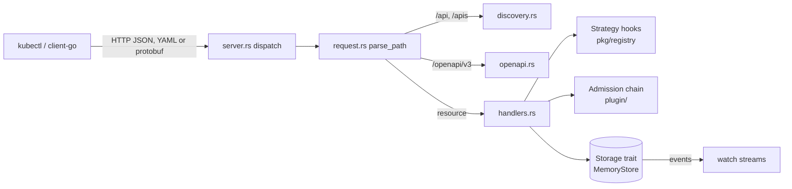

# Phase 1 — Core modules and kube-apiserver

This document describes what Phase 1 implements, how a request flows through the code, and the deliberate
differences from upstream Kubernetes.

## 1. Request flow

| Step | Code |
|------|------|
| Routing, health (`/healthz`, `/livez`, `/readyz`), `/version`, request logging | `staging/src/k8s.io/apiserver/src/server.rs` |
| URL → `{group, version, resource, namespace, name, subresource}` | `apiserver/src/request.rs` |
| Body decoding (JSON, YAML, **Kubernetes protobuf**) | `handlers.rs::decode_body`, `api/src/protobuf.rs` |
| CRUD, patch, watch, scale/status/custom subresources | `apiserver/src/handlers.rs` |
| Per-resource defaults, validation, side effects, table columns | `pkg/registry/src/**`, `pkg/apis/src/**` |
| Admission (NamespaceLifecycle) | `plugin/src/admission/namespace/lifecycle.rs` |
| Persistence + watch fan-out | `apiserver/src/storage/memory.rs` |

## 2. Create pipeline (`handlers::create_object`)

1. Decode body; check `kind`/`apiVersion` match the URL's resource (`check_type`).
2. Namespace from URL (400 if the body disagrees); `generateName` → random 5-char suffix.
3. System metadata: `uid`, `creationTimestamp`, `generation=1`; strip `resourceVersion`, `deletionTimestamp`, `managedFields`.
4. Drop `.status` for resources with a status subresource; `Strategy::prepare_for_create` (defaults).
5. Mutating admission → `ObjectMeta` + strategy validation (422 `Invalid` with causes) → validating admission.
6. `?dryRun=All` stops here.
7. `Strategy::before_create` (e.g. ClusterIP / NodePort allocation) → `Storage::create` (409 `AlreadyExists`,
   with `rollback_create` releasing allocations).

Update (`PUT`), patch (`PATCH`) and status/scale writes all go through `update_object`: copy immutable metadata from
the stored object, keep `.status` (main endpoint) or keep everything **but** `.status` (status endpoint), bump
`generation` when the spec changes, validate, skip no-op writes, enforce `resourceVersion` preconditions (409 `Conflict`),
and delete the object when its last finalizer is removed while it is marked for deletion.

Patch types: JSON Patch (RFC 6902), JSON Merge Patch (RFC 7386), Strategic Merge Patch (merge keys for well-known
lists: containers, env, ports, volumes, volumeMounts, conditions, ...) and server-side apply (`application/apply-patch+yaml`,
create-or-merge). Conflicting writes are retried up to 5 times for patches without an explicit `resourceVersion`.

Delete: preconditions (uid / resourceVersion) → **graceful deletion** for pods bound to a node (`deletionTimestamp` +
`deletionGracePeriodSeconds`; the kubelet finishes it with `gracePeriodSeconds=0`) → **finalizers** (mark only) →
`Strategy::before_delete` → storage delete → `Strategy::after_delete` (release IPs/ports).

## 3. Storage and watch (`storage/memory.rs`)

- One global revision counter = every object's `metadata.resourceVersion` (like etcd `ModRevision`).
- Keys use the etcd layout: `/registry/<group-resource>/<namespace>/<name>`.
- Each write appends a `StoredEvent {type, key, object, prev, revision}` to a bounded history (10 000 events) and
  broadcasts it. `watch(prefix, from)` replays history after `from` then streams live events; a `from` older than
  the history returns `410 Gone` (clients relist, exactly as after an etcd compaction).
- Watch semantics in the handler: `resourceVersion=""|"0"` sends synthetic `ADDED` events for the current state
  first; `sendInitialEvents=true` adds the `k8s.io/initial-events-end` bookmark; `allowWatchBookmarks` sends periodic
  bookmarks; label/field selectors turn objects moving in/out of the selector into `ADDED`/`DELETED`.
- `--data-dir` persists a JSON snapshot (debounced 1 s, atomic rename). On restart, strategies' `restore` hooks
  rebuild in-memory allocators from stored Services.

The `Storage` trait is async so an etcd backend can be added in Phase 6 without touching handlers.

## 4. Compatibility work for the official kubectl

| kubectl behaviour | What the server does |
|-------------------|----------------------|
| `kubectl get` asks for `as=Table` | `table.rs` + per-resource `table_columns`/`table_cells` (pods: READY/STATUS/RESTARTS/AGE/IP/NODE…) |
| Typed clients (`kubectl create deploy/cm/secret`, `describe`) send **protobuf** bodies | Upstream `generated.proto` files are compiled at build time with `protox` (no `protoc`) and decoded dynamically with `prost-reflect`; special types (Time, MicroTime, Quantity, IntOrString, RawExtension) are converted to their JSON forms, and Go's always-encoded empty strings / zero times are dropped so defaulting applies |
| `kubectl apply/create` validation needs OpenAPI | `/openapi/v3` lists group-versions; each document advertises PATCH operations with `x-kubernetes-group-version-kind` and the `fieldValidation` parameter, so kubectl uses server-side validation |
| Discovery | `/api`, `/apis`, `/apis/<g>`, `/api/v1`, `/apis/<g>/<v>` with short names, categories (`all`) and subresources |
| Version skew warnings | `/version` reports `v1.35.0+rustkubernetes-<ver>` |

## 5. Resources served

| Group/Version | Resources |
|---------------|-----------|
| `v1` | namespaces (+status, finalize), pods (+status, binding), nodes (+status), services (+status), endpoints, configmaps, secrets, serviceaccounts, events |
| `apps/v1` | deployments (+status, scale), replicasets (+status, scale), daemonsets (+status), statefulsets (+status, scale), controllerrevisions |
| `batch/v1` | jobs (+status), cronjobs (+status) |
| `coordination.k8s.io/v1` | leases |
| `discovery.k8s.io/v1` | endpointslices |

Bootstrap (`pkg/controlplane::bootstrap`): namespaces `default`, `kube-system`, `kube-public`, `kube-node-lease`;
Service `default/kubernetes` (first IP of the service CIDR) and its Endpoints.

## 6. Known differences from upstream (by design for Phase 1)

| Area | Phase 1 | Planned |
|------|---------|---------|
| Transport / auth | Plain HTTP, every request is admin | TLS, authn, RBAC (Phase 6) |
| Storage | In-memory + JSON snapshot | etcd backend (Phase 6) |
| Namespace deletion | ~~Contents deleted synchronously by the API server~~ | ✅ Finalizer + namespace controller (Phase 2) |
| `propagationPolicy` | ~~Treated as `Background`~~ | ✅ Foreground/Orphan finalizers + garbage collector (Phase 2) |
| Server-side apply | Strategic merge + create-if-missing; no field ownership / conflicts | managedFields tracking |
| Responses | Always JSON (clients accept it even when they prefer protobuf) | Protobuf encoding |
| Continue tokens | Resume after the last key at the *current* revision (no MVCC snapshot) | etcd backend |
| Protobuf `*string` = `""` | Indistinguishable from unset on the wire, dropped | — |
| OpenAPI | Operations only, no schemas (`kubectl explain` unsupported) | Schemas from proto descriptors |
