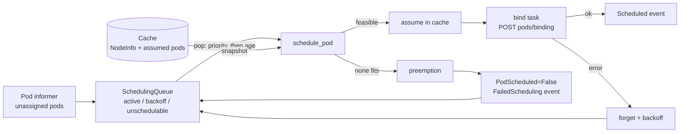

# Phase 3 — kube-scheduler (+ hollow nodes)

Phase 3 adds `kube-scheduler` (crate `kube-scheduler-core` in `pkg/scheduler`), the `PriorityClass` API with
`Priority` admission, and **kubemark hollow nodes** (`pkg/kubemark`, `cmd/kubemark`) so the whole control plane can
be exercised end-to-end before the real kubelet (Phase 4).

## 1. Scheduling cycle



| Piece | Code | Go equivalent |
|-------|------|---------------|
| Main loop, informer handlers, bind, failure handling | `pkg/scheduler/src/lib.rs` | `scheduler.go`, `schedule_one.go`, `eventhandlers.go` |
| Filter → score → select host, preemption | `pkg/scheduler/src/algorithm.rs` | `schedule_one.go`, `framework/preemption` |
| Queue | `pkg/scheduler/src/backend/queue.rs` | `backend/queue` |
| Cache (assume/confirm/forget) | `pkg/scheduler/src/backend/cache.rs` | `backend/cache` |
| Framework (`Plugin`, `Status`, `CycleState`, `NodeInfo`) | `pkg/scheduler/src/framework/` | `framework` |
| Profiles / `KubeSchedulerConfiguration` | `pkg/scheduler/src/apis/mod.rs` | `apis/config` |

**Queue** — `activeQ` is ordered by `spec.priority` then age. A pod that fits nowhere waits in `unschedulable`
until a cluster event (node added/updated, assigned pod deleted/terminated) or 60 s; binding errors go to
`backoffQ` (1 s · 2ⁿ, max 10 s). Status-only updates of a pending pod do not requeue it. Pods with
`spec.schedulingGates` wait outside the active queue until the gates are removed.

**Cache** — the chosen node is written into the cache *before* binding completes ("assume"), so the next pod
already sees the used resources; the informer confirms it, a failed bind forgets it, and assumed pods that never
show up expire after 30 s.

## 2. Plugins (default profile)

| Plugin | Filter | Score (weight) |
|--------|--------|----------------|
| `SchedulingGates` | PreEnqueue: hold gated pods | — |
| `NodeUnschedulable` | `spec.unschedulable` nodes need the unschedulable toleration | — |
| `NodeName` | honours pre-set `spec.nodeName` | — |
| `TaintToleration` | `NoSchedule`/`NoExecute` taints must be tolerated | fewer `PreferNoSchedule` (3) |
| `NodeAffinity` | `nodeSelector` + required node affinity (`matchExpressions`, `matchFields metadata.name`) | preferred terms (2) |
| `NodePorts` | free `hostPort`s | — |
| `NodeResourcesFit` | cpu, memory, ephemeral-storage, extended resources, pod count | `LeastAllocated` / `MostAllocated` (1) |
| `PodTopologySpread` | `DoNotSchedule` constraints (`maxSkew`, `minDomains`) | `ScheduleAnyway` + system default spreading by hostname/zone (2) |
| `InterPodAffinity` | required affinity / anti-affinity (incl. existing pods' anti-affinity) | preferred terms (2) |
| `NodeResourcesBalancedAllocation` | — | balanced cpu/memory (1) |
| `ImageLocality` | — | images already on the node (1) |
| `DefaultPreemption` | PostFilter: evict lower-priority pods | — |
| `DefaultBinder` | `POST pods/<name>/binding` | — |

Failure messages follow upstream, e.g.
`0/3 nodes are available: 1 Insufficient cpu, 2 node(s) had untolerated taint {dedicated: db}.`

**Preemption** — for each node rejected with a resolvable reason, remove all lower-priority pods, check the
preemptor fits, then reprieve victims (highest priority first) while it still fits. The node with the lowest
highest-victim priority, then lowest priority sum, then fewest victims wins; victims are deleted (event
`Preempted`) and the preemptor gets `status.nominatedNodeName`. While victims terminate, the nominated node's
resources are **reserved** for the preemptor (pods of lower or equal priority see it as occupied) and the
preemptor does not preempt again (`PodEligibleToPreemptOthers`). `preemptionPolicy: Never` disables it.

## 3. Configuration

```bash
kube-scheduler --kubeconfig ... --config sched.yaml
```

```yaml
apiVersion: kubescheduler.config.k8s.io/v1
kind: KubeSchedulerConfiguration
profiles:
- schedulerName: default-scheduler
- schedulerName: bin-packer            # pods opt in with spec.schedulerName: bin-packer
  plugins:
    score:
      disabled: [{name: NodeResourcesBalancedAllocation}]
      enabled: [{name: NodeResourcesFit, weight: 5}]
  pluginConfig:
  - name: NodeResourcesFit
    args: {scoringStrategy: {type: MostAllocated}}
```

Pods whose `schedulerName` has no profile are ignored (left for another scheduler).

## 4. PriorityClass & Priority admission

* `scheduling.k8s.io/v1 PriorityClass` (`kubectl get pc`), bootstrap classes `system-node-critical` (2000001000)
  and `system-cluster-critical` (2000000000).
* `Priority` admission resolves `priorityClassName` → `spec.priority` + `preemptionPolicy`, applies the
  `globalDefault` class, rejects unknown classes, allows only one default and reserves values above 10⁹ for
  `system-` classes. `value` and `preemptionPolicy` are immutable.

## 5. Hollow nodes (kubemark)

```bash
kubemark --kubeconfig ... --nodes 3 --cpu 4 --memory 8Gi --zones 2 --node-labels disk=ssd --job-duration-secs 5
```

Each hollow node registers `<prefix>-<i>` with capacity/allocatable, `kubernetes.io/hostname`,
`topology.kubernetes.io/zone`, a `podCIDR` (`10.244.<i+1>.0/24`) and `Ready=True`; renews its Lease every 10 s;
marks bound pods `Running`/`Ready` with an IP; finishes `restartPolicy: Never/OnFailure` pods as `Succeeded`
after `--job-duration-secs`; and confirms graceful deletions. Stopping kubemark makes the nodes go `Unknown`
after the node-monitor grace period, exactly like dead kubelets.

`hack/local-up-cluster.sh` starts 3 hollow nodes by default (`HOLLOW_NODES`, `HOLLOW_CPU`, `HOLLOW_MEMORY`,
`HOLLOW_ZONES`; `HOLLOW_NODES=0` disables them — Phase 4 replaces them with the real kubelet).

## 6. Tests

* `pkg/scheduler` unit tests: filters + failure message, anti-affinity, preemption victim selection, queue
  ordering/gating, profile config, normalisation, resource accounting.
* `test/integration/tests/scheduler_test.rs` (real apiserver + scheduler + hollow nodes + controllers):
  spread & readiness of a 6-replica Deployment, insufficient resources then scale-up, node selector / taints /
  cordon, pod (anti-)affinity, preemption with PriorityClasses, scheduling gates & foreign schedulers, Job
  completion.
* `hack/test-cmd.sh`: `kubectl rollout status` completes, pods on hollow nodes, endpoints with pod IPs,
  `kubectl wait` for a Job, `FailedScheduling` reason, priority classes.

## 7. Known simplifications

| Area | Phase 3 | Upstream |
|------|---------|----------|
| Preemption & PDBs | PodDisruptionBudgets not considered | fewest PDB violations preferred |
| `percentageOfNodesToScore` | all feasible nodes are scored | adaptive sampling for large clusters |
| Queueing hints | every relevant event retries all unschedulable pods | per-plugin hints |
| Volume plugins | none (no PV/PVC API yet) | VolumeBinding, VolumeZone, ... |
| `namespaceSelector` in pod affinity | treated as all namespaces | evaluated against namespace labels |
| Extenders, Permit plugins | not supported | supported |
