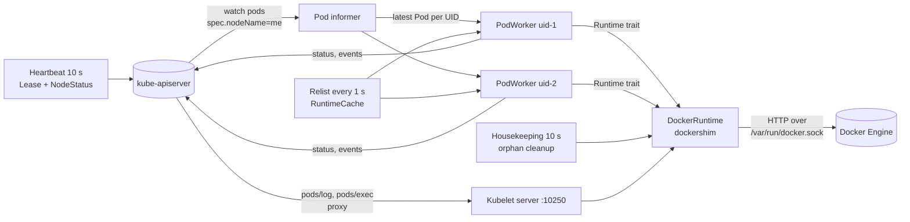
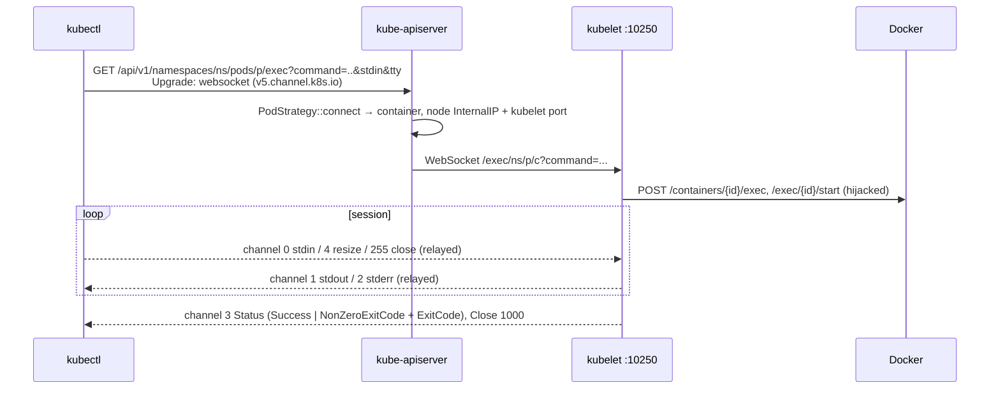

# Phase 4 — kubelet

Phase 4 adds the node agent: `kubelet` (crate `kube-kubelet` in `pkg/kubelet`, binary in `cmd/kubelet`). Pods now
run as **real containers**. The API server also gains the `pods/log`, `pods/exec` and `pods/attach` subresources,
which it proxies to the kubelet, so `kubectl logs` and `kubectl exec` work.

## 1. Architecture



| Piece | Code | Go equivalent |
|-------|------|---------------|
| Main loop, dispatch, PLEG relist, housekeeping | `pkg/kubelet/src/lib.rs` | `kubelet.go` (`syncLoop`, `HandlePodCleanups`), `pleg/generic.go` |
| Per-pod state machine | `pkg/kubelet/src/pod_workers.rs` | `pod_workers.go`, `kuberuntime/kuberuntime_manager.go` (`SyncPod`) |
| Runtime interface | `pkg/kubelet/src/runtime.rs` | CRI `RuntimeService` / `ImageService` |
| Docker backend | `pkg/kubelet/src/dockershim/` | `cri-dockerd` (formerly `pkg/kubelet/dockershim`) |
| Pod status | `pkg/kubelet/src/status.rs` | `kubelet_pods.go: generateAPIPodStatus` |
| Probes | `pkg/kubelet/src/prober.rs` | `pkg/kubelet/prober`, `pkg/probe/{exec,http,tcp}` |
| Volumes | `pkg/kubelet/src/volumes.rs` | `pkg/volume/{emptydir,hostpath,configmap,secret,downwardapi,projected}` |
| Env vars | `pkg/kubelet/src/envvars.rs` | `kubelet_pods.go: makeEnvironmentVariables`, `third_party/forked/golang/expansion` |
| Node registration, status, lease | `pkg/kubelet/src/nodestatus.rs` | `kubelet_node_status.go`, `nodestatus/setters.go`, `nodelease` |
| Kubelet API (logs, exec) | `pkg/kubelet/src/server.rs` | `pkg/kubelet/server`, `cri/streaming` |
| API server proxy | `staging/src/k8s.io/apiserver/src/proxy.rs`, `PodStrategy::connect` in `pkg/registry/src/core/pod.rs` | `registry/core/pod/rest/subresources.go`, `UpgradeAwareHandler` |

## 2. Why Docker, not containerd CRI

Upstream kubelets talk gRPC CRI to containerd or CRI-O. On a developer workstation containerd's socket is
root-only and its CRI plugin is often disabled, while Docker is usually reachable by members of the `docker` group.
So the runtime is behind a CRI-shaped `Runtime` trait (`run_pod_sandbox`, `create_container`, `exec_stream`, ...)
and the first implementation, `DockerRuntime`, follows `cri-dockerd`:

- **Sandbox** = a `pause` container (`registry.k8s.io/pause:3.10`) owning the network and IPC namespaces
  (`NetworkMode: bridge` or `host`, `IpcMode: shareable`, port bindings from `hostPort`).
- **App containers** join it with `NetworkMode`/`IpcMode: container:<sandbox-id>`, so all containers of a pod
  share `localhost` and the pod IP is the sandbox's bridge IP.
- **Names** follow dockershim: `k8s_<container>_<pod>_<namespace>_<uid>_<attempt>` (`k8s_POD_...` for sandboxes).
- **Labels** `io.kubernetes.pod.{name,namespace,uid}`, `io.kubernetes.container.name`, attempt, spec hash,
  plus `io.rustkubernetes.node=<node>` so several kubelets can share one Docker daemon without touching each
  other's (or unrelated) containers.
- **Exec** uses Docker's hijacked exec stream; **logs** come from `/containers/{id}/logs`, demultiplexed from
  Docker's 8-byte frame headers unless the container has a TTY.

A containerd backend can be added later behind the same trait (planned for Phase 6).

## 3. Pod lifecycle (`PodWorker::sync`)

Each pod UID gets its own Tokio task fed by a `watch` channel holding the latest `Pod`. It syncs whenever the pod
changes and at least once a second (to pick up runtime changes found by the relist):

1. **Deletion** (`deletionTimestamp` set): run `preStop` hooks, stop containers within the grace period, remove
   containers and sandboxes, tear down volumes, then delete the API object with grace 0 and a UID precondition.
2. **Terminal phase** (`Succeeded`/`Failed`): make sure nothing is running.
3. **Running** (`sync_running`):
   - set up volumes (on failure: `FailedMount` event, containers report `ContainerCreating`);
   - ensure a ready sandbox — if it died, kill the pod's containers and create a new one (`SandboxChanged`);
   - init containers strictly one at a time; a failing one is retried per `restartPolicy` with backoff;
   - app containers: start missing ones; restart exited ones per `restartPolicy` with
     **CrashLoopBackOff** (10 s · 2ⁿ, capped at 300 s); restart when the container spec hash changes;
   - start = image pull per `imagePullPolicy` (`ErrImagePull` → `ImagePullBackOff`, `ErrImageNeverPull`),
     env, mounts, `securityContext` (user, privileged, capabilities, read-only root), CPU/memory limits
     (`NanoCpus`, `Memory`), then the `postStart` exec hook; events `Pulling`/`Pulled`/`Created`/`Started`.
4. **Probes**: startup gates liveness and readiness; a liveness or startup failure marks the container not
   ready, emits `Unhealthy` + `Killing`, and stops it **in the background** with the full grace period so
   status keeps flowing; the restart policy then brings it back with `restartCount + 1`.
5. **Status**: `status::generate` builds phase, conditions (`PodScheduled`, `Initialized`, `ContainersReady`,
   `Ready`, `PodReadyToStartContainers`; unchanged conditions keep their `lastTransitionTime`), `podIP(s)`,
   `hostIP`, init and app container statuses (`restartCount` = attempt number, `lastState` = previous attempt),
   and writes it with `pods/status` only when it changed.

**Restart safety**: containers keep running when the kubelet stops. On start it relists the runtime, sees the
existing sandboxes/containers through their labels and adopts them; housekeeping removes containers, sandboxes
and pod directories of pods that no longer exist.

## 4. Volumes and environment

Volumes live under `<root-dir>/pods/<uid>/volumes/<plugin>/<name>` and are bind-mounted into containers
(`subPath` supported):

| Type | Behaviour |
|------|-----------|
| `emptyDir` | directory, removed with the pod (`medium: Memory` is a plain directory) |
| `hostPath` | bind mount; `type` checks (`Directory`, `DirectoryOrCreate`, `File`, `FileOrCreate`, `Socket`, ...) |
| `configMap`, `secret` | files written atomically, `items`/`defaultMode`/`optional`, refreshed while the pod runs |
| `downwardAPI` | `metadata.{name,namespace,uid,labels,annotations}`, resource fields |
| `projected` | configMap + secret + downwardAPI sources (service-account tokens: Phase 6) |

Environment: `env` (literal, `$(VAR)` expansion and `$$` escaping, `fieldRef`, `resourceFieldRef`,
`configMapKeyRef`, `secretKeyRef`), `envFrom` (with `prefix`), and Docker-link-style service variables
(`KUBERNETES_SERVICE_HOST`, `<SVC>_SERVICE_PORT`, ...) for services in the pod's namespace.

## 5. Node status and heartbeats

On start the kubelet registers its `Node` (labels `kubernetes.io/hostname|os|arch`, `--node-labels`,
`--register-with-taints`) and writes its status: capacity/allocatable from the host (CPU count, `MemTotal`,
filesystem size of the root dir, `--max-pods`), `InternalIP`/`Hostname` addresses, `daemonEndpoints.kubeletEndpoint`,
`nodeInfo` (kernel, OS image, `docker://<version>`, kubelet version), and the 50 largest images. Every 10 s it
renews its `Lease` in `kube-node-lease` (the node lifecycle controller watches these) and refreshes the status,
retrying on conflicts with controllers that update the node concurrently.

## 6. `kubectl logs` and `kubectl exec`



- `PodStrategy::connect` resolves the container (`?container=`, the `kubectl.kubernetes.io/default-container`
  annotation, or the only container; otherwise *"a container name must be specified for pod X, choose one of:
  [...]"*), requires `spec.nodeName`, and looks up the node's `InternalIP` and kubelet port.
- `pods/log` is a streamed HTTP proxy, so `kubectl logs -f` follows until interrupted. Supported options:
  `container`, `follow`, `previous`, `tailLines`, `timestamps`, `sinceSeconds`.
- `pods/exec` and `pods/attach` are WebSocket relays. Frames are forwarded unchanged; the kubelet negotiates
  `v5.channel.k8s.io` (or v4), reports the exit code on channel 3 and closes with code **1000** — kubectl treats
  any other close code as a stream error.

## 7. Fixes made elsewhere during this phase

- **API server shutdown**: graceful shutdown now drains for at most 3 s and then closes remaining (watch)
  connections, and writes a final storage snapshot. Before, a stopped server kept serving open watches for
  minutes against its own, diverging in-memory state while a new server already owned the port.
- **Watch from a future resourceVersion** (newer than the store, e.g. after a restart lost the last writes) now
  returns `410 Gone`, so informers relist instead of silently skipping events.
- `hack/test-cmd.sh` waits for namespace deletion to finish before reusing the namespace.

## 8. Flags (`cmd/kubelet`)

| Flag | Default | Meaning |
|------|---------|---------|
| `--kubeconfig` / `--master` | `$KUBECONFIG` | API server connection |
| `--hostname-override` | hostname | node name |
| `--node-ip` | `127.0.0.1` | address the API server uses to reach the kubelet (node `InternalIP`) |
| `--port` | `10250` | kubelet API port |
| `--root-dir` | `~/.local/share/rustkubernetes/kubelet/<node>` | pod volumes and state |
| `--container-runtime-endpoint` | `unix:///var/run/docker.sock` | Docker Engine API socket |
| `--pod-infra-container-image` | `registry.k8s.io/pause:3.10` | sandbox image |
| `--max-pods` | `110` | `pods` capacity |
| `--node-labels`, `--register-with-taints` | — | `k=v,...` and `k=v:Effect,...` applied at registration |
| `-v` | `1` | log verbosity (`RUST_LOG` overrides) |

## 9. Testing

```bash
make test-e2e-node          # hack/test-e2e-node.sh: 30 checks against a real kubelet + Docker
hack/local-up-cluster.sh    # full cluster with a kubelet; KUBELET=0 HOLLOW_NODES=3 for the Docker-free mode
```

Unit tests cover Docker stream demultiplexing, image reference parsing, volume file projection, env expansion,
probe scheduling, pod phase/condition generation, exec query decoding and exit status frames.

## 10. Known limitations

- Single host: pod IPs come from Docker's default bridge; there is no CNI, so pods on different machines cannot
  reach each other. Service ClusterIPs are not routed yet (kube-proxy is Phase 5).
- `kubectl attach`, `port-forward` and `cp` are not implemented; the kubelet API has no authentication (bind it to
  localhost or a trusted network).
- No eviction manager, image garbage collection, static pods, CSI/PVC volumes or service-account token projection.
- HTTPS probes are not supported; gRPC probes are reported as successful.
