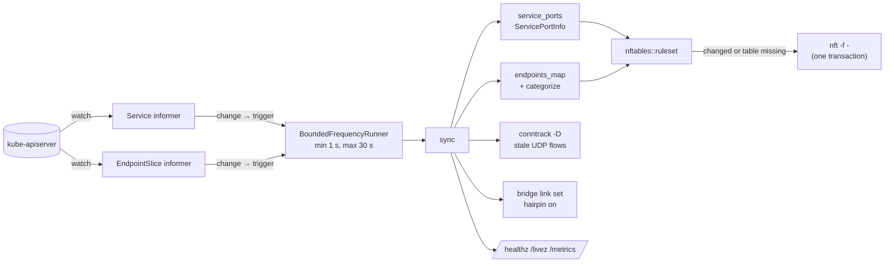

# Phase 5 — kube-proxy

Phase 5 adds `kube-proxy` (crate `kube-proxy-core` in `pkg/proxy`, binary in `cmd/kube-proxy`). Service
**ClusterIPs, NodePorts, externalIPs and load-balancer IPs now carry traffic**: kube-proxy watches Services and
EndpointSlices and programs the Linux kernel with **nftables**, the same data path as upstream's `nftables` mode
(GA since Kubernetes 1.33).

## 1. Architecture



| Piece | Code | Go equivalent |
|-------|------|---------------|
| Main loop, sync, UDP conntrack bookkeeping | `pkg/proxy/src/lib.rs` | `nftables/proxier.go: syncProxyRules`, `cmd/kube-proxy/app/server.go` |
| Service → service ports | `pkg/proxy/src/serviceport.rs` | `serviceport.go`, `servicechangetracker.go` |
| EndpointSlices → endpoints, traffic policies | `pkg/proxy/src/endpoints.rs` | `endpointslicecache.go`, `topology.go: CategorizeEndpoints` |
| Ruleset generation, `nft` executor | `pkg/proxy/src/nftables/mod.rs` | `pkg/proxy/nftables/proxier.go`, `sigs.k8s.io/knftables` |
| Rate-limited sync | `pkg/proxy/src/runner.rs` | `pkg/util/async/bounded_frequency_runner.go` |
| Stale UDP flows | `pkg/proxy/src/conntrack.rs` | `pkg/proxy/conntrack` |
| Hairpin mode on bridge ports | `pkg/proxy/src/hairpin.rs` | `pkg/kubelet/network/hairpin` (kubelet's job upstream) |
| Health and metrics | `pkg/proxy/src/healthcheck.rs` | `pkg/proxy/healthcheck`, `pkg/proxy/metrics` |
| Runtime image (nft, conntrack, iproute2) | `build/kube-proxy/Dockerfile` | `build/server-image/kube-proxy` |

## 2. The ruleset

Each sync renders the **complete** table and loads it with one `nft -f -` call:

```
add table ip rustkube-proxy        # makes the next line succeed on first run
delete table ip rustkube-proxy
table ip rustkube-proxy { ... }    # the new rules
```

Everything in the file is one netlink transaction, so the kernel switches atomically and nothing outside the
table is touched. The script is only loaded when it differs from the last one applied, or when the table has
disappeared (self-healing on the 30 s periodic sync). Existing connections keep their NAT bindings in conntrack
across reloads.

```
nat-prerouting / nat-output (dstnat) ─▶ services
  ip daddr . l4proto . dport vmap @service-ips         (ClusterIP → service-*, external IPs → external-*)
  <local, non-loopback address> l4proto . dport vmap @service-nodeports   (NodePort → external-*)

service-HASH-ns/name/tcp/port        cluster endpoints
  ip daddr <ClusterIP> tcp dport <port> ip saddr != <cluster-cidr> jump mark-for-masquerade
  [ip saddr @affinity-<ep> goto endpoint-<ep>]            # sessionAffinity: ClientIP
  numgen random mod N vmap { 0 : goto endpoint-A , 1 : goto endpoint-B }
local-HASH-...                       same, node-local endpoints (internal/externalTrafficPolicy: Local)
external-HASH-...                    Cluster policy: jump mark-for-masquerade; goto service-...
                                     Local policy:   pods / node itself → service-...; others → local-... (source IP kept)
endpoint-HASH-...__<ip>/<port>
  ip saddr <ip> jump mark-for-masquerade                  # hairpin
  [update @affinity-<ep> { ip saddr }]
  meta l4proto tcp dnat to <ip>:<port>

nat-postrouting (srcnat) ─▶ masquerading: mark 0x4000 → masquerade fully-random

filter-input / filter-forward / filter-output (pre-DNAT)
  ct state new: ip daddr . l4proto . dport vmap @no-endpoint-services   → reject (or drop, see below)
                <local addr> l4proto . dport vmap @no-endpoint-nodeports
filter-forward / filter-output-post-dnat
  ct state new: ip daddr @cluster-ips reject              # a ClusterIP on a port the Service doesn't define
```

Rules for picking endpoints (`endpoints::categorize`):

- Ready endpoints are used. If **none** is ready, endpoints that are still `serving` while `terminating` are
  used, so connections drain during rolling updates.
- `internalTrafficPolicy: Local` uses only endpoints on this node for ClusterIP traffic;
  `externalTrafficPolicy: Local` does the same for NodePort/external traffic and skips the masquerade, so the
  pod sees the real client IP.
- With no usable endpoints, traffic is **rejected** (the client gets "connection refused" straight away instead of
  timing out). If the Service has endpoints, but none on this node under a `Local` policy, traffic is **dropped**.

Services skipped, as upstream: `ExternalName`, headless (`clusterIP: None`), non-IPv4, and Services labelled
`service.kubernetes.io/service-proxy-name` (owned by another proxy).

## 3. Running it: privileges and the Docker bridge

kube-proxy needs `CAP_NET_ADMIN` in the node's network namespace. On a real cluster it runs as a privileged,
host-network DaemonSet. `hack/local-up-cluster.sh` does the equivalent with Docker:

```bash
docker run -d --network host --cap-add NET_ADMIN --cap-add NET_RAW \
  -v $PWD/target/debug/kube-proxy:/usr/local/bin/kube-proxy:ro \
  -v $KUBECONFIG:/etc/kubernetes/kubeconfig:ro \
  rustkubernetes/kube-proxy-base:24.04 \
  --kubeconfig /etc/kubernetes/kubeconfig --hostname-override $NODE \
  --cluster-cidr 172.17.0.0/16 --hairpin-bridge docker0
```

The image only provides `nft`, `conntrack` and `bridge`. The binary is mounted in, so after a `cargo build` you
just restart the container. On exit the script removes the rules (`kube-proxy --cleanup`). If you start
kube-proxy yourself, its rules stay after it stops, like upstream, so traffic keeps flowing across restarts.

Three host details matter with Docker's bridge as the pod network:

- **`br_netfilter`** must be loaded (`net.bridge.bridge-nf-call-iptables = 1`), otherwise replies between two
  pods on the same bridge bypass conntrack and are never un-NATed. kube-proxy warns if it isn't.
- **Hairpin**: when a pod reaches its own Service and is picked as the backend, the packet must go back out the
  bridge port it came from, which a Linux bridge only allows with `hairpin_mode` on. Upstream the kubelet sets it
  (`--hairpin-mode=hairpin-veth`). Our kubelet is unprivileged, so kube-proxy does it with
  `--hairpin-bridge docker0` (`bridge link set dev <veth> hairpin on` on each sync).
- **`--cluster-cidr`** is the pod network: the Docker bridge subnet (`docker network inspect bridge`), or with
  kubenet (Phase 6d) the controller-manager's `--cluster-cidr`, with `--hairpin-bridge cbr0`. Traffic to a ClusterIP from
  outside it (the host, the LAN) is masqueraded so replies come back through the node.

## 4. Flags (`cmd/kube-proxy`)

| Flag | Default | Meaning |
|------|---------|---------|
| `--kubeconfig` / `--master` | `$KUBECONFIG` | API server connection |
| `--hostname-override` | hostname | node name (decides which endpoints are local) |
| `--proxy-mode` | `nftables` | only `nftables` is implemented |
| `--cluster-cidr` | — | pod CIDR; ClusterIP traffic from outside it is masqueraded |
| `--masquerade-all` | false | masquerade all ClusterIP traffic |
| `--nodeport-addresses` | all local non-loopback | CIDRs whose addresses accept NodePort traffic |
| `--sync-period` / `--min-sync-period` | `30s` / `1s` | periodic full sync / minimum gap between syncs |
| `--healthz-bind-address` | `0.0.0.0:10256` | `/healthz`, `/livez` (unhealthy if an update is pending > 2 × sync period) |
| `--metrics-bind-address` | `127.0.0.1:10249` | `/metrics` (sync count/duration, errors, service ports, endpoints) |
| `--nft-table` | `rustkube-proxy` | table owned by this proxy (use distinct names for several clusters on one host) |
| `--hairpin-bridge` | — | bridge whose ports get hairpin mode (rustkubernetes extension) |
| `--nft-path`, `--conntrack-path` | `nft`, `conntrack` | tools |
| `--cleanup` | — | delete the table and exit |
| `--dry-run` | — | print generated scripts on stdout instead of applying them (no privileges needed) |

## 5. Testing

```bash
make test                     # unit tests: service ports, slices, policies, ruleset, runner, health
make test-e2e-node            # 39 checks incl. 9 Service checks with a real kube-proxy (KUBE_PROXY=0 skips)
kube-proxy --dry-run --kubeconfig ... | less     # inspect the generated rules
docker run --rm -i --network none --cap-add NET_ADMIN --entrypoint nft \
  rustkubernetes/kube-proxy-base:24.04 -c -f - < rules.nft   # validate rules in an isolated netns
```

What I checked against a live cluster:
- ClusterIP from the host and from pods, load-balanced over the replicas.
- NodePort on the LAN IP and the bridge gateway.
- Hairpin from each backend pod.
- `sessionAffinity: ClientIP`.
- An immediate reject with no endpoints, and for ports the Service doesn't define.
- A UDP Service.
- `externalTrafficPolicy: Local` keeps the client pod's IP.
- Rules survive a kube-proxy stop.
- A deleted table comes back on the next periodic sync.
- `--cleanup` and local-up shutdown leave no rules behind.

## 6. Known limitations

- Cluster DNS arrived in Phase 6b (CoreDNS add-on).
- In-cluster API access (`kubernetes.default.svc`) works since Phase 6a.
- NodePorts were tested from the node itself (LAN and bridge addresses) and from pods. Access from other machines
  is untested. Docker 28+ adds FORWARD rules that drop traffic entering its bridge from other interfaces unless
  Docker published the port, so it may be blocked.
- IPv4 only; no `iptables` or `ipvs` modes; no `loadBalancerSourceRanges` firewall and no `healthCheckNodePort`
  server; topology-aware routing (`trafficDistribution`) is ignored.
- The full ruleset is reloaded on every change (upstream does partial syncs), which resets ClientIP-affinity
  state whenever the rules change.
