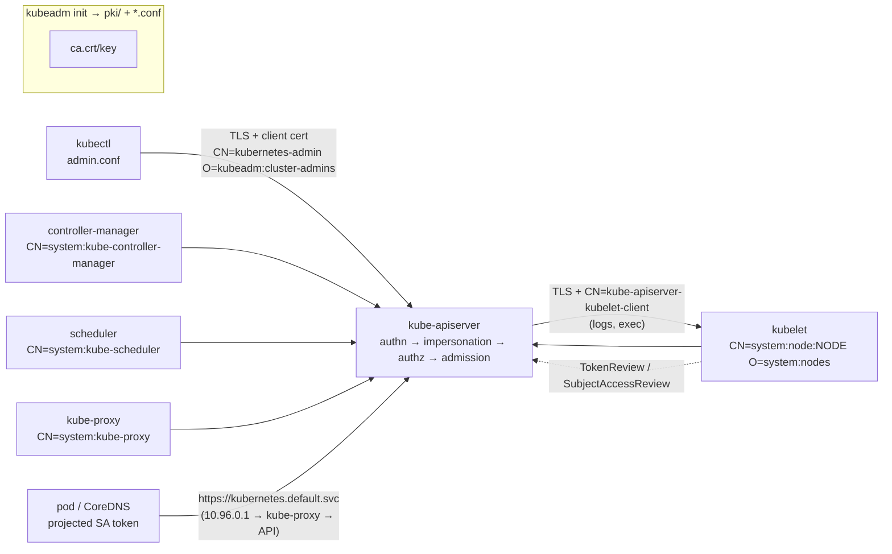

# Phase 6a/6b — Security and cluster DNS

Phase 6 ("production hardening") is split into sub-phases. This document covers the two done so far:

- **6a, security:** a PKI, TLS everywhere, authentication, RBAC, ServiceAccount tokens and an authenticated
  kubelet API.
- **6b, cluster DNS:** the CoreDNS add-on and kubelet DNS settings.

The etcd backend (6c) and containerd/OpenAPI/metrics (6d) come next.

`hack/local-up-cluster.sh` now starts a secure cluster by default. `SECURE=0` keeps the old insecure HTTP mode
(handy for kubemark and scheduling experiments).

## 1. The picture



## 2. PKI and kubeconfigs — `cmd/kubeadm`

`kubeadm init` (or `init phase certs all` / `init phase kubeconfig all`) writes kubeadm's layout. Existing files
are kept, so it can be re-run.

| File | Subject | Purpose |
|------|---------|---------|
| `pki/ca.crt,key` | CN=kubernetes | cluster CA (ECDSA P-256, 10 years) |
| `pki/apiserver.crt,key` | CN=kube-apiserver; SANs kubernetes, kubernetes.default[.svc[.cluster.local]], node name, localhost, 10.96.0.1, advertise IP, 127.0.0.1, extras | API server serving cert |
| `pki/apiserver-kubelet-client.crt,key` | CN=kube-apiserver-kubelet-client, O=kubeadm:cluster-admins | API server → kubelet |
| `pki/kubelet.crt,key` | CN=node; SANs node name, node IPs | kubelet serving cert, signed by the CA so the API server can verify it |
| `pki/sa.key,pub` | — | ServiceAccount token signing (ES256) |
| `admin.conf` | kubernetes-admin / kubeadm:cluster-admins | `cluster-admin` via binding |
| `super-admin.conf` | kubernetes-super-admin / system:masters | bypasses RBAC |
| `controller-manager.conf`, `scheduler.conf`, `kubelet.conf`, `kube-proxy.conf` | component identities | bound by the bootstrap policy |

`kubeadm kubeconfig user --client-name jane --org dev` prints a kubeconfig for a new user (O = groups).

## 3. API server request pipeline

Code: `staging/src/k8s.io/apiserver/src/{server,authentication,authorization,impersonation}.rs`.

1. **TLS** (`serve_router_tls`, rustls with the `ring` provider): an HTTP/1.1 accept loop with upgrades.
   Client certificates are requested and checked against `--client-ca-file` but are optional. The verified
   chain is attached to the request.
2. **Authentication**: authenticators are tried in order, and the first that recognises the credentials wins.
   Invalid credentials get 401 even when anonymous access is on.
   - x509: CN is the user, O values are the groups.
   - `--token-auth-file`: CSV lines `token,user,uid,"groups"`.
   - ServiceAccount JWTs: `pkg/serviceaccount`.
   - Unknown bearer token: rejected.
   - No credentials: anonymous (`system:anonymous`, group `system:unauthenticated`).

   Authenticated users also get the `system:authenticated` group.
3. **Impersonation** (`kubectl --as`, `--as-group`): needs the `impersonate` verb on users, groups,
   serviceaccounts, uids or userextras.
4. **Authorization**: request attributes use upstream's `RequestInfo` verbs (get, list, watch, create, update,
   patch, delete, deletecollection; exec over WebSocket counts as `create`). The authorizer chain is:
   - `system:masters` → allow;
   - then `--authorization-mode` (default `Node,RBAC` with TLS). `Node` is satisfied by the `system:node`
     ClusterRole; there is no separate node authorizer yet.

   Forbidden messages match upstream word for word.
5. Then admission and the handlers. The user is available to handlers through a task-local (`current_user()`).

Without `--tls-cert-file`, the server keeps the insecure development mode: plain HTTP, and every request runs as
`system:admin` in `system:masters`.

## 4. RBAC — `plugin/src/auth/rbac`, `pkg/registry/src/rbac.rs`

- **API**: `rbac.authorization.k8s.io/v1` Roles, ClusterRoles, RoleBindings and ClusterRoleBindings. Names may
  contain `:`, because RBAC names are validated as path segments.
- **Authorizer**: an in-memory index fed by storage watches. It matches rules on verbs, apiGroups, resources
  (`pods/log`, `*/status`, `res/*`), resourceNames and nonResourceURLs (`/api/*`), and implements
  `SelfSubjectRulesReview`.
- **Escalation prevention** (`ConfirmNoEscalation`): you can only create or update a role, or bind one, if you
  already hold every permission it grants. Each verb × group × resource × name is checked against the
  authorizer. The `escalate` and `bind` verbs lift the restriction. The error matches upstream:
  `... is attempting to grant RBAC permissions not currently held: {APIGroups:[""], Resources:["nodes"], Verbs:["get"]}`.
- **Bootstrap policy**: about 30 ClusterRoles and bindings are reconciled at startup. Those marked
  `rbac.authorization.kubernetes.io/autoupdate: "true"` are kept in sync. They include:
  - `cluster-admin`, `admin`/`edit`/`view` (aggregated from `system:aggregate-to-*`),
  - `system:discovery`, `system:basic-user`, `system:public-info-viewer`,
  - `system:node`, `system:node-proxier`, `system:kube-scheduler`, `system:kube-controller-manager`,
  - `system:kubelet-api-admin`, `system:auth-delegator`, `system:service-account-issuer-discovery`,
    `system:monitoring`.

  Anonymous users may read `/healthz`, `/livez`, `/readyz` and `/version`; discovery requires authentication.
- **Controller** `clusterrole-aggregation-controller`: keeps aggregated roles current. For example, a new role
  labelled `rbac.authorization.k8s.io/aggregate-to-edit: "true"` extends `edit`.

Deviation: `system:kube-controller-manager` has full access, because this controller manager does not use
per-controller ServiceAccounts (`--use-service-account-credentials`).

## 5. Reviews

These are create-only, never stored, and implemented with the `Strategy::create_virtual` hook.

| Resource | Used by |
|----------|---------|
| `selfsubjectaccessreviews` | `kubectl auth can-i` |
| `selfsubjectrulesreviews` | `kubectl auth can-i --list` |
| `subjectaccessreviews`, `localsubjectaccessreviews` | kubelet webhook authorizer, other components |
| `selfsubjectreviews` | `kubectl auth whoami` |
| `tokenreviews` | kubelet webhook authentication |

## 6. ServiceAccount tokens — `pkg/serviceaccount`

- **Format**: ES256 JWTs with upstream's claims (`iss`, `sub=system:serviceaccount:ns:name`, `aud`, `exp`,
  `iat`, `nbf`, `jti`, and `kubernetes.io` holding namespace, serviceaccount and pod name+uid). `kid` is the
  base64url SHA-256 of the public key.
- **TokenRequest** (`serviceaccounts/<name>/token`): used by `kubectl create token` and by the kubelet.
  Options: audiences, `expirationSeconds` (minimum 10 minutes) and `boundObjectRef` (a Pod or Secret, with its
  UID checked).
- **Authenticator**: checks signature, issuer, audience and expiry, then confirms that the ServiceAccount and the
  bound Pod still exist with the same UIDs. Deleting the pod or the ServiceAccount revokes the token at once.
  The user gets the groups `system:serviceaccounts` and `system:serviceaccounts:<ns>`, and extras for pod
  name/uid and credential id.
- **OIDC discovery**: `/.well-known/openid-configuration` and `/openid/v1/jwks`, readable by ServiceAccounts.
- **ServiceAccount admission plugin**: on every new pod it
  - defaults `serviceAccountName` to `default` and requires that account to exist;
  - unless `automountServiceAccountToken: false`, injects a `kube-api-access-xxxxx` projected volume (token
    lasting 3607 s, `ca.crt` from `kube-root-ca.crt`, `namespace`) at
    `/var/run/secrets/kubernetes.io/serviceaccount`.
- **`root-ca-certificate-publisher-controller`** (`--root-ca-file`): writes `kube-root-ca.crt` into every
  namespace.
- **Kubelet**: fills `serviceAccountToken` projected sources through TokenRequest (bound to the pod), caches the
  tokens and refreshes them at 80% of their lifetime.
- **client-go**: `Config::in_cluster()` (the `KUBERNETES_SERVICE_*` variables plus the mounted token and CA).
  Token files are re-read on every request, so rotated tokens are picked up.

## 7. Kubelet API security — `pkg/kubelet/src/server.rs`

Flags: `--tls-cert-file`, `--tls-private-key-file`, `--client-ca-file`, `--anonymous-auth` (default false) and
`--authorization-mode=Webhook`.

- **Authentication**: client certificate, or bearer token checked with a TokenReview (cached 2 minutes).
- **Authorization**: a SubjectAccessReview for verb + `nodes/<subresource>` (`proxy` for exec/logs/pods; also
  `stats`, `metrics`, `log`, `healthz`, `spec`), cached 5 minutes when allowed and 30 seconds when denied.
- **API server side**: talks to kubelets over `https://` with `--kubelet-client-certificate/key`, verifying them
  with `--kubelet-certificate-authority`. `kubectl logs` and `kubectl exec` (WebSocket over TLS) work as before.

## 8. Cluster DNS — `cluster/addons/dns/coredns/coredns.yaml`, `pkg/kubelet/src/dns.rs`

- **The add-on**: the real CoreDNS image (`registry.k8s.io/coredns/coredns:v1.12.1`) behind the `kube-dns`
  Service at `10.96.0.10`. It has its own ServiceAccount, the `system:coredns` ClusterRole, the upstream
  Corefile, `dnsPolicy: Default`, and runs with all capabilities dropped except `NET_BIND_SERVICE`.
- **How it reaches the API**: in-cluster, with its projected token, through kube-proxy, verified by the mounted
  CA. This is a good end-to-end check of everything above.
- **Kubelet** (`--cluster-dns`, `--cluster-domain`): applies `dnsPolicy`.
  - `ClusterFirst`: nameserver 10.96.0.10, search `<ns>.svc.cluster.local svc.cluster.local cluster.local`,
    `ndots:5`.
  - `ClusterFirstWithHostNet`, `Default` and `None` behave as upstream.
  - `dnsConfig` merges in nameservers, searches and options.
  - Settings go on the sandbox; containers share its `resolv.conf`.
- **API server reachability**: the `kubernetes` Service gets Endpoints *and* an EndpointSlice pointing at the
  API server's advertise address. local-up binds the API server to the Docker bridge gateway (e.g. 172.17.0.1)
  so pods can reach it.

## 9. Testing

```bash
make test              # 120 unit + integration tests (authn, RBAC, JWT, kubeadm, DNS, ...)
hack/test-cmd.sh       # 39 kubectl checks (insecure dev mode)
make test-e2e-node     # 59 checks on a secure cluster: pods, Services, RBAC, tokens, kubelet auth, CoreDNS, in-cluster API
```

What the e2e checks cover:
- anonymous access (only `/readyz`);
- `whoami`; a new user is forbidden until bound; RBAC scoping by namespace;
- escalation prevention; impersonation denied without RBAC;
- `create token`; the kubelet API refusing anonymous callers; root CA publishing;
- CoreDNS ready; pod `resolv.conf`; resolving Service FQDNs, short names and external names;
- a pod's token denied and then allowed by RBAC when calling the API in-cluster.

## 10. Known limitations

- No etcd yet (6c): state is the in-memory store with JSON snapshots.
- No Node authorizer or NodeRestriction admission: a kubelet credential can read every Secret.
- No certificate rotation, CSR API or kubelet TLS bootstrap; kubeadm issues 1-year leaf certificates.
- No OIDC user authentication, webhook token authentication for the API server, audit logging or API Priority
  and Fairness.
- No legacy Secret-based ServiceAccount tokens (`kubernetes.io/service-account-token`).
- The API server listens on the Docker bridge gateway; the kubelet API listens on all interfaces, protected by TLS
  and authorization.
