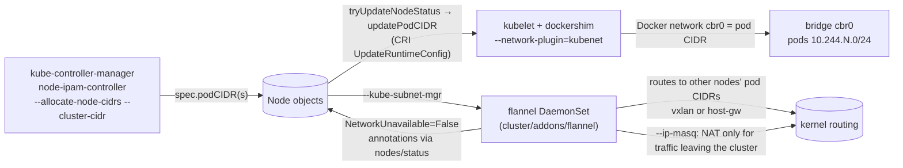

# Phase 6d — Pod network across machines

Pods on different machines can now reach each other directly, by pod IP and without NAT, as the Kubernetes
network model requires. The pieces are the same as in a kubeadm cluster with a pod network add-on:



| Piece | Code | Upstream |
|-------|------|----------|
| Node IPAM | `pkg/controller/nodeipam` (`ipam/cidrset.rs`, `ipam/range_allocator.rs`) | `pkg/controller/nodeipam` (RangeAllocator, `cidrset`) |
| Controller-manager flags | `cmd/kube-controller-manager/src/app` | `--allocate-node-cidrs`, `--cluster-cidr`, `--node-cidr-mask-size[-ipv4/-ipv6]`, `--service-cluster-ip-range`, `--cidr-allocator-type` |
| Pod CIDR rules in the API | `pkg/registry/src/core/node.rs` | `ValidateNode`, `ValidateNodeUpdate`, v1 conversion `podCIDR` ⇄ `podCIDRs` |
| `nodes/status`, `pods/status` may change labels and annotations | `Strategy::status_updates_metadata` | node/pod status strategies (no `ResetObjectMetaForStatus`) |
| Runtime status and pod CIDR | `pkg/kubelet/src/{lib,nodestatus}.rs`, `runtime.rs` | `updateRuntimeUp`, `updatePodCIDR`, CRI `Status` / `UpdateRuntimeConfig`, `nodestatus.ReadyCondition` |
| kubenet | `pkg/kubelet/src/dockershim/network.rs` | `pkg/kubelet/dockershim/network/kubenet` |
| Condition taints | `pkg/controller/src/nodelifecycle` | `TaintNodesByCondition` (`network-unavailable`, `*-pressure`) |
| CIDR helpers | `staging/src/k8s.io/apimachinery/src/net.rs` | `k8s.io/utils/net` |
| Pod network add-on | `cluster/addons/flannel/kube-flannel.yaml` | flannel's `kube-flannel.yml` (the kubeadm docs' example) |

## 1. Node IPAM (`node-ipam-controller`)

With `--allocate-node-cidrs=true --cluster-cidr=10.244.0.0/16`, every node without `spec.podCIDRs` gets the
next free `/24` (`--node-cidr-mask-size`, default 24 for IPv4 and 64 for IPv6):

- **Existing nodes are occupied first.** A pod CIDR outside the cluster CIDR stops the controller, as upstream does.
- **The Service range never becomes a pod range.** `--service-cluster-ip-range` is occupied when it overlaps.
- **Patches.** The controller sends a strategic-merge patch `{"spec":{"podCIDR":…,"podCIDRs":[…]}}`, retried 3 times.
  If they all fail, it records a `CIDRAssignmentFailed` event and releases the CIDR (unless the error was a timeout).
- **Running out.** Allocation fails with "CIDR allocation failed; there are no remaining CIDRs left to allocate in the
  accepted range" and a `CIDRNotAvailable` event. The node is retried, so it gets a CIDR as soon as one is free.
- **Deleting a node releases its CIDRs.** `nextCandidate` moves forward, so a freed range is handed out last.
- **Dual stack.** `--cluster-cidr=v4,v6` gives one CIDR per family, sized by `--node-cidr-mask-size-ipv4` and
  `--node-cidr-mask-size-ipv6`.
- **Startup errors.** The controller-manager refuses to start with the upstream messages for these cases: no
  `--cluster-cidr`, more than two CIDRs, a non-dual-stack pair, or a mask size smaller than the cluster prefix.

The API server keeps `podCIDR` equal to `podCIDRs[0]`, checks that the values are CIDRs with at most one per IP
family, and forbids changes once they are set: "node updates may not change podCIDR except from "" to valid".

## 2. kubelet: kubenet in the dockershim

`--network-plugin` chooses the network, exactly as with the dockershim:

| `--network-plugin` | Pods | NetworkReady |
|--------------------|------|--------------|
| `""` (default, *noop*) | Docker's default bridge (`docker0`), as before | always |
| `kubenet` | bridge `cbr0` on the node's pod CIDR | once the node has a pod CIDR |

**How the kubelet gets the pod CIDR.** Each node status update reads `spec.podCIDRs` and calls
`UpdateRuntimeConfig`. On the first CIDR, the dockershim creates the Docker network `cbr0`:
- subnet = the pod CIDR;
- gateway `.1` on `cbr0`;
- `--network-plugin-mtu` (0 = the smallest MTU of the host's interfaces, like `findMinMTU`);
- Docker's masquerading disabled and direct routing to pods allowed (`gateway_mode_ipv4=nat-unprotected`).

Later CIDR changes are ignored ("Ignoring subsequent pod CIDR update to new cidr"), as in kubenet.

**Before there is a CIDR**, every 5 seconds `updateRuntimeUp` asks the runtime for its status. The node stays
`Ready=False`:

```
container runtime network not ready: NetworkReady=false reason:NetworkPluginNotReady
message:docker: network plugin is not ready: kubenet does not have netConfig. This is most likely due to lack of PodCIDR
```

Pods that are not `hostNetwork` wait with a `NetworkNotReady` event ("network is not ready: …"). `hostNetwork` pods,
such as flannel itself, still start.

Other kubelet details:
- **Node registration.** The kubelet sets `volumes.kubernetes.io/controller-managed-attach-detach: "true"` when it
  registers a node, as upstream does. flannel relies on nodes having annotations.
- **Conditions.** The kubelet only rewrites the conditions it owns, so the `NetworkUnavailable` condition that
  flannel sets survives. Ready changes are recorded as `NodeReady` / `NodeNotReady` events.
- **resolv.conf.** On `cbr0`, Docker would point resolv.conf at its embedded DNS. The dockershim writes the pod's own
  resolv.conf (`rewriteResolvFile` format) and mounts it into every container of the pod.
- **`hostPath` with `DirectoryOrCreate` / `FileOrCreate`.** Upstream's kubelet runs as root. Ours may not, so when it
  isn't allowed to create the path, the container runtime creates it (flannel needs `/run/xtables.lock`).

The bridge name is `cbr0`, as in kubenet. `--kubenet-bridge-name` is a rustkubernetes extension for several kubelets
sharing one Docker daemon.

## 3. The pod network add-on: flannel

The add-on is the kubeadm docs' example (flannel v0.27.4), minus the two init containers that copy CNI binaries and
config. Here the kubelet's kubenet plugin attaches pods, not CNI. With `--kube-subnet-mgr`, flanneld:

- reads each node's `spec.podCIDR` and publishes its backend data as node annotations (`PATCH nodes/status`);
- routes every other node's pod CIDR:
  - `vxlan` (default): through `flannel.1`, which works across subnets. Pods need MTU 1450 on a 1500-byte network, so
    set kubelet `--network-plugin-mtu=1450`.
  - `host-gw`: via the node IP. All nodes must be on one L2 network; no overhead.
- masquerades pod traffic that leaves the cluster CIDR (`--ip-masq`). Pod-to-pod traffic keeps the pod's source IP.
- sets `NetworkUnavailable=False` (reason `FlannelIsUp`).

`Network` in its ConfigMap must equal `--cluster-cidr`. The scripts and the console substitute it.

## 4. Where it is used

| | Pod network |
|-|-------------|
| rustkubeadmin clusters | **kubenet + flannel by default**. New cluster → Add-ons: pod CIDR (default `10.244.0.0/16`) and backend (vxlan / host-gw), or "Docker bridge" for single-machine clusters. The flannel image is in the offline bundle (5 images). Deleting a cluster removes `cbr0`, `flannel.1` and flannel's lease file. As with `kubeadm reset`, iptables rules are left alone. Clusters created before this phase keep the Docker bridge. |
| `hack/local-up-cluster.sh` | Docker bridge by default. `NET_PLUGIN=kubenet` enables node IPAM, `cbr0` and flannel (`POD_CIDR`, `FLANNEL_BACKEND`, default host-gw). flannel adds `FLANNEL-*` chains to the host's iptables. |
| `hack/test-e2e-network.sh` | Two machines (privileged containers of `build/e2e-node`, each with its own Docker Engine and network namespace) with kubenet + flannel. |

## 5. Tests

```bash
make test               # cidrset, node validation, kubenet plugin, resolv.conf, node IPAM integration test
make test-e2e-network   # 36 checks on two machines (BACKEND=host-gw for the other flannel backend)
```

`hack/test-e2e-network.sh` checks:
- **Before node IPAM runs:** NotReady with the upstream message.
- **Node IPAM:** distinct `/24`s, `podCIDRs` equals `podCIDR`, the CIDR is immutable, `cbr0` has the gateway and
  MTU, flannel runs on both nodes, `NetworkUnavailable=False`, and the vxlan / host-gw routes exist.
- **Pod traffic between nodes:** ping and TCP pod to pod, with the client's pod IP seen by the server (no NAT); node to
  remote pod; 200 kB transfers (MTU).
- **Services:** a ClusterIP load-balances over both nodes and keeps the pod source; a NodePort on n2 reaches a pod on
  n1; CoreDNS answers from both nodes; pods reach the `kubernetes` Service.
- **Egress:** traffic leaving the cluster is masqueraded to the node IP; `hostNetwork` pods use the node IP.

Both backends pass 36/36. A console-created two-machine cluster was also tested:
- the machines were added over SSH and installed from the bundle;
- after creation, nodes got pod CIDRs, flannel came up, and pods pinged across machines and resolved DNS;
- delete removed the bridge and flannel's device.

## 6. Differences from upstream and limits

- **Pod attachment.** Pods are attached by kubenet in the dockershim (a Docker bridge network), not by CNI plugins.
  `--network-plugin=cni` is refused.
- **IPv4 only.** kubenet uses only the IPv4 pod CIDR; node IPAM itself supports dual stack.
- **No route controller.** There is no cloud provider, so routes come from the add-on (flannel), as on bare-metal
  kubeadm clusters.
- **Docker version.** Docker ≥ 28 is needed (`gateway_mode_ipv4=nat-unprotected`).
- **NetworkPolicy** is not enforced. flannel does not implement it.
