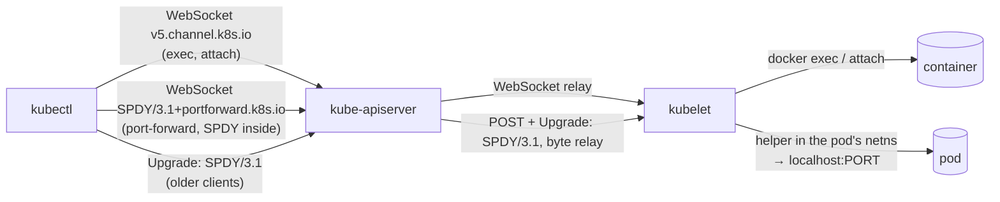

# Phase 6f — Streaming: port-forward, attach, cp

`kubectl port-forward`, `kubectl attach` (and `kubectl run -i`), `kubectl cp`, and exec over every transport kubectl
uses now all work. The path is upstream's: kubectl → API server (`pods/portforward`, `pods/attach`, `pods/exec`) →
the pod's kubelet.



| Piece | Code | Upstream |
|-------|------|----------|
| SPDY/3.1 frames, header compression, connections | `vendor/github.com/moby/spdystream` | `github.com/moby/spdystream` (vendored by Kubernetes) |
| Port forwarding server | `pkg/kubelet/src/portforward.rs` | `cri-streaming/pkg/streaming/portforward/httpstream.go` |
| Exec/attach over SPDY | `pkg/kubelet/src/remotecommand.rs` | `cri-streaming/pkg/streaming/remotecommand/httpstream.go` |
| Kubelet routes, handshake, upgrade | `pkg/kubelet/src/server.rs` | `pkg/kubelet/server`, `httpstream.Handshake`, `spdy.NewResponseUpgrader` |
| Runtime: attach, port forward | `pkg/kubelet/src/dockershim/mod.rs` | CRI `Attach` / `PortForward` (cri-dockerd) |
| Port-forward helper | `cmd/rustkube-portforward` | the `socat` cri-dockerd runs with `nsenter` |
| API server tunnel and SPDY proxy | `staging/src/k8s.io/apiserver/src/proxy.rs` | `util/proxy/streamtunnel.go` (`TunnelingHandler`), `UpgradeAwareHandler` |
| Locations and parameters | `pkg/registry/src/core/pod.rs` | `PortForwardLocation`, `streamParams` |

## 1. Port forwarding

1. **kubectl → API server.** kubectl 1.30+ opens a WebSocket to `pods/<name>/portforward` with the subprotocol
   `SPDY/3.1+portforward.k8s.io`, and speaks SPDY inside binary messages. Older clients
   (`KUBECTL_PORT_FORWARD_WEBSOCKETS=false`) send `Upgrade: SPDY/3.1` directly.
2. **API server → kubelet.** The API server opens `POST /portForward/{namespace}/{pod}` on the kubelet with
   `Upgrade: SPDY/3.1` and `X-Stream-Protocol-Version: portforward.k8s.io`. Requested ports become `port=a,b`. It then
   relays bytes both ways, unchanged.
3. **Kubelet streams.** For every local connection, kubectl opens two SPDY streams with the headers `streamType`
   (`error`, `data`), `port` and `requestID`. The kubelet validates them: a stream without a valid port or type is
   reset. It pairs them by `requestID`, and an incomplete pair gets `timed out waiting for streams` after 30 s. It then
   copies the data stream to the pod.
4. **Kubelet → pod.** The target is `localhost:PORT` *inside the pod's network namespace*, as with cri-dockerd
   (`nsenter … socat`) and containerd. So a server bound to the pod's `127.0.0.1` is reachable, and it sees the
   client as `127.0.0.1`. The kubelet here is unprivileged and cannot enter a namespace itself. Instead it starts a
   short-lived container:
   - its image is the pause image (already on every node);
   - it uses `NetworkMode: container:<sandbox>`;
   - its entrypoint is the **static** `rustkube-portforward` binary, mounted from next to the kubelet;
   - its stdin and stdout are attached to the stream.
5. **Errors** reach kubectl on the error stream, in the same words as upstream, and both streams are then reset:

```
error forwarding port 81 to pod 0335…bd4a, uid : exit status 1: failed to connect to localhost:81 inside the pod
network namespace, IPv4: dial tcp4 127.0.0.1:81: connect: connection refused IPv6 dial tcp6 [::1]:81: connect:
connection refused
```

`hack/build-portforward-helper.sh` builds the helper with `crt-static`, because the pause image has no libc. The
`hack/` scripts and `make build`, `make release` and `make admin` run it; the console's offline bundle ships the
helper. If a kubelet finds no helper, port-forward fails on that node with a clear message.

## 2. SPDY

`spdystream` implements SPDY/3.1 as Kubernetes uses it:
- control and data frames;
- name/value header blocks compressed with zlib and the SPDY/3 dictionary (copied byte for byte from the vendored Go
  source), with one context per direction and a sync flush per block;
- `SYN_STREAM` / `SYN_REPLY`, data with `FIN`, `RST_STREAM`;
- client-parity pings echoed, `GOAWAY`;
- stream-id validation;
- flow control ignored, as spdystream does.

## 3. Attach and exec

- **WebSocket** (`v5.channel.k8s.io`, `v4.channel.k8s.io`) is used for exec since Phase 4, and now also for
  `GET|POST /attach/{ns}/{pod}/{container}`.
  - Attach uses the container's own stdio through Docker attach. Its TTY setting comes from the container spec, and
    stdin works only for containers with `stdin: true`.
  - Terminal resizes resize the container.
  - The final status is `Success` when the stream ends.
- **SPDY** (`v4`, `v3`, `v2` and `channel.k8s.io`), as used by kubectl before 1.29 or with
  `KUBECTL_REMOTE_COMMAND_WEBSOCKETS=false`:
  - one stream per channel (`error`, `stdin`, `stdout`, `stderr`, and `resize` with a TTY);
  - the status is JSON on the error stream in v4, plain text before.
- **Parameters**, now as upstream:
  - the API server turns `PodExecOptions` / `PodAttachOptions` into the kubelet's `input=1`, `output=1`, `error=1`,
    `tty=1` and repeated `command`;
  - the kubelet applies `NewOptions`: TTY drops stderr, and at least one of stdin/stdout/stderr is required.
- `kubectl run -i` and `kubectl run -it --rm` attach to the new pod.
- `kubectl cp` is exec with `tar` in the container; it needs `tar` in the image, as upstream.

Discovery now lists `pods/exec`, `pods/attach`, `pods/portforward` (verbs `create`, `get`) and `pods/log`.

## 4. Tests

```bash
make test            # SPDY frames/compression/dictionary id, connections, stream ids, exec options, params
make test-e2e-node   # 81 checks, incl. port-forward (WebSocket and plain SPDY, loopback-only server, 1 MiB,
                     # error text), attach, run -i, exec/attach over SPDY, kubectl cp both ways
make test-e2e-network  # 38 checks, incl. port-forward from the API server on n1 to a pod on n2
```

All pass with the official kubectl 1.35.
