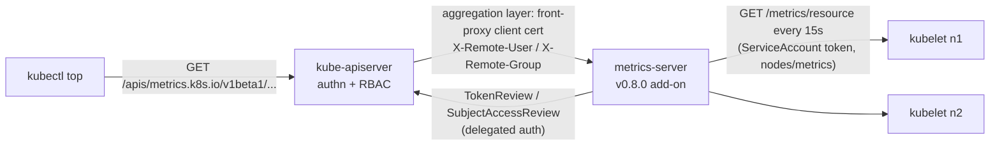

# Phase 6g — Resource metrics and the aggregation layer

`kubectl top nodes` and `kubectl top pods` now work, through the same chain as upstream:



| Piece | Code | Upstream |
|-------|------|----------|
| Kubelet resource metrics | `pkg/kubelet/src/metrics.rs` (`GET /metrics/resource`) | `pkg/kubelet/metrics/collectors/resource_metrics.go` |
| Container stats | `Runtime::container_stats` (Docker one-shot stats) | CRI `ContainerStats` / cAdvisor |
| HTTPS probes, `httpHeaders` | `pkg/kubelet/src/prober.rs` | `pkg/probe/http` |
| Aggregation layer | `staging/src/k8s.io/kube-aggregator` | `k8s.io/kube-aggregator` |
| `APIService` resource | `pkg/registry/src/apiregistration.rs` | `kube-aggregator/pkg/registry/apiservice` |
| Hook in the API server | `staging/src/k8s.io/apiserver/src/aggregator.rs` | the aggregator delegating to kube-apiserver |
| Front-proxy PKI | `kubeadm` (`front-proxy-ca`, `front-proxy-client`) | kubeadm certs phase |
| `extension-apiserver-authentication` ConfigMap | `cmd/kube-apiserver` | `controller/clusterauthenticationtrust` |
| Bootstrap Role/RoleBinding in `kube-system` | `bootstrappolicy::namespace_roles()` | `NamespaceRoles()` / `NamespaceRoleBindings()` |
| metrics-server add-on | `cluster/addons/metrics-server/metrics-server.yaml` | metrics-server v0.8.0 `components.yaml` (unchanged) |

## 1. Kubelet: `/metrics/resource`

The kubelet serves the metrics metrics-server scrapes, in the Prometheus text format with sample timestamps. Metric
names, labels, `[STABLE]` help texts, family order and number formatting (Go's `FormatFloat(v, 'g', -1, 64)`, e.g.
`1.048576e+06`) all match upstream.

- `container_cpu_usage_seconds_total`, `container_memory_working_set_bytes` and `container_start_time_seconds`, with
  labels `container`, `namespace` and `pod`, for every running container. They come from Docker's one-shot stats,
  which read the same cgroup files as cAdvisor. Working set = usage − `inactive_file`.
- `pod_cpu_usage_seconds_total` and `pod_memory_working_set_bytes`: the sum over the pod's containers.
- `node_cpu_usage_seconds_total` and `node_memory_working_set_bytes`: from the node's cgroup (`cpu.stat`,
  `memory.current`/`memory.stat`), falling back to `/proc/stat` and `/proc/meminfo` on a cgroup-v2 root.
- `resource_scrape_error`.

Access is authenticated and authorized like the rest of the kubelet API. A request needs `get` on `nodes/metrics`, as
the `system:metrics-server` ClusterRole grants.

The prober now supports HTTPS probes (no certificate verification, as upstream) and custom `httpHeaders`.
metrics-server's readiness and liveness probes are HTTPS.

## 2. Aggregation layer

- **`APIService` (`apiregistration.k8s.io/v1`)**
  - It has upstream's validation: the name is `<version>.<group>` (`v1.` for the core group); priority ranges; no
    `caBundle` or `insecureSkipTLSVerify` on local APIServices.
  - The service port defaults to 443.
  - `kubectl get apiservices` shows the columns Service (`Local` or `ns/name`) and Available (`True`, or
    `False (Reason)`).
  - It is stored at `/registry/apiregistration.k8s.io/apiservices/…`, as upstream.
- **Autoregistration.** At start, every local group/version gets an APIService with upstream's priorities and the
  label `kube-aggregator.kubernetes.io/automanaged: onstart`.
- **Availability** is checked every 10 s:
  - local APIServices are `Available=True`, reason `Local`;
  - remote ones go through upstream's checks in order, reporting `ServiceNotFound`, `ServicePortError`,
    `EndpointsNotFound` or `MissingEndpoints`;
  - then a discovery check (`GET /apis/<g>/<v>` as `system:kube-aggregator`, five tries in parallel) gives
    `FailedDiscoveryCheck`, or `Passed`.
- **Discovery.** `/apis` lists extension groups after the local ones, ordered by `groupPriorityMinimum`, then
  `versionPriority`, then version. `/apis/<group>` is answered from the APIServices; `/apis/<group>/<version>` is
  proxied.
- **Proxy**
  - The request has already been authenticated and authorized by kube-apiserver (RBAC on `metrics.k8s.io` resources).
  - It is then sent to the Service with the front-proxy client certificate (`--proxy-client-cert-file`). The
    `Authorization` and `Impersonate-*` headers are dropped, and `X-Remote-User`, `X-Remote-Group` and
    `X-Remote-Extra-*` carry the user.
  - The server is verified with `caBundle` as `<service>.<namespace>.svc`, unless `insecureSkipTLSVerify`.
  - The target is the Service ClusterIP, or an endpoint with `--enable-aggregator-routing`.
  - While unavailable, the answer is 503 `service unavailable`; kubectl shows "the server is currently unable to
    handle the request".
- **kube-apiserver flags** (kubeadm's): `--requestheader-client-ca-file`, `--requestheader-allowed-names`,
  `--requestheader-username-headers`, `--requestheader-group-headers`, `--requestheader-extra-headers-prefix`,
  `--proxy-client-cert-file`, `--proxy-client-key-file`, `--enable-aggregator-routing`.
- **`extension-apiserver-authentication` ConfigMap.** kube-apiserver writes it in `kube-system`: `client-ca-file`
  plus the requestheader settings, as JSON string lists. Extension API servers read it through the bootstrap Role
  `extension-apiserver-authentication-reader`.
- **Discovery clients.** Ours (used by the console) now skips a failing group/version and returns the rest, as
  `ServerPreferredResources` does, so an unavailable extension API does not break other clients.

## 3. Where it is used

| | |
|-|-|
| `hack/local-up-cluster.sh` | front-proxy flags in secure mode; metrics-server add-on with DNS (`METRICS=0` to skip) |
| rustkubeadmin | front-proxy certs and flags on the master; **metrics-server** add-on (checkbox, default on; needs kube-proxy); the image is in the offline bundle (6 images) |
| `hack/test-e2e-network.sh` | metrics-server on two machines, `kubectl top`, APIService availability, RBAC through the proxy |
| `hack/test-e2e-node.sh` | kubelet `/metrics/resource`, local APIServices, the authentication ConfigMap |

## 4. Tests

```bash
make test               # metrics exposition and Go float format, APIService printer/validation/names, ordering
make test-e2e-network   # 55 checks, incl.:
                        #   kubelet metrics (with and without credentials), Local APIServices, the ConfigMap,
                        #   metrics-server rollout and APIService Available, discovery and api-resources,
                        #   kubectl top nodes / pods / --containers, NodeMetricsList,
                        #   RBAC enforced before proxying, the aggregated view role (user passed as X-Remote-User),
                        #   False (MissingEndpoints) and 503 while metrics-server is scaled to 0
make test-e2e-node      # 87 checks
```

Example output from the two-machine test cluster:

```
$ kubectl top nodes
NAME   CPU(cores)   CPU(%)   MEMORY(bytes)   MEMORY(%)
n1     219m         0%       213Mi           0%
n2     720m         2%       182Mi           0%
$ kubectl get apiservices
v1.apps                  Local                        True    2m
v1beta1.metrics.k8s.io   kube-system/metrics-server   True    90s
```

## 5. Not done

- **kube-apiserver does not accept requestheader authentication itself.** That only matters when another proxy sits
  in front of it; extension servers authenticate *it* with these headers.
- **No `/stats/summary`**, and no `nodes/proxy` subresource. metrics-server only needs `/metrics/resource`.
- **No swap metrics.** Pod totals exclude the pause container.
- **No aggregated discovery (`apidiscovery.k8s.io/v2`).** kubectl falls back to the classic discovery documents.
