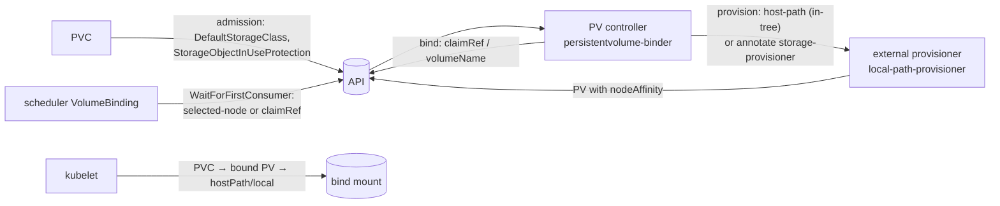

# Phase 6h — Persistent volumes

Pods can now use durable storage through PersistentVolumeClaims, with the same objects, controllers, scheduler
plugin and kubelet behaviour as upstream. That includes static volumes, dynamic provisioning (in-tree host-path or
an external provisioner), `WaitForFirstConsumer` topology-aware binding, reclaim policies and the protection
finalizers.



| Piece | Code | Upstream |
|-------|------|----------|
| Types `PersistentVolume`, `PersistentVolumeClaim`, `StorageClass` | `k8s-api` (`core/v1`, `storage/v1`) | `k8s.io/api` |
| Defaults, validation, printers | `pkg/registry/src/storage.rs` | `pkg/registry/core/persistentvolume{,claim}`, `storage/storageclass`, `pkg/printers` |
| Matching and binding helpers | `staging/src/k8s.io/component-helpers` | `component-helpers/storage/volume` |
| `DefaultStorageClass`, `StorageObjectInUseProtection` | `plugin/src/admission/storage` | `plugin/pkg/admission/storage` |
| `persistentvolume-binder-controller` | `pkg/controller/src/volume/persistentvolume.rs` | `pkg/controller/volume/persistentvolume` |
| PVC/PV protection controllers | `pkg/controller/src/volume/protection.rs` | `pvcprotection`, `pvprotection` |
| `ephemeral-volume-controller` | `pkg/controller/src/volume/ephemeral.rs` | `pkg/controller/volume/ephemeral` |
| `VolumeBinding` scheduler plugin | `pkg/scheduler/src/framework/plugins/volumebinding.rs` | `framework/plugins/volumebinding` |
| Kubelet PVC volumes | `pkg/kubelet/src/volumes.rs` | volume manager, `hostpath` and `local` plugins |

## 1. API

- **PersistentVolume** (`pv`, cluster-scoped)
  - Defaults: reclaim policy `Retain`, volume mode `Filesystem`, phase `Pending` on create.
  - Validation: capacity and access modes are required; exactly one volume source; `local` requires `nodeAffinity`;
    the source is immutable ("spec.persistentvolumesource is immutable after creation").
- **PersistentVolumeClaim** (`pvc`)
  - Validation: access modes and `resources.requests.storage` are required.
  - The spec is immutable except the storage request, a `volumeName` set once, and a class filled in when there was
    none.
- **StorageClass** (`sc`)
  - Defaults: `reclaimPolicy: Delete`, `volumeBindingMode: Immediate`.
  - Parameters, provisioner, reclaim policy and binding mode cannot change.
- **`kubectl get` columns are upstream's.** For example `RWO,ROX`, the claim shown as `ns/name`, `Terminating`, a
  PVC's capacity shown only once it is bound, and `standard (default)`. To support the last one, a printer may now
  supply its own Name cell.
- **Fixed with this phase:** a namespace sent on a cluster-scoped object is dropped (`BeforeCreate`), as upstream
  does; upstream's own `storage-class/local/default.yaml` sets one.

## 2. Admission (both on by default)

- **`DefaultStorageClass`**: a new PVC without any class gets the default class. With several classes marked
  default, the newest wins.
- **`StorageObjectInUseProtection`**: new PVCs get `kubernetes.io/pvc-protection`, new PVs
  `kubernetes.io/pv-protection`.

## 3. Controller manager

- **`persistentvolume-binder-controller`** (`--pvclaimbinder-sync-period`, 15 s). For each claim:
  - **Binding.** It picks the smallest Available volume that fits: class, access-mode group, size, selector, volume
    mode. It then sets the PV's `claimRef` (annotation `bound-by-controller`), the PVC's `volumeName` (annotations
    `bind-completed`, `bound-by-controller`), and both phases to Bound; the claim's status gets the volume's capacity
    and access modes.
  - **Default class.** A class-less claim that finds no volume gets the default class (retroactive assignment).
  - **`WaitForFirstConsumer`.** The claim waits with `WaitForFirstConsumer` / `WaitForPodScheduled` events until the
    scheduler sets `volume.kubernetes.io/selected-node`.
  - **Provisioning.** With `--enable-hostpath-provisioner`, the in-tree host-path plugin creates
    `/tmp/hostpath_pv/<uuid>` and the PV `pvc-<uid>`, with annotation `provisioned-by: kubernetes.io/host-path` and
    event `ProvisioningSucceeded`. For any other provisioner the claim gets `volume.kubernetes.io/storage-provisioner`
    and the `ExternalProvisioning` event, word for word.
  - **No volume.** `FailedBinding`: "no persistent volumes available for this claim and no storage class is set".
  - **Pre-bound and failure cases.** Pre-bound claims and volumes are handled, including mismatch and "already bound
    to a different claim". A claim whose volume disappears becomes `Lost` (`ClaimLost`, `ClaimMisbound`).
  - **Volumes.** A volume is Available, Bound, or Released once its claim is gone.
  - **Reclaim.** `Retain` keeps the volume. `Delete` deletes it; host-path volumes are only deleted under `/tmp/`, as
    upstream's deleter enforces, and external provisioners delete their own. `Recycle` sets `Failed`, "No recycler
    plugin found for the volume!".
- **Protection controllers** remove the finalizers once a claim is no longer used by a pod that hasn't finished, and
  once a volume is no longer Bound.
- **`ephemeral-volume-controller`** creates the PVC `<pod>-<volume>` for generic ephemeral volumes, owned by the pod.

## 4. Scheduler: `VolumeBinding`

- **PreFilter.**
  - A claim that does not exist fails with `persistentvolumeclaim "x" not found`, one being deleted with `… is being
    deleted`.
  - An unbound claim of an `Immediate` class fails with "pod has unbound immediate PersistentVolumeClaims".
- **Filter.**
  - A bound volume's node affinity must match the node: "node(s) had volume node affinity conflict".
  - A `WaitForFirstConsumer` claim needs a matching Available volume on the node, or a class that can provision there
    (honouring `allowedTopologies`): "node(s) didn't find available persistent volumes to bind".
- **PreBind** (binding cycle). The scheduler writes the binding for the chosen node: a matched volume gets its
  `claimRef`, a claim to provision gets `selected-node`. It then waits until the PV controller has bound every claim
  (`bindTimeoutSeconds`, 600 s).
- **Requeueing.** PVC, PV and StorageClass changes move waiting pods back to the active queue.
- **RBAC.** The scheduler gets the bootstrap `system:volume-scheduler` role.

## 5. Kubelet

`persistentVolumeClaim` and generic `ephemeral` volumes are resolved claim → bound PV → `hostPath` or `local` path,
then bind-mounted.
- **Unbound claim:** the pod waits in ContainerCreating with upstream's message "PVC ns/x has non-bound phase
  ("Pending") or empty pvc.Spec.VolumeName ("")".
- **Missing `local` path:** reported, as the local plugin does.
- **Reads are authorized** by the Node authorizer's graph (pod → PVC → PV).

## 6. Storage for clusters

| Where | Default storage |
|-------|-----------------|
| `hack/local-up-cluster.sh` | upstream's: `--enable-hostpath-provisioner` and the `standard (default)` class with `kubernetes.io/host-path` (`ENABLE_HOSTPATH_PROVISIONER=false` to skip) |
| rustkubeadmin clusters | **local-path-provisioner** add-on (Rancher v0.0.32, manifest unchanged), class `local-path` marked default, as kind does; checkbox under Add-ons; the image and `busybox:latest` are in the offline bundle (8 images) |

The in-tree host-path provisioner is upstream's testing tool. It has no node affinity and creates directories on
the controller-manager's machine. For more than one machine use the external provisioner, which creates directories
on the selected node and pins its PVs there.

## 7. Bugs found and fixed while testing with real Go clients

The local-path-provisioner talks protobuf. Its pods arrived with
- `"volumeSource": {...}` instead of the inlined `hostPath`;
- configMap volumes with no `name`.

**Cause.** Go embeds structs with `json:""` (inlined), but in protobuf they are separate messages. The decoder now
inlines every such field. The list is generated from upstream's `types.go`: `Volume.volumeSource`,
`PersistentVolumeSpec.persistentVolumeSource`, `Probe.handler`, the `LocalObjectReference` of
configMap/secret volumes, projections, key selectors and env sources, `EphemeralContainer`, and `IngressRule`.

**Impact.** This affected any Go client sending such pods. The `storage.k8s.io/v1` protobuf descriptors were added
too.

## 8. Tests

```bash
make test               # PV/PVC/SC validation and printers, matching, admission, protobuf inlining,
                        # binder integration test (bind, release, WaitForFirstConsumer, provision, delete)
make test-e2e-node      # 108 checks, incl. 21 storage checks:
                        #   static hostPath PV + pod (data on disk), PVC protection (Terminating until the pod is gone),
                        #   Retain → Released, default class + host-path provisioning + Delete (volume and dir gone),
                        #   local PV with WaitForFirstConsumer bound at scheduling, missing PVC blocks scheduling
make test-e2e-network   # 65 checks, incl. local-path-provisioner: scheduler picks n2, claim handed to the provisioner,
                        #   PV pinned to n2, data on n2's disk, Delete removes PV and directory
```

**Not done:** volume expansion (`allowVolumeExpansion` is stored, not acted on); CSI drivers and
VolumeAttachments; `Recycle`; `readOnly` on the claim source; raw block volumes; storage capacity scoring.
