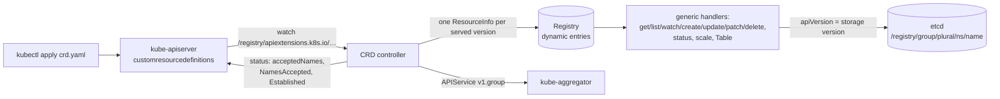

# Phase 6j — CustomResourceDefinitions

Operators and Helm charts define their own resource types. This phase adds `apiextensions.k8s.io/v1`
CustomResourceDefinitions and serves their custom resources the way upstream's apiextensions-apiserver does:

- **CRDs**: validated with upstream's rules and messages, named, established, and deleted together with their instances.
- **Schemas**: OpenAPI v3 schemas validate custom resources, set defaults, and prune unknown fields.
- **Versions**: several served versions over one storage version, with `None` or `Webhook` conversion.
- **Subresources**: `status` and `scale`, plus `additionalPrinterColumns`.
- **Everything generic applies**: discovery, watch, RBAC, admission, garbage collection, namespace deletion, and
  `kubectl explain`.



Upstream runs apiextensions-apiserver as a separate delegate server behind kube-apiserver. Here, the CRD resource
is registered in the main registry. Each established CRD adds runtime registry entries (`Registry::set_dynamic`), so
custom resources use the same handlers as built-in types.

| Piece | Code | Upstream |
|-------|------|----------|
| Types, defaults, condition and version helpers | `staging/src/k8s.io/apiextensions-apiserver/src/apis.rs` | `apiextensions-api/pkg/apis/apiextensions/v1`, `pkg/apihelpers` |
| CRD validation (spec, names, versions, structural schema, printer columns, scale paths, conversion, API approval) | `…/validation.rs` | `pkg/apis/apiextensions/validation`, `pkg/apiserver/schema/validation.go` |
| Schema validation, pruning, defaulting, null pruning, metadata coercion, list types | `…/schema.rs` | kube-openapi `validate`, `pkg/apiserver/schema/{pruning,defaulting,objectmeta,listtype}` |
| JSONPath for printer columns | `…/jsonpath.rs` | `client-go/util/jsonpath` |
| CRD strategy (finalizer and `Terminating` on delete, `storedVersions`, `CREATED AT` table) | `…/registry.rs` `CrdStrategy` | `pkg/registry/customresourcedefinition` |
| Custom resource strategy (coercion, validation, scale, columns, deprecation warning, OpenAPI) | `…/registry.rs` `CustomResourceStrategy` | `pkg/registry/customresource`, `customresource_handler.go`, `tableconvertor` |
| Version conversion (`None`, `Webhook` ConversionReview) + schema coercion | `…/conversion.rs`, `registry.rs` `SchemaCoercingConverter`, `apiserver/src/storage/converting.rs` | `pkg/apiserver/conversion` |
| Naming, establishing, finalizer, API approval, crdregistration controllers | `…/controller.rs` | `pkg/controller/{status,establish,finalizer,apiapproval}`, `pkg/controlplane/controller/crdregistration` |
| Runtime registry entries, storage-version conversion, `fieldValidation`, `Warning` headers, CR scale paths | `staging/src/k8s.io/apiserver/src/{registry,handlers,warning,openapi}.rs` | `k8s.io/apiserver` |
| Discovery resync in the garbage collector | `pkg/controller/src/garbagecollector` | `garbageCollector.Sync` (every 30 s) |

## 1. The CRD API: `apiextensions.k8s.io/v1` CustomResourceDefinition (`crd`, `crds`)

- **Defaults.**
  - `names.singular` defaults to the lowercase kind, and `names.listKind` to `<Kind>List`.
  - `conversion.strategy` defaults to `None`, and the webhook service port to 443.
- **Validation** (upstream messages):
  - The name must be `plural.group`: ``metadata.name: Invalid value: "x": must be spec.names.plural+"."+spec.group``.
  - The group must be a domain with a dot. `scope` must be `Cluster` or `Namespaced`.
  - Exactly one version is the storage version and at least one is served. Version names are unique DNS-1035 labels.
  - Names are DNS-1035 labels; kind and listKind may use mixed case.
  - Every version needs a **structural** `openAPIV3Schema`:
    - Every specified field has a `type`, unless it uses `x-kubernetes-int-or-string` or
      `x-kubernetes-preserve-unknown-fields`.
    - The root is an object, without `additionalProperties`.
    - `metadata` may only constrain `name` and `generateName`.
    - Patterns must compile. `x-kubernetes-list-type` and `x-kubernetes-list-map-keys` must be consistent.
  - Printer columns need a type from `boolean,date,integer,number,string` and a JSONPath that parses.
  - Scale subresource paths are simple paths under `.spec.` and `.status.`.
  - `Webhook` conversion needs a client config with exactly one of URL or Service, and `conversionReviewVersions`
    must include `v1` or `v1beta1`.
  - Groups under `k8s.io` and `kubernetes.io` need the `api-approved.kubernetes.io` annotation.
- **Updates.**
  - `group` and `names.plural` are immutable.
  - Once the CRD is established, `scope` and `names.kind` are immutable too.
  - `status.storedVersions` keeps every version that was ever the storage version.
- **`kubectl get crd`**: `NAME  CREATED AT`.

## 2. Naming, establishing, serving

The CRD controller watches CRDs in storage and acts like upstream's controllers:

1. **NamingConditionController.** Requested names are checked against the accepted names of the group's other CRDs.
   Plural, singular and short names are checked against resources; kind and listKind against kinds. A conflict sets
   `NamesAccepted=False`, with reason `PluralConflict`, `SingularConflict`, `ShortNamesConflict`, `KindConflict` or
   `ListKindConflict` and message `"X" is already in use`. As upstream, the last conflict wins. Without conflicts,
   `status.acceptedNames` is set with `NamesAccepted=True NoConflicts` and `Established=False Installing`.
2. **EstablishingController.** It sets `Established=True InitialNamesAccepted`, so `kubectl wait --for
   condition=established` works.
3. **Serving.** Each served version becomes a registry entry, with:
   - the accepted names, short names and categories;
   - the `status` and `scale` subresources;
   - etcd prefix `/registry/<group>/<plural>/`.

   Discovery lists versions in kube-aware order (`v1` > `v1beta1` > `v1alpha1`), so the preferred version is the
   newest GA version.
4. **crdregistration.** Each served group/version gets an `APIService` `v1.<group>` (priority 1000/100,
   `kube-aggregator.kubernetes.io/automanaged=true`). The APIService is removed when no CRD serves that
   group/version any more.
5. **apiapproval.** CRDs in protected groups get the `KubernetesAPIApprovalPolicyConformant` condition.

At start-up, kube-apiserver serves every established CRD before it reports ready, so custom resources survive restarts.

## 3. Custom resources

- **Write pipeline.** This is upstream's `schemaCoercingDecoder` followed by validation:
  1. Unknown `metadata.*` fields are dropped.
  2. `default`s are applied, including for `null` values of non-nullable fields.
  3. Unknown fields are pruned unless `x-kubernetes-preserve-unknown-fields` is set. Embedded resources keep
     `apiVersion`, `kind` and `metadata`.
  4. `null` values without a default are dropped.
  5. The object is validated against the schema with kube-openapi semantics. Errors are converted as
     `kubeOpenAPIResultToFieldErrors` does:

     ```
     spec.replicas: Invalid value: "string": spec.replicas in body must be of type integer: "string"
     spec.cronSpec: Invalid value: "nope": spec.cronSpec in body should match '^(\d+|\*)…$'
     spec.replicas: Invalid value: 50: spec.replicas in body should be less than or equal to 10
     spec.color: Unsupported value: "green": supported values: "red", "blue"
     spec.tags[2]: Duplicate value: "a"            # x-kubernetes-list-type: set
     spec.ports: Too many: 3: must have at most 2 items
     ```

  The validator supports `type` (including `nullable` and int-or-string), `enum`, `pattern`, `format`, min/max
  lengths and values, `multipleOf`, min/max items and properties, `uniqueItems`, `required`,
  `additionalProperties`, `allOf`/`anyOf`/`oneOf`/`not`, and `x-kubernetes-list-type` `set`/`map`. The supported
  formats are `byte`, `date`, `date-time`, `ipv4`, `ipv6`, `cidr`, `uuid*`, `mac`, `hostname` and `email`.
- **`?fieldValidation=`** (new for every resource):
  - `Strict` (kubectl's default) rejects unknown fields: `strict decoding error: unknown field "spec.foo"`.
  - `Warn` (the server default) returns them as `Warning: unknown field "spec.foo"` headers.
  - `Ignore` drops them silently.

  Responses can now carry `Warning` headers. They use the same recorder as upstream's `warning.AddWarning`.
- **Status subresource.** The main endpoint keeps the stored `status`, `/status` changes only `status`, and only
  spec changes bump `generation`.
- **Scale subresource.** `autoscaling/v1 Scale` comes from `specReplicasPath`, `statusReplicasPath` and
  `labelSelectorPath`. A missing replicas value reads as 0. `kubectl scale` and HPA-style clients work.
- **Patches.** JSON patch, merge patch and server-side apply work. Strategic merge returns `415`, with upstream's
  accepted media types.
- **Tables.**
  - The columns are `additionalPrinterColumns`, or `AGE` when none are set.
  - Cells follow `cellForJSONValue`: integers and numbers are typed, `date` becomes an age, `string` uses JSONPath
    text, and missing values are empty.
  - JSONPath supports fields, indexes, `[*]`, `['dotted.key']` and filters such as
    `[?(@.type=="Ready")]`.
- **Versions.**
  - Objects are stored in the storage version and converted on every read, write and watch event.
  - `None` conversion changes only `apiVersion`, then prunes against the target version's schema
    (`schemaCoercingConverter`).
  - `Webhook` conversion POSTs a `ConversionReview` (`v1`, or `v1beta1` when that is the only accepted version) to the
    webhook URL or Service. A Service is reached through its ClusterIP and verified with `caBundle` against
    `<svc>.<ns>.svc`.
  - Requests to a `deprecated` version return a warning, by default
    `Warning: ops.example.org/v1alpha1 Backup is deprecated; use ops.example.org/v1 Backup`.
- **OpenAPI.**
  - `/openapi/v3/apis/<group>/<version>` publishes each kind's schema, named like `com.example.stable.v1.CronTab`.
  - The schema includes `apiVersion`, `kind` and `metadata` (`ObjectMeta`) and is tagged with
    `x-kubernetes-group-version-kind`, so `kubectl explain crontab.spec` works.
- **Deleting a CRD.**
  1. The first delete adds the `customresourcecleanup.apiextensions.k8s.io` finalizer and
     `Terminating=True InstanceDeletionPending`.
  2. The finalizer controller deletes every instance, honouring their finalizers, and reports
     `InstanceDeletionInProgress`, then `InstanceDeletionCheck` while instances remain.
  3. When none remain, it removes the finalizer, the CRD is deleted, and its endpoints and APIServices go away.
  4. While the CRD terminates, creates fail with `create not allowed while custom resource definition is terminating`.
- **Garbage collection.** The garbage collector re-runs discovery every 30 s, as `garbageCollector.Sync` does, so
  it starts monitoring new custom resources. Owner references to custom resources cascade in background and
  foreground mode. Namespace deletion removes custom resources through discovery.

## 4. Testing

```bash
make test                       # includes apiextensions unit tests and test/integration/tests/apiextensions_test.rs
hack/test-cmd.sh                # "+++ CustomResourceDefinitions": 15 checks with the official kubectl
```

By hand (any cluster from `hack/local-up-cluster.sh`):

```bash
kubectl apply -f examples/crontab-crd.yaml
kubectl wait --for condition=established crd/crontabs.stable.example.com
kubectl api-resources --api-group=stable.example.com      # crontabs   ct   stable.example.com/v1   true   CronTab
kubectl apply -f examples/crontab.yaml
kubectl get ct                                            # NAME  SPEC  REPLICAS  AGE  (replicas defaulted to 1)
kubectl scale ct my-new-cron-object --replicas=3
kubectl patch ct my-new-cron-object --subresource=status --type=merge -p '{"status":{"replicas":3}}'
kubectl explain crontab.spec
kubectl delete crd crontabs.stable.example.com            # instances go first
```

## 5. Not implemented

- **`x-kubernetes-validations` (CEL).** Rules are accepted but not evaluated.
- **Validation ratcheting.**
- **`selectableFields`.**
- **`ValidatingAdmissionPolicy`.**
- **Defaulting on read.** Defaults are applied on writes and version conversion, not when reading old objects
  from storage.
- **Built-in OpenAPI schemas.** `kubectl explain` for built-in types is planned for 6n. Custom resources already
  work.
- **Webhook conversion without a `caBundle`.** Such webhooks cannot be verified, because no system roots are loaded.
